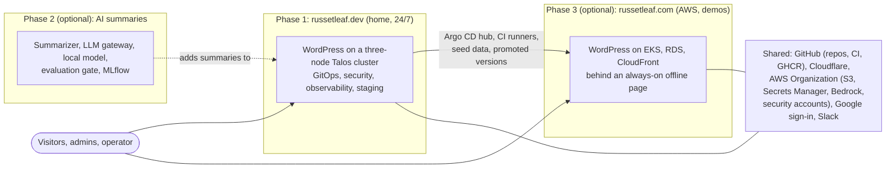
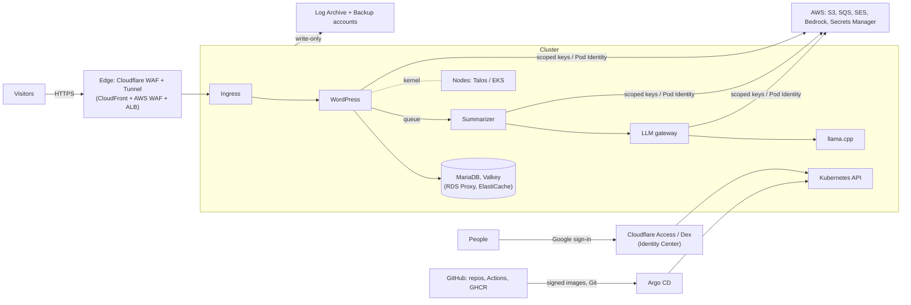
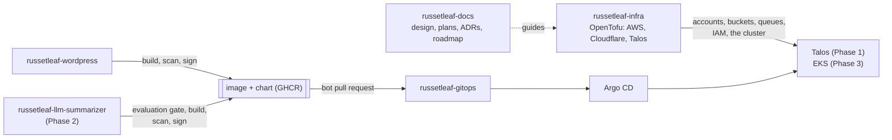

# RussetLeaf: project overview

RussetLeaf is an open-source reference implementation of a production-grade WordPress platform, built the way a platform team would build it, with infrastructure as code, GitOps, layered security, observability, tested delivery, and decisions recorded as ADRs. It is built in **three phases**, each with its own design, build plan and decisions. **Phase 1 is a complete project on its own**; Phases 2 and 3 are optional additions.

## The three phases

| Phase | What it builds | Needs | Design | Plan | Decisions |
|---|---|---|---|---|---|
| **1. russetleaf.dev** | WordPress on a three-node, highly available Talos cluster at home, running 24/7: GitOps, platform services, security, observability, staging and promotion, disaster recovery, and the AWS Organization it uses | — | [design](phase-1-russetleaf-dev/design.md) | [plan](phase-1-russetleaf-dev/plan.md) | [ADRs](#architecture-decision-records) |
| **2. AI summaries and MLOps** | AI-generated post summaries on russetleaf.dev: an event-driven summarizer, an LLM gateway (Bedrock plus a self-hosted model on `rl-home-cp02`), an evaluation gate, MLflow, guardrails, online evaluation and drift monitoring, feedback and data versioning, fine-tuning on a rented GPU with drift-triggered retraining, and an AI operations assistant (kagent) that diagnoses with the project's own documentation and proposes fixes as pull requests | Phase 1 | [design](phase-2-ai-mlops/design.md) | [plan](phase-2-ai-mlops/plan.md) | [ADRs](#architecture-decision-records) |
| **3. russetleaf.com** | The same site on the full AWS production design (EKS, Karpenter, RDS with RDS Proxy, ElastiCache, CloudFront, ALB, AWS WAF), brought up only for demos, with an always-on offline page | Phase 1 | [design](phase-3-russetleaf-com/design.md) | [plan](phase-3-russetleaf-com/plan.md) | [ADRs](#architecture-decision-records) |

The reasoning for this split is in [ADR 1037](phase-1-russetleaf-dev/adr/1037-project-phases.md).

## The system at a glance



## How the documents are organized

- **Where to read it:** in the `russetleaf-docs` repo, or as the docs site built from it ([ADR 1038](phase-1-russetleaf-dev/adr/1038-documentation-repo-and-site.md)).
- **This overview:** what is shared by all phases: how the two sites compare, defense in depth, the threat model, platform security, compliance, project highlights, the operations budget, effort and timelines, the repositories, and the index of all decisions.
- **Each phase folder:** `design.md` (what is built and why), `plan.md` (the steps to build it, with a progress checklist), `roadmap.md` (milestones with target and actual dates; Phase 1's [roadmap](phase-1-russetleaf-dev/roadmap.md)) and `adr/` (the decisions first made in that phase).
- **Tracking and step specs:** each step becomes a GitHub issue in its roadmap milestone (created by `tools/plan_to_issues.py`), and each step starts with a short spec written from [`specs/TEMPLATE.md`](specs/TEMPLATE.md) and kept in `docs/specs/`, linked from the issue and its pull request. Together with the plans' estimate-vs-actual columns and milestone retros, they show the work was planned, measured and adjusted.
- **ADR numbers start with their phase:** 1001 upwards for Phase 1, 2001 upwards for Phase 2, 3001 upwards for Phase 3. They are unique across the project and do not change once used; the [index](#architecture-decision-records) lists them all. The template is [`adr/0000-template.md`](adr/0000-template.md).
- **Writing style:** third person throughout; "the operator" is the person who builds and runs the platform. Instructions in the plans and runbooks use the imperative ("Install X"). No contractions, except inside quoted text such as commands, code or test inputs. Pre-commit and CI enforce this with `tools/check_doc_style.py`; a line that must break the rule can end with `<!-- style: allow -->`.
- **References are links:** every mention of an ADR or another document is a link, written as [ADR 1032](phase-1-russetleaf-dev/adr/1032-defense-in-depth.md); only files that do not exist yet (such as future runbooks) appear as plain paths. Pre-commit and CI enforce this with `tools/check_doc_links.py`.
- **Phase 1** also has the [disaster recovery plan](phase-1-russetleaf-dev/disaster-recovery.md), the [improvements list](phase-1-russetleaf-dev/improvements.md) (work deliberately put off, reviewed after go-live and quarterly), and **setup guides** for every procedure done by hand (accounts, consoles, hardware), such as the [AWS management account](phase-1-russetleaf-dev/setup/aws-management-account.md), [Slack](phase-1-russetleaf-dev/setup/slack-and-monitoring.md) and the [lab network](phase-1-russetleaf-dev/setup/lab-network.md); each ends with checks matching its plan step.
- **Runbooks:** every runbook in every repo is listed in the [runbook index](runbooks.md), with the step that writes it and how it is rehearsed ([ADR 1046](phase-1-russetleaf-dev/adr/1046-incident-response-and-runbook-index.md)).
- **Standards:** the [bash script standard](standards/bash.md) for every script in every repo, enforced by pre-commit, a Claude Code hook and CI ([ADR 1048](phase-1-russetleaf-dev/adr/1048-bash-script-standard.md)).
- **Instructions for people and agents:** each repo's `AGENTS.md` (imported by its `CLAUDE.md`, so every Claude Code session starts with it) states the repo's conventions and checks.
- **License:** GPL v3.0 for all code and documentation; the RussetLeaf name and logo are reserved ([ADR 1049](phase-1-russetleaf-dev/adr/1049-licensing.md)).

## The two sites

> russetleaf.com exists once **Phase 3** is built. The AI summaries (Phase 2) run on russetleaf.dev only; russetleaf.com shows the summaries of posts seeded from russetleaf.dev but generates none of its own.

The two sites are **fully independent**: each has its own URL, database, cache, media bucket, queues, secrets and content. Nothing is shared at runtime. What they share is how they are built: the same WordPress image (`russetleaf-wordpress`), the same base manifests (`russetleaf-gitops`) and the same OpenTofu modules (`russetleaf-infra`). Each site's specifics (domain, endpoints, bucket names, queue URLs, secrets) live in its own overlay and OpenTofu environment.

| | **russetleaf.com** (AWS) | **russetleaf.dev** (home lab) |
|---|---|---|
| Purpose | Full production design, for demos | Always-on public site |
| Running | Only during demos; an offline page points visitors to russetleaf.dev the rest of the time | 24/7 |
| DNS | Route 53 | Cloudflare |
| Path in | Route 53 → CloudFront (always on) → ALB + AWS WAF → EKS | Cloudflare (CDN, WAF, TLS) → Cloudflare Tunnel → cloudflared → Cilium Gateway (Gateway API) → Talos |
| TLS certificates | ACM | Cloudflare |
| Kubernetes | EKS, a Karpenter general NodePool | Talos, **three control-plane nodes** with a virtual IP: `rl-home-cp03` (i5-8500T, 16 GB: main workloads), `rl-home-cp01` (i5-6400T, 8 GB: secondary workloads), `rl-home-cp02` (i5-6500T, 8 GB: CI runners; the LLM node in Phase 2) |
| Database | RDS for MariaDB (Multi-AZ) behind **RDS Proxy**, restored from a snapshot each demo | MariaDB in-cluster (MariaDB Operator), backups to S3 every 6 hours |
| Database login | **IAM auth tokens** (Pod Identity) to RDS Proxy; no app password; master password managed and rotated by RDS | Passwords **generated by MariaDB Operator** into Kubernetes Secrets, rotated automatically each quarter (two alternating users, so no downtime); TLS required by the server on every connection |
| Object cache | ElastiCache Valkey, AUTH token regenerated every demo | Valkey in-cluster, ACL users with generated passwords rotated automatically each quarter |
| Media | Its own S3 bucket (always on), served through CloudFront | Its own S3 bucket |
| Summary queue | None (no summaries generated on russetleaf.com) | Its own SQS queue + dead-letter queue |
| Secrets | Its own Secrets Manager entries | Its own Secrets Manager entries |
| Email | Amazon SES, its own domain identity (DKIM records in Route 53) | Amazon SES, its own domain identity (DKIM records in Cloudflare) |
| Networking (CNI) | **Cilium** in chaining mode with the Amazon VPC CNI | **Cilium** as the full CNI (replaces Flannel and kube-proxy) |
| Network policies | **CiliumNetworkPolicies** (default-deny, DNS-name egress rules), enforced by Cilium | **CiliumNetworkPolicies**, same base policies |
| Intrusion detection | Falco, Hubble, CloudWatch audit logs + GuardDuty EKS audit-log monitoring, GuardDuty and CloudTrail (account) | Falco, Hubble, Talos API audit logs in Loki with alert rules, GuardDuty and CloudTrail (account) |
| Encryption in transit | TLS on sensitive connections; Cilium WireGuard between nodes, if supported in chaining mode | TLS on sensitive connections; Cilium WireGuard between nodes |
| Service mesh | None, by decision (ADR) | None, by decision (ADR) |
| Container isolation | seccomp `RuntimeDefault` for every workload; no gVisor | seccomp `RuntimeDefault`; **gVisor** for the CI runners (and WordPress, if its load test passes) |
| Admin sign-in | Google (OIDC) in WordPress, behind the ALB's OIDC rule on admin paths | Google (OIDC) in WordPress, behind Cloudflare Access on admin paths |
| Logs | Loki + Alloy, 14-day retention (bucket in the always-on edge stack); control-plane audit logs in CloudWatch | Loki + Alloy, 7-day retention, including Talos system logs |
| Traces | Tempo, on for every demo, 7-day retention (bucket in the always-on edge stack) | Tempo always on, 3-day retention |
| Network visibility | Hubble + Hubble UI (port-forward), metrics in Prometheus | Hubble + Hubble UI (Cloudflare Access), metrics in Prometheus |
| AWS resource tags | `Project=russetleaf`, `Site=com` | `Project=russetleaf`, `Site=dev` |
| Self-hosted model | None | llama.cpp (CPU build) on `rl-home-cp02` |
| Bedrock | None | Same models through the gateway, with its own budget alert |
| OpenTofu environment (`russetleaf-infra`) | `envs/aws-edge` (always on) + `envs/aws` (demo stack) | `envs/home` |
| GitOps overlay (`russetleaf-gitops`) | `overlays/aws` | `overlays/home` |
| Alerts (Slack) | `#rl-com-alerts` (+ `#rl-critical` for criticals) | `#rl-dev-alerts` (+ `#rl-critical` for criticals) |
| Environments | prod only (demo); versions arrive after passing home staging and russetleaf.dev | local → ci → staging (on demand) → prod |
| Availability | **Highly available design within one region while running** (EKS control plane, nodes across zones, RDS Multi-AZ, ElastiCache replica, multi-zone ALB, CloudFront), with one demo cut (one NAT Gateway); runs **only during demos** | **Highly available for a single node failure**: three control-plane nodes, replicated MariaDB with automatic failover, WordPress and cloudflared spread across nodes, the gateway on every node; still **one home power supply and internet connection** |
| Recovery targets | While running: seconds to minutes for a node, zone or database failure; between demos: content kept in the final snapshot | Node failure: seconds of data at most (replication lag), about a minute to recover (failover); disaster (home lost): ≤ 6 hours of data (backup interval), 1–2 days with new hardware; damage found late: up to a month, from the monthly copies kept 12 months |
| AWS account | **russetleaf-com** (Workloads OU) | **russetleaf-home** (Workloads OU), used for S3, SQS, Bedrock, Secrets Manager and SES |
| Monthly cost | ~$1 always on, plus ~$0.70 an hour during demos | ~$14–33 (including the organization-wide security services and `rl-home-cp03`'s electricity) |

Running MariaDB and Valkey inside the home cluster, instead of RDS and ElastiCache, is the biggest saving in the home lab: those two managed services alone would cost about $130/month at the AWS design's sizes. Both sites use the **MariaDB** engine (in-cluster at home, RDS for MariaDB on AWS), so database backups move between them without conversion.

## Naming

Machines, nodes and clusters are named `<project>-<site>-<role><nn>`, for example `rl-home-cp03` (RussetLeaf, home lab, control-plane node, number 3). Names describe what kind of machine it is, never its hardware or workload, and numbers are never reused. Clusters are `rl-home` (Talos) and `rl-use1` (EKS in us-east-1); EKS node names come from AWS, so cloud nodes are identified by their node group, NodePool and `Name` tag instead. The full convention, and when each name is applied, is in [ADR 1041](phase-1-russetleaf-dev/adr/1041-naming-convention.md); the home inventory is in the Phase 1 design's [Home hardware](phase-1-russetleaf-dev/design.md#home-hardware). AWS resources are also tagged `Project`, `Site`, `Env` and `ManagedBy`.

## Defense in depth

Security is layered, so a failure at one layer is caught at another. The layers are the four that Kubernetes' security documentation uses (cloud, cluster, container, code); each depends on the one outside it. The reasoning, and the gaps this closed, are in [ADR 1032](phase-1-russetleaf-dev/adr/1032-defense-in-depth.md).

| Layer | What it protects against | Main controls | Details |
|---|---|---|---|
| **Cloud** | Account takeover, misconfigured cloud resources, leaked keys | Separate AWS accounts with organization-wide guardrails; GuardDuty and Security Hub; no long-lived keys; hardened GitHub, Cloudflare and Google accounts; a lab network separated from the home LAN | [AWS accounts](phase-1-russetleaf-dev/design.md#aws-account-structure-and-best-practices-security-reference-architecture), [security foundations](phase-1-russetleaf-dev/design.md#security-foundations) |
| **Cluster** | Unauthorized access, unsafe workloads, lateral movement | Sign-in through Dex with least-privilege roles; Kyverno admission policies; default-deny network policies; audit logs with alerts | [Hardening](phase-1-russetleaf-dev/design.md#kubernetes-component-hardening), [identity](phase-1-russetleaf-dev/design.md#identity-and-access-to-the-clusters), [networking](phase-1-russetleaf-dev/design.md#networking-cilium-and-hubble) |
| **Container** | Tampered or vulnerable images, compromised containers | Signed images with SBOM and provenance; non-root, read-only containers; Falco runtime detection | [Supply chain](phase-1-russetleaf-dev/design.md#supply-chain-and-policy), [runtime security](phase-1-russetleaf-dev/design.md#runtime-security-and-compliance) |
| **Code** | Vulnerable WordPress code and plugins, malicious input | Code scanning and dependency checks in CI; Google sign-in with no passwords; WAF and security headers | [Web application security](phase-1-russetleaf-dev/design.md#web-application-security), [admin sign-in](phase-1-russetleaf-dev/design.md#admin-sign-in-with-google) |

The sections below look at the same controls from other angles: the Kubernetes threat model, platform security, and compliance frameworks.

## Security across the phases

These security views cover the whole project. Each row or control notes the phase that builds it; Phase 1 builds most of them.

### Kubernetes threat model coverage

The design is checked against the common **Kubernetes threat model**, which groups threats into eight areas. Each area has named controls, a detection and a test; the gaps found in this check, and the controls added for them, are recorded in [ADR 1034](phase-1-russetleaf-dev/adr/1034-kubernetes-threat-model-coverage.md). The full STRIDE threat model (Phase 1 step 8.5) builds on this.

**Trust boundaries and data flows** (both sites; the AWS names in brackets):



| # | Trust boundary | What crosses it | Main controls |
|---|---|---|---|
| 1 | Internet → edge | Visitor HTTP requests | WAF, rate limits, `/xmlrpc.php` blocked, TLS |
| 2 | Edge → cluster | Requests to the site and admin tools | Outbound-only tunnel (home), ALB accepting only CloudFront (AWS); Cloudflare Access or ALB OIDC for admin paths |
| 3 | Pod → pod | Application traffic | Default-deny CiliumNetworkPolicies, layer-7 rules, WireGuard, internal TLS |
| 4 | Pod → Kubernetes API | Service-account requests | No token by default, least-privilege RBAC, audit alerts |
| 5 | Person → Kubernetes and Talos APIs | Admin actions | Dex OIDC, group roles, `os:reader`, break-glass alert, API restricted to the LAN (home IP on EKS) |
| 6 | CI and Git → cluster | Images, charts, manifests | Signed images with SBOM and provenance, registry allow-list, required reviews, Argo CD as the only deployer |
| 7 | Container → node | System calls, files | Non-root, read-only, no capabilities, seccomp, user namespaces, gVisor for CI runners, Falco |
| 8 | Cluster → AWS | API calls with credentials | Scoped keys (home, until Phase 1 step 9.1) or Pod Identity, DNS-name egress rules, CloudTrail, GuardDuty |
| 9 | Cluster → logs and backups | Audit logs, backups | Write-only roles into separate accounts, Object Lock |
| 10 | Lab → home network | Any traffic | A separate lab network behind its own router; nodes cannot reach household devices; the workstation reaches the APIs over WireGuard |

**The eight threat areas:**

| Threat area | Prevention | Detection | Test |
|---|---|---|---|
| **Trust boundaries and data flow** | The boundaries above, each with controls | — | Reviewed in the threat model (Phase 1 step 8.5) |
| **Persistence** (an attacker leaves something behind) | Talos nodes are read-only with no shell or SSH; Argo CD self-heal; Kyverno **blocks long-lived service-account token Secrets** | Argo CD **orphaned-resource warnings**; `KubeWorkloadCreatedOutsideArgoCD`, `KubeAdmissionWebhookChanged`, `KubeTokenSecretCreated`, `KubeRBACChangedOutsideArgoCD` | Create a CronJob and a webhook by hand: alerts fire, Argo CD flags them |
| **Denial of service** | Edge rate limits; namespace quotas and LimitRanges (CPU, memory, **ephemeral storage**); memory limits; **kubelet PID limit** and **hard eviction thresholds**; reserved resources for the system; HPA and KEDA maximums; API Priority and Fairness | Node pressure alerts; `KubeAPIRequestsRejected`; quota usage | A fork bomb in a test pod stops at the PID limit and the node stays healthy |
| **Malicious code execution** | Signed images with SBOM and provenance, registry allow-list, digests, read-only root filesystem, seccomp, gVisor (CI runners), `DISALLOW_FILE_MODS` | Falco process allow-lists and writes to code; Trivy Operator | An unsigned image is rejected; a shell in WordPress fires Falco |
| **Compromised applications in containers** | Non-root, no capabilities, no privilege escalation, no service-account token, Pod Security `restricted`, default-deny networking | Falco; Hubble drops; evidence (memory, files, network state) preserved before the container is rebuilt ([ADR 1045](phase-1-russetleaf-dev/adr/1045-container-forensics.md)) | From a WordPress pod: no token, no route to other namespaces, no unlisted egress |
| **Attacker on the network** | CiliumNetworkPolicies (default-deny, DNS-name egress, layer 7), WireGuard, internal TLS ([ADR 1028](phase-1-russetleaf-dev/adr/1028-internal-pki.md)), a separate lab network with WireGuard access, host firewall, API endpoints restricted | Hubble (`HubblePolicyDropsSpike`), CrowdSec, GuardDuty | MariaDB unreachable from other namespaces; ports 6443 and 50000 refused from outside the LAN |
| **Access to sensitive data** | Secrets encrypted at rest, External Secrets, Secrets as files, roles without Secret access, encrypted backups, IMDSv2 with hop limit 1, egress limited by DNS name | `KubeUnexpectedSecretRead`; audit archive; CloudTrail | **Exfiltration test:** sending data from each application pod to an unlisted destination is blocked and shows in Hubble |
| **Privilege escalation** | Pod Security, no privileged pods or host access, NodeRestriction, least-privilege human roles; a Kyverno policy **rejecting risky RBAC** (`escalate`, `bind`, `impersonate`, `nodes/proxy`, wildcards, `cluster-admin` bindings) outside an allow-list | `KubeRBACChangedOutsideArgoCD`; Kubescape RBAC checks in CI and monthly | A Role with `impersonate` is rejected; the RBAC review lists who can create pods or read Secrets |

### Platform security

The platform's own security (supply chain, registry, observability, mesh, PKI, mTLS and admission), checked against the common platform-security topics and recorded in [ADR 1035](phase-1-russetleaf-dev/adr/1035-platform-security.md):

| Topic | How it is covered |
|---|---|
| **Supply chain security** | Signed images with SBOM and SLSA provenance, verified at admission and pinned by digest; signed charts; mirrored upstream images; Renovate, Scorecard, zizmor, gitleaks, Checkov; accepted vulnerabilities as signed **OpenVEX** statements. See [Supply chain and policy](phase-1-russetleaf-dev/design.md#supply-chain-and-policy). |
| **Image repository** | GHCR, each package linked to its repo with write access only from that repo's Actions; images pinned by digest; a monthly **cleanup workflow** that never deletes a digest referenced in `russetleaf-gitops` in the last 90 days or one of the last 10 releases. |
| **Observability** | Grafana through Cloudflare Access and Dex SSO; **two Loki tenants**, with the audit log and runtime-security events in a **Security** Grafana organization visible only to platform admins; Loki, Prometheus, Tempo and Alertmanager reachable only by Grafana, Alloy and Prometheus (network policies are their access control; none is exposed); token masking in logs. |
| **Service mesh** | Not used ([ADR 1001](phase-1-russetleaf-dev/adr/1001-no-service-mesh.md)); its features are covered by Cilium (WireGuard, layer-7 policies, Hubble) and Argo Rollouts; Istio ambient tried as an experiment. |
| **Kubernetes PKI** | Talos manages the cluster CAs and rotates leaf certificates; **kubelet serving certificates signed by the cluster CA** (no `--kubelet-insecure-tls` anywhere); certificate expiry alerts; a rehearsed **CA rotation runbook**; yearly talosconfig renewal; the internal CA for applications ([ADR 1028](phase-1-russetleaf-dev/adr/1028-internal-pki.md)). On EKS, AWS runs the cluster PKI. |
| **Mutual TLS** | etcd mTLS; WireGuard between nodes; TLS on every sensitive connection with the internal CA. Per-service cryptographic identity is not used ([ADR 1001](phase-1-russetleaf-dev/adr/1001-no-service-mesh.md)): identity is enforced by Cilium policies. |
| **Admission controllers** | Kyverno with **three admission replicas** across nodes, **fail-closed** security policies with short timeouts, recovery exclusions and runbook; **ValidatingAdmissionPolicy backstops** (allowed registries, no `cluster-admin` bindings, no token Secrets) that hold even if Kyverno is down; Pod Security Admission; enabled admission plugins checked on both clusters. |

### Compliance and privacy

Which compliance frameworks the project follows, and how, recorded in [ADR 1036](phase-1-russetleaf-dev/adr/1036-compliance-frameworks-and-privacy.md) and summarized in `docs/security/compliance.md`:

| Framework | Applies? | How it is covered |
|---|---|---|
| **GDPR** | Yes, lightly (a small public site holding commenters' names and emails, visitors' IPs in logs, admins' Google accounts) | A **privacy notice** on both sites; a **record of processing** and **processors list** (Cloudflare, AWS, Google, GitHub, Slack); a **retention schedule** (logs 7–14 days, backups 30 days locked plus lifecycle and monthly copies for 12 months, audit logs 1 year, unapproved comments 30 days); runbooks for **access and erasure requests** (WordPress's built-in export and erasure tools, with an erasure log re-applied after any restore, since locked backups cannot be erased early) and **personal data breaches** (72-hour notification); **no tracking cookies**, checked in CI, so no consent banner is needed |
| **CIS Benchmarks** | Yes | CIS Kubernetes (kube-bench on EKS, Trivy Operator, Talos hardening notes), CIS AWS Foundations (Security Hub), **CIS Docker** (Trivy's compliance check on each image), CIS Controls in the control matrix; results linked from the control matrix as evidence |
| **NIST** | As guidance, not certification | The control matrix is organized by **Cybersecurity Framework 2.0** functions, with **SP 800-190** (container security) and **SP 800-218 (SSDF)** checklists; SLSA provenance and the CI checks map onto SSDF |
| **MITRE ATT&CK** | Yes, for detection coverage | Kubescape's ATT&CK posture score, plus a **detection map** (`docs/security/attack-coverage.md`) from each detection (Falco, audit alerts, GuardDuty, Hubble, CrowdSec) to the **ATT&CK for Containers** techniques it covers, with gaps listed; Falco alerts by technique in Grafana |
| **HIPAA** | No (no health data) | If it ever applied: the encryption, audit logging and access controls carry over; AWS's Business Associate Agreement and HIPAA-eligible services would be needed |
| **PCI DSS** | No (no card payments) | If a shop is ever added: a **hosted payment page** (e.g. Stripe Checkout) keeps card data off the site, keeping it in PCI's smallest self-assessment category (SAQ A) |

## Project highlights

What each phase builds. Phase 1 on its own is a complete project; Phases 2 and 3 add to it.

### Phase 1: russetleaf.dev

- **One set of GitOps manifests, two live sites.** Argo CD deploys the same Helm charts and values to russetleaf.dev and russetleaf.com, with small per-environment overrides (`overlays/home`, `overlays/aws`). Only the domain and backing services change: in-cluster MariaDB vs RDS, Valkey vs ElastiCache, Cloudflare vs CloudFront. *(Completed by Phase 3.)*
- **Real AWS integration from home:** S3 media offload, Secrets Manager, SES, S3 backups and IAM, all managed by OpenTofu (Phase 2 adds SQS and Bedrock).
- **Performance engineering:** smoke, load, stress, spike and soak tests with k6 (distributed in-cluster), results beside system metrics in Grafana, a performance regression gate in promotion, and capacity numbers that set SLOs and costs.
- **Engineering practices:** SLOs with error budgets that block promotions automatically, DORA metrics, an internal developer platform (Backstage, a golden-path template proven with a second service, multi-tenancy), hub-and-spoke fleet management, chaos experiments and blameless postmortems, a threat model and control matrix, strategy documents, and engineering write-ups of the main decisions (knowledge sharing).
- **A multi-repo GitOps structure:** infrastructure, deployment config and the WordPress image (plus the summarizer from Phase 2) are separated by purpose and permissions, with automated, reviewed promotion of signed images and charts into the GitOps repo.
- **Progressive delivery:** Argo Rollouts canaries with automatic rollback based on Prometheus metrics, through Cilium's Gateway API at home.
- **Architecture decision records:** documented choices with their trade-offs, e.g. why media is on S3 rather than the commonly recommended EFS, and why there is no service mesh and when one would be added, with an optional Istio ambient experiment to back it up.
- **Defense in depth for containers:** seccomp `RuntimeDefault` everywhere, Falco process allow-lists per workload (with Tetragon enforcement as an optional extra), and gVisor sandboxing for the self-hosted CI runners that run pull-request code (with a measured trial for WordPress), backed by an ADR comparing gVisor and Kata Containers.
- **A custom, tested front end:** an AI-assisted block theme and SVG logo kept in Git (Site Editor locked in production), with visual regression, accessibility and Lighthouse checks in CI and staging.
- **Passwordless admin access:** Google sign-in (OIDC) for WordPress, an edge login layer (Cloudflare Access at home, ALB OIDC on AWS), application passwords kept only for the REST API, and break-glass recovery with `wp-cli`.
- **Defense in depth:** cloud (AWS SRA plus hardened GitHub, Cloudflare, Google and registrar accounts, a separate lab network, Secure Boot), cluster, container (signed images and charts, mirrored dependencies, user namespaces) and code (SAST, DAST, security headers, ASVS mapping).
- **Identity and access:** OIDC sign-in through Dex for kubectl and the admin tools, group-based human roles with no day-to-day cluster-admin, an alerted break-glass path, Talos read-only access by default, and a year of tamper-evident audit logs; the passwords the cluster generates for itself (database and cache) are rotated automatically every quarter, with two alternating database users so rotation causes no errors ([ADR 1047](phase-1-russetleaf-dev/adr/1047-in-cluster-credentials-and-rotation.md)).
- **Kubernetes threat model coverage:** trust boundaries and data flows drawn, and every one of the Kubernetes threat model's eight areas (persistence, denial of service, privilege escalation and the rest) mapped to prevention, detection and a test, including alerts for objects created outside GitOps, PID limits and a policy rejecting risky RBAC.
- **Platform security:** fail-closed, highly available admission with built-in backstop policies, CA-signed kubelet certificates and a rehearsed CA rotation, a registry cleanup that protects rollback images, security logs visible only to admins, and signed VEX statements for accepted vulnerabilities.
- **Compliance and privacy:** a clear compliance scope (GDPR, CIS, NIST, MITRE ATT&CK; HIPAA and PCI DSS out of scope with reasons), GDPR basics from launch (privacy notice, record of processing, retention schedule, request and breach runbooks, no tracking cookies), a control matrix organized by NIST CSF 2.0, and an ATT&CK detection map with its gaps listed.
- **Kubernetes component hardening:** per-namespace Pod Security Admission with Kyverno's `restricted` set, service-account tokens off by default, Secrets and disks encrypted at rest (TPM-sealed at home, customer-managed KMS on EKS), kubelet `seccompDefault`, a Talos host firewall, and verified control-plane settings.
- **Layered intrusion detection and prevention:** WAFs and edge login, Cilium policies, Kyverno admission, runtime controls, plus detection at runtime (Falco), in the Kubernetes API (audit logs with alert rules) and in the AWS account (CloudTrail, GuardDuty), all reporting to Slack.
- **Zero-trust networking with Cilium on both clusters:** WireGuard encryption between nodes, default-deny CiliumNetworkPolicies, outbound traffic allowed by DNS name, layer-7 rules where useful, and Hubble flow visibility with metrics, dashboards and alerts in the same Prometheus and Grafana. *(Completed by Phase 3.)*
- **Supply-chain security and policy as code:** linting and Opengrep SAST for the project's own code, dependency and workflow audits (dependency review, zizmor), SBOMs and SLSA build provenance attached as signed, Rekor-logged attestations, vulnerability and secret scans and signed images in CI, OpenSSF Scorecard on every repo, signature checks on upstream images too, with the same Kyverno policies tested in CI and enforced in the cluster (signatures, tags, resource limits), plus Checkov scanning OpenTofu, rendered manifests, Helm charts, Dockerfiles and GitHub Actions workflows in all four repos, with results in GitHub code scanning.
- **Runtime security and compliance:** Falco rules written for this application (shells in pods, writes to WordPress code, processes outside each workload's allow-list), alerts in Grafana, CIS benchmark reports from kube-bench on EKS, continuous Trivy Operator compliance reports on both clusters, periodic Kubescape NSA-CISA, MITRE ATT&CK and RBAC reports, and monthly Prowler scans of the AWS account against CIS AWS Foundations.
- **Cost awareness (FinOps):** OpenCost shows cost per namespace and workload (and, with Phase 2, cost per summary) with cost-spike alerts; AWS Budgets and Cost Anomaly Detection alert on the real bill; and a per-demo report compares actual Cost Explorer costs with the estimates.
- **Self-hosted CI on Kubernetes:** ephemeral GitHub Actions runners managed by ARC, with fork pull requests gated for a public repo.
- **Pod permissions without stored keys at home ([ADR 1033](phase-1-russetleaf-dev/adr/1033-identity-and-access.md)):** publish the Talos cluster's service-account OIDC discovery files (e.g. in a public S3 bucket) and register them as an IAM OIDC provider. Pods such as WordPress (S3) and External Secrets (and, with Phase 2, the summarizer and the gateway) then assume IAM roles without stored keys, just like IRSA on EKS. Until then, the home cluster uses narrowly scoped IAM user keys kept in Secrets Manager.
- **A gated OpenTofu pipeline:** linting (tflint + AWS ruleset), Checkov with custom project policies, module tests, Infracost cost diffs, secret scanning with push protection, and approved applies of the exact reviewed plan through a GitHub Environment.
- **OpenTofu for both sides, in one repo (`russetleaf-infra`; [ADR 1052](phase-1-russetleaf-dev/adr/1052-opentofu-instead-of-terraform.md)):** shared modules, plus separate root modules for russetleaf.com's always-on edge, its demo stack (including Karpenter and its NodePools), and the russetleaf.dev home lab (Talos provider `siderolabs/talos` for all three nodes' machine configs, Cloudflare provider for the tunnel, DNS and WAF rules, and the AWS pieces used from home). *(Completed by Phase 3.)*
- **CI on GitHub in every repo:** OpenTofu checks and plans in `russetleaf-infra`; manifest validation and Kyverno policy tests in `russetleaf-gitops`; image builds with SBOMs, scans and signing in `russetleaf-wordpress` (and, from Phase 2, `russetleaf-llm-summarizer`, with its prompt evaluation gate). Every check runs, and is visible, on each pull request without the AWS stack running.
- **A highly available home cluster:** three Talos control-plane nodes with a virtual IP, replicated MariaDB with automatic failover, workloads spread across nodes, rolling upgrades without downtime, and recorded node-failure drills (unplug a node, the site stays up).
- **An AWS Security Reference Architecture foundation:** separate management, security tooling, log archive, backup, infrastructure and workload accounts; SCP guardrails and RCPs forming a data perimeter; centralized root access management; Identity Center with MFA; organization-wide Security Hub, GuardDuty, Config, Access Analyzer and CloudTrail, all in OpenTofu; and a Well-Architected review.
- **Disaster recovery beyond a single account:** immutable, cross-account and cross-region copies (S3 Object Lock) encrypted with the Backup account's own keys, monthly copies kept 12 months for damage found late, a copy outside AWS, daily repo mirrors plus a GitLab mirror of every repo on every push, every copy checked daily for freshness, a break-glass kit, a written plan with recovery objectives, scenarios (including a compromised cluster) and a bootstrap order, and restore drills for every kind of copy plus a yearly full rebuild.
- **Incident response:** severity levels with an incident thread as the timeline, a narrow rule for emergency changes when GitOps is down, about forty runbooks in one index (security incidents, recovery, rollback and alerts), evidence capture from a compromised container before it is rebuilt, and tabletop exercises ([ADR 1045](phase-1-russetleaf-dev/adr/1045-container-forensics.md), [ADR 1046](phase-1-russetleaf-dev/adr/1046-incident-response-and-runbook-index.md)).
- **Tested tooling and one bash standard:** the workstation is set up by a script that CI runs twice on a fresh Ubuntu 24.04 every week, and every bash script in every repo follows one standard, with bats tests and checks at commit time, after every edit by Claude, and in CI ([ADR 1048](phase-1-russetleaf-dev/adr/1048-bash-script-standard.md)).
- **A defined rollback strategy:** decision rules (roll back first), Git revert as the default, automatic canary rollback, backups before database schema changes, recovery paths for Cilium, Kyverno and Argo CD, `prevent_destroy` on stateful infrastructure, and regular rollback drills (Phase 2 adds re-summarizing bad AI output).
- **A defined update strategy:** every update is a Renovate pull request, risk-tiered (patches auto-merge; minors and majors rehearsed; applications through staging and canaries), with WPScan for WordPress plugin vulnerabilities, 48-hour security releases, and a monthly end-of-life report.
- **Environments and promotion:** local, ci (kind + Moto per pull request; Phase 2 adds a mock LLM), on-demand scale-to-zero staging with scrubbed production data, and automated promotion to production after staging passes.
- **Full observability on both sites:** metrics (Prometheus), logs (Loki + Alloy, with log-based alerts), network flows (Hubble), security events (Falco) and traces (Tempo; Phase 2 follows each AI summary end to end through the SQS queue and model gateway), correlated in Grafana.
- **Application-level monitoring:** exporters around WordPress (Apache, database, cache, synthetic probes) plus a custom metrics plugin (cron backlog, cache hit ratio, versions; Phase 2 adds the business-level `posts_without_summary` signal) tied to alerts and runbooks.
- **Operational alerting:** alerts as code with tests and runbooks, routed to Slack by site and severity, with inhibition rules, a dead man's switch, external uptime checks and silences during demo teardown.
- **Documentation:** architecture diagrams for both environments, the cost breakdown, Grafana dashboard screenshots, Slack alert screenshots, the runbook index and its runbooks, the bash script standard, sample evaluation reports comparing models, and the end-to-end verification records of the AWS stack.

### Phase 2: AI summaries and MLOps

- **Agentic AI in operations, with guardrails:** kagent in the cluster triages alerts with read-only tools, through the same LLM gateway and budgets as the summarizer, and its diagnoses cite the project's own runbooks and decisions (a pgvector knowledge base), and fixes arrive as `ai-proposed` pull requests for review, all evaluated against incident and chaos scenarios ([ADR 2006](phase-2-ai-mlops/adr/2006-ai-operations-assistant.md), [ADR 2007](phase-2-ai-mlops/adr/2007-ai-diagnosis-and-remediation-proposals.md)).
- **Built with AI coding agents, measured:** least-privilege agent identities, sandbox-first iteration, `AGENTS.md` instructions in every repo (in place since Phase 1; [ADR 1048](phase-1-russetleaf-dev/adr/1048-bash-script-standard.md)), pull-request review, and per-step records of what agents did and what review caught, compared with the agent-free Phase 1 baseline ([ADR 2004](phase-2-ai-mlops/adr/2004-agentic-ai-delivery.md)).

- **Generative AI run like production software:** Bedrock integration with least-privilege IAM, event-driven scaling to zero, a dead-letter queue, and cost controls, on russetleaf.dev.
- **Model serving on Kubernetes:** a self-hosted model on dedicated nodes (labels, taints, tolerations, node selectors), behind an LLM gateway with routing, fallback, canary splits, rate limits and budgets, so no single model provider is a dependency.
- **The full MLOps lifecycle:** MLflow experiment tracking and model registry with lineage, guardrails against prompt injection and personal-data leaks, online evaluation and drift alerts, a LoRA fine-tuning (distillation) pipeline on a rented spot GPU with evaluation against the base model, drift-triggered retraining proposals, DVC-versioned data, and an editor feedback loop.
- **A standalone MLOps repo (`russetleaf-llm-summarizer`):** versioned prompts, an evaluation set, a CI gate that compares every model and blocks changes that lower summary quality, releases gated on evaluation, a model card, a published Helm chart, and a local demo anyone can run. It is the repo to read first for the AI and MLOps roles.
- **LLM monitoring:** token, latency, error, fallback and cost metrics per model and prompt version, plus model-server throughput, in Prometheus and Grafana, with alerts.

### Phase 3: russetleaf.com on EKS

- **Agentic infrastructure work with guardrails:** AI agents write OpenTofu and manifests and run `tofu plan` through a plan-only AWS role, while applies stay behind human approval ([ADR 2004](phase-2-ai-mlops/adr/2004-agentic-ai-delivery.md)).

- **An always-on edge for an on-demand stack:** russetleaf.com's CloudFront distribution falls back to an offline page automatically whenever the EKS stack is down, with ExternalDNS and the Load Balancer Controller handling the switch, and RDS snapshots carrying content between demos.
- **EKS node autoscaling with Karpenter:** a general NodePool with spot and on-demand capacity, interruption handling, and consolidation, with a documented reason it does not apply to fixed home hardware.

## Operations budget

Running this many systems is a lot for one person, so operations have a deliberate budget:

- **Automate first:** Renovate auto-merges patches; scans, reports, version-age checks, cost reports and backups run on schedules and post results to Slack; drills are scripted where possible. Most weeks need no manual work beyond reading Slack.
- **Minimum cadence** (when time is short): **one monthly maintenance window of 2–4 hours**: review Renovate pull requests and Security Hub, read the automated reports, run one drill (alternating restore, rollback, node failure), and apply Talos patches. Security releases (48 hours) and real alerts are always handled.
- **Full cadence** (when time allows): everything in the plans' ongoing-operations tables (weekly reviews, monthly and quarterly drills, demos).
- **Measure it:** record actual operations time each month in the decision log; if the minimum cadence regularly takes more than 4 hours, automate or remove something, and record the decision.

## Build plans, priorities and effort

Each phase's plan tiers every step as **Core** (a complete, working, secure platform), **Extended** (hardening, operations and evidence) or **Advanced** (reliability and platform practices, and optional experiments), with hour estimates (focused hours with Claude's help; expect ±50%):

| Plan | Core | Extended | Advanced | Total |
|---|---|---|---|---|
| [Phase 1: russetleaf.dev](phase-1-russetleaf-dev/plan.md#priorities-and-time-estimates) | ~177–290 | ~95–167 | ~89–144 | **~361–601** |
| [Phase 2: AI summaries and MLOps](phase-2-ai-mlops/plan.md#priorities-and-time-estimates) (optional) | ~50–86 | ~33–54 | ~64–104 | **~147–244** |
| [Phase 3: russetleaf.com](phase-3-russetleaf-com/plan.md#priorities-and-time-estimates) (optional) | ~74–123 | ~14–22 | ~16–25 | **~104–170** |
| **Whole project** | ~301–499 | ~142–243 | ~169–273 | **~612–1015** |

**Calendar time at about 20 hours a week:**

| Scope | Hours | Calendar |
|---|---|---|
| Phase 1, Core tier | ~177–290 | 9–14 weeks |
| Phase 1, everything | ~361–601 | 18–30 weeks (4–7 months) |
| Phases 1 and 2 | ~508–845 | 25–42 weeks (6–10 months) |
| All three phases | ~612–1015 | 30–50 weeks (7–12 months; 14–23 months at 10 hours a week) |

Phase 1 is built with AI assistance in conversation; Phases 2 and 3 are built with AI coding agents under [ADR 2004](phase-2-ai-mlops/adr/2004-agentic-ai-delivery.md), with Phase 1's actual hours as the baseline for measuring the difference. Claude speeds up writing code and documents; debugging, waiting (quotas, CI, DNS) and learning each tool dominate the calendar. A finished Phase 1 is worth more than three unfinished phases.

## Repository structure (four repos)

The project's code is split across four Git repositories, by **what each one controls** and **how often it changes**, not by environment. Both clusters (home Talos and AWS EKS) are driven from the same repos. A fifth repo, **`russetleaf-docs`**, holds the project documentation and publishes it as the docs site ([ADR 1038](phase-1-russetleaf-dev/adr/1038-documentation-repo-and-site.md)).

| Repo | Purpose | Publishes | Who reads or writes it | Changes when |
|---|---|---|---|---|
| **`russetleaf-gitops`** | The **source of truth for Argo CD**: everything that runs on both clusters (WordPress, monitoring, platform services, gateway, model server, summarizer settings), with `overlays/home` and `overlays/aws`. | Nothing; it is what Argo CD reads | Both Argo CD instances (read only); bots from `russetleaf-wordpress` and `russetleaf-llm-summarizer` open version-bump pull requests | Config or version changes (often) |
| **`russetleaf-docs`** | The **project documentation and hub**: the overview, phase designs, plans and roadmaps, all ADRs, step specs, the threat model, control matrix, strategy documents and postmortems; the planning issues, milestones and Projects board | The **docs site** (Zensical on GitHub Pages) | Its own CI (a strict build that fails on broken links) | Every step (specs, ADRs, checklists, retros) |
| **`russetleaf-infra`** | All **OpenTofu**: shared modules, plus root modules for russetleaf.com (`envs/aws-edge`, always on; `envs/aws`, demo stack) and russetleaf.dev (`envs/home`) | Cloud and home infrastructure | Its own CI (the only place with cloud admin permissions), and the operator, locally | Infrastructure changes (rarely) |
| **`russetleaf-wordpress`** | The **custom WordPress image**: plugins, themes, the SQS must-use plugin | Signed image + SBOM | Its own CI | Plugin, theme or WordPress updates |
| **`russetleaf-llm-summarizer`** | The **standalone MLOps project**: summarizer code, prompts, evaluation set and gate, Helm chart, model card, local demo | Signed image + **Helm chart** (OCI), evaluation reports | Its own CI | Code, prompt or model-evaluation changes |

**In every repo:** the same **GPL v3.0 `LICENSE`** (only the RussetLeaf name and logo are reserved, in `brand/` folders; [ADR 1049](phase-1-russetleaf-dev/adr/1049-licensing.md)), a **GitLab mirror** updated on every push (a copy outside GitHub and AWS), an `AGENTS.md` with a `CLAUDE.md` that imports it, and the bash standard's checks and shared files ([ADR 1048](phase-1-russetleaf-dev/adr/1048-bash-script-standard.md)), set up with the rest of each repo's guardrails in Phase 1 step 1.1.

### Why four repos instead of one

- **Config is kept separate from code** (standard Argo CD practice). Argo CD watches only `russetleaf-gitops`, so building an image never triggers a deploy by accident, and every deploy is a reviewed commit in one place.
- **Permissions stay limited by repo.** Only `russetleaf-infra`'s CI can change cloud infrastructure. The image repos can push images and open pull requests, nothing more. Argo CD only reads.
- **Each repo changes at its own pace**, with its own history, CI and releases.
- **`russetleaf-llm-summarizer` stands on its own** as an MLOps project: it can be understood, tested and deployed without the rest of the project.

### Why OpenTofu is not split by environment

The home lab's OpenTofu creates AWS resources too (S3, SQS, Secrets Manager, Bedrock IAM), and the AWS stack needs the same ones. Two OpenTofu repos would mean duplicating those modules or making one repo depend on the other. One `russetleaf-infra` repo with **shared modules** and a **separate root module and state per environment** avoids both. Destroying the AWS demo never touches the home lab's state.

### How the repos connect



### `russetleaf-gitops`: the source of truth for Argo CD

```
russetleaf-gitops/
  README.md                 # what the repo does; links to the docs site and the other repos
  docs/
                            # (project docs live in russetleaf-docs; these are the operational docs
                            #   that change with this repo's code)
    runbooks/               # one page per alert (what it means, how to check, how to fix), plus
                            #   rollback-<layer>.md and incident runbooks; README.md points to
                            #   the runbook index on the docs site
    slos/                   # SLO definitions (Sloth) and the error-budget policy
    chaos/                  # chaos experiment hypotheses and results
    performance/            # load, stress, spike and soak test results (Phase 2: AI burst); production baselines
    security/               # kube-bench, Kubescape and Prowler reports, RBAC review, accepted-findings files
    talos-hardening.md      # how Talos meets the CIS benchmark, with the talosctl checks
                            # + diagrams, cost breakdown, Grafana screenshots, verification records
  bootstrap/
    home/                   # root "app of apps" Application for the home cluster
    aws/                    # root "app of apps" Application for EKS
  apps/                     # the applications, each with base + overlays/home (prod), overlays/home-staging,
                            #   overlays/aws, overlays/ci
    wordpress/              # values for the russetleaf-wordpress Helm chart (version pinned), analysis templates
                            #   (home: Prometheus/Cilium Gateway; aws: CloudWatch/ALB)
    staging-data/           # Job: load the latest prod backup into staging MariaDB and scrub personal data
    db-setup/               # PreSync Job: create the wordpress DB user behind RDS Proxy (aws only)
    smoke-tests/            # Job: staging smoke tests (pages, uploads, summary end to end)
    post-summarizer/        # values for the russetleaf-llm-summarizer Helm chart (chart version pinned), per environment:
                            #   queue URL, gateway URL, scaling limits, IAM role
    seed-from-dev/          # one-off Job: load the latest russetleaf.dev backup + media into russetleaf.com
                            #   (aws only, manual sync)
  platform/                 # shared cluster services, each with base + overlays/home, overlays/aws
    monitoring/             # prometheus-operator-crds (first sync wave), kube-prometheus-stack (watching
                            #   ServiceMonitors in all namespaces), Grafana dashboards, alert rules (+ promtool tests),
                            #   Alertmanager routing to Slack (receivers per site in the overlays)
                            #   blackbox_exporter probes for key WordPress URLs
    external-secrets/       # External Secrets Operator + AWS Secrets Manager store
    ingress/                # home: Gateway API CRDs, Cilium Gateway + HTTPRoutes; aws: AWS Load Balancer Controller
    external-dns/           # ExternalDNS, manages origin.russetleaf.com in Route 53 (aws only)
    cloudflared/            # Cloudflare Tunnel connector (home only)
    storage/                # home: local-path-provisioner; aws: EBS CSI StorageClass
    cert-manager/           # cert-manager + trust-manager, internal CA ClusterIssuer, expiry alerts
    dex/                    # Dex OIDC provider (Google connector) for kubectl, Argo CD, Grafana, Backstage
    rbac/                   # human ClusterRoles (platform-admin, operator, read-only) and their bindings
    cilium/                 # Cilium + Hubble (home: full CNI; aws: chaining with the VPC CNI), cluster-wide
                            #   default-deny CiliumClusterwideNetworkPolicy, Cilium/Hubble ServiceMonitors,
                            #   dashboards and alert rules
    mariadb/                # MariaDB Operator + database (two alternating WordPress users) + scheduled
                            #   Backup to S3 + metrics sidecar (home only; RDS on AWS)
    valkey/                 # Valkey object cache with ACL users + redis_exporter (home only; ElastiCache on AWS)
    secret-rotation/        # quarterly CronJob rotating the database and cache passwords (home only)
    forensics/              # empty namespace, PolicyException and quarantine policy for the forensics toolkit
    keda/                   # KEDA operator (event-driven autoscaling)
    argo-rollouts/          # Argo Rollouts controller (canary releases)
    kyverno/                # Kyverno + policies (signed images and digests, allowed registries, no :latest,
                            #   required labels, requests/memory limits, Pod Security baseline, the
                            #   restricted set for app namespaces, service-account token default, non-root,
                            #   read-only root filesystem, probes, no NodePort/LoadBalancer Services, unique
                            #   Ingress hosts and HTTPRoute hostnames) + PolicyExceptions + the default-deny
                            #   Cilium generate rule + policy tests + Policy Reporter (violations to Slack)
                            #   + ValidatingAdmissionPolicy backstops; 3 admission replicas, fail-closed
    falco/                  # Falco (modern eBPF) + custom rules + Falcosidekick; gVisor event source (home)
                            #   for sandboxed pods; per-workload process allow-list rules and their tests;
                            #   ServiceMonitors and health alerts (FalcoNotRunning, FalcosidekickOutputErrors,
                            #   FalcoEventsDropped)
    trivy-operator/         # continuous CIS compliance (+ Prometheus metrics, Compliance dashboard, alert),
                            #   running-image vulnerability and config reports
    opencost/               # OpenCost (cost per namespace/workload/node) + cost alerts (
                            #   NamespaceDailyCostSpike) + weekly summary workflow config
    logging/                # Loki (single binary, S3 storage, ruler for log-based and Kubernetes audit alerts)
                            #   + Grafana Alloy DaemonSet (labels, noise dropping, masking; the Talos API
                            #   audit log and Talos log receiver at home; OTLP receiver forwarding traces
                            #   to Tempo)
    tracing/                # Grafana Tempo (single binary, S3 storage); always on at home (sampled) and on EKS
    karpenter/              # Karpenter general NodePool, EC2NodeClass (aws only)
    kube-bench/             # CIS benchmark Job templates per node pool, EKS profile (aws only; applied by the
                            #   demo-up workflow, not synced by Argo CD)
    mlflow/                 # MLflow tracking server and model registry (MariaDB metadata, S3 artifacts)
    backstage/              # Backstage developer portal (+ CloudNativePG PostgreSQL), catalog, TechDocs,
                            #   golden-path software templates
    tenants/                # per-tenant namespaces, Argo CD projects, quotas, limit ranges, RBAC, Kyverno policies
    sloth/                  # SLO rule generation (Sloth) and SLO dashboards
    chaos-mesh/             # Chaos Mesh and scheduled experiments
    k6-operator/            # k6 Operator for distributed in-cluster load tests (scripts in perf/)
    argo-workflows/         # Argo Workflows (online evaluation, data export, retraining proposals)
    llm-gateway/            # LiteLLM + routing config: model list, fallbacks, canary weights, budgets
    llm-serving/            # llama.cpp model server, tolerations/node selector;
                            #   CPU build on rl-home-cp02 (home only)
    actions-runner-controller/  # ARC + ephemeral self-hosted GitHub Actions runners (for russetleaf-llm-summarizer's
                            #   evaluation gate and russetleaf-gitops' staging-test workflow), running under gVisor
    runtime-classes/        # gvisor RuntimeClass (home only; the Talos gVisor extension is in russetleaf-infra)
  .github/workflows/        # render every overlay (Helm/Kustomize), validate against Kubernetes schemas
                            #   (kubeconform), run Kyverno CLI policy tests, promtool tests; install changed
                            #   platform components into kind; staging-test (on ARC runners); promote-to-prod; mirror-images
                            #   (scheduled: copy critical upstream images by digest into GHCR, verify, re-sign)
  .mise.toml                # pinned CLI tool versions (same versions locally and in CI)
```

- **App of apps:** each cluster gets one root Argo CD Application (`bootstrap/home` or `bootstrap/aws`) that points at the overlays for that environment. Argo CD then creates an Application for every app and platform service.
- **Sync order:** use Argo CD **sync waves** so operators and CRDs come up before the things that need them: Cilium (adopted from OpenTofu's bootstrap install) and the `prometheus-operator-crds` chart first, then storage, External Secrets and Kyverno, then monitoring, KEDA, Argo Rollouts and the gateway, then WordPress and the summarizer. Start Kyverno policies in **audit mode** and switch them to enforce once everything passes.
- **What is in `platform/` vs `apps/`:** `platform/` holds cluster services the applications depend on; `apps/` holds the applications themselves. Components marked "home only" exist only in the home overlays because AWS supplies a managed service in their place. Components marked "aws only" exist only in the AWS overlays because they do not apply to fixed home hardware or to Talos.
- **Which model runs in production** is decided here, in `platform/llm-gateway/`. **Whether a model is good enough** is decided by the evaluation in `russetleaf-llm-summarizer`. A routing change should link to the evaluation report that justifies it.

### `russetleaf-infra`: OpenTofu

```
russetleaf-infra/
  bootstrap/                # applied once, locally (russetleaf-infra): S3 bucket for OpenTofu state; in each
                            #   account, the GitHub OIDC provider and CI roles (plan, apply, image push) and a
                            #   read-only audit role for Prowler
  envs/github/              # GitHub organization and repo settings (GitHub provider): branch protection,
                            #   default read-only workflow token, allowed Actions, environments, push protection
  envs/org/                 # management account: Organization, OUs (incl. Policy Staging, Suspended), accounts,
                            #   SCPs, RCPs, declarative policies, IAM Identity Center permission sets, tag
                            #   policies, centralized root access management, alternate contacts,
                            #   delegated administrators, budgets, cost allocation tag activation
  envs/security/            # Security Tooling + Log Archive: organization CloudTrail trail, GuardDuty (with EKS
                            #   audit-log monitoring), Security Hub (FSBP + CIS), Config (focused recording,
                            #   conformance pack, aggregator), Access Analyzer, KMS keys; findings to Slack via
                            #   EventBridge, SNS and Amazon Q Developer
  modules/                  # reusable modules shared by both environments
    s3-media/               # media bucket, versioning (old versions expire after 90 days), IAM policy
    s3-mlops/               # MLflow artifact and DVC data buckets (versioning, old versions expire, encryption; written by the
                            #   training instance's narrow role)
    s3-logs/                # Loki log and Tempo trace buckets: encryption, lifecycle matching retention, IAM policy
    s3-backups/             # database backup bucket: versioning, encryption, lifecycle rules, IAM policy
    sqs-queue/              # queue + dead-letter queue + alarms
    secrets/                # Secrets Manager entries
    bedrock-access/         # model access, gateway IAM role, Bedrock budget alert
    alerting/               # SNS topics, CloudWatch alarms, Amazon Q Developer Slack channel configs
    ...                     # vpc, eks, karpenter, rds, elasticache, cloudfront, waf
  envs/
    dr/                     # Backup account (ALWAYS ON, shared): Object Lock buckets in us-west-2 encrypted
                            #   with the Backup account's own KMS keys, the monthly-copies bucket (365-day lock),
                            #   replication roles, the write-only repo-mirror role and the read-only freshness-
                            #   check role; plus replication rules on the source buckets in russetleaf-home,
                            #   russetleaf-com and russetleaf-infra
    aws-edge/               # russetleaf.com, ALWAYS ON (~$1/month): Route 53 hosted zone (DNSSEC signing with a KMS key), ACM certificates
                            #   (us-east-1 for CloudFront; the ALB's region for origin.russetleaf.com), CloudFront
                            #   distribution with the offline-page fallback, offline-page bucket, media bucket,
                            #   SES domain identity,
                            #   CloudFront-to-ALB secret header
    aws/                    # russetleaf.com DEMO STACK: VPC, EKS (small managed node group for Karpenter),
                            #   Karpenter IAM + interruption queue, RDS (restored from the latest snapshot;
                            #   master password managed by RDS), RDS Proxy (IAM auth + TLS required),
                            #   ElastiCache, WAF, SQS, Budgets, plus the shared modules; installs Argo CD and
                            #   points it at russetleaf-gitops/bootstrap/aws; reads aws-edge outputs (zone, certificate,
                            #   secret header) from its remote state
    home/                   # russetleaf.dev: Talos machine configs (three control-plane nodes with a shared
                            #   virtual IP and system/kubelet reservations; TPM-sealed disk encryption, host
                            #   firewall, kubelet seccompDefault, Pod Security Admission defaults; rl-home-cp02 labeled and tainted for the LLM), Cloudflare tunnel/DNS/WAF, plus the shared modules
                            #   (media and database-backup buckets, Secrets Manager, SES identity; Phase 2 adds
                            #   SQS, the model mirror bucket and Bedrock IAM), plus a second, smaller set of the same modules
                            #   for staging (Env=staging)
  .github/workflows/        # pull requests: fmt, validate, tflint (+ AWS ruleset), Checkov (source + plan + custom
                            #   policies, SARIF), `tofu test`, saved plan, Infracost and plan comments; after
                            #   merge: approval in the `apply` GitHub Environment, then apply the saved plan;
                            #   scheduled: drift-check plans, the DR copies' daily freshness check and monthly
                            #   copies, repo mirrors; demo-up, demo-down and forensic-hold (Phase 3)
  .pre-commit-config.yaml   # pre-commit-terraform hooks (fmt, validate, tflint, terraform-docs, Checkov) + gitleaks
                            #   + the bash standard's hooks
  .checkov/                 # Checkov custom policies (required tags, allowed region and instance families, S3)
```

- **State:** every environment stores state in the S3 bucket in the **russetleaf-infra** account, under separate keys (CI roles in each account are granted access to their own keys only), using OpenTofu's built-in S3 state locking (`use_lockfile = true`, OpenTofu 1.10+; no DynamoDB table needed).
- **CI permissions without stored keys:** GitHub Actions authenticates to AWS through **GitHub's OIDC provider**, in each target account (russetleaf-home, russetleaf-com, russetleaf-infra, and the security accounts for `envs/security`). Pull requests get a read-only *plan* role; the *apply* role trusts only the **`apply` GitHub Environment** (required reviewers, `main` only), which applies the **saved, reviewed plan**; see [OpenTofu pipeline](phase-1-russetleaf-dev/design.md#opentofu-pipeline-russetleaf-infra). The Cloudflare API token is a GitHub secret.
- **The home environment needs local network access:** the Talos provider talks to the nodes directly, which GitHub's hosted runners cannot reach. Run the first `envs/home` apply from the workstation. After the cluster and ARC are up, later home applies can run on the in-cluster ARC runners.
- **Why the AWS side has two environments:** `envs/aws-edge` holds what russetleaf.com needs even when the demo is down (DNS, CloudFront, the offline page, media), and is never destroyed. `envs/aws` holds the expensive demo stack and is created and destroyed for each demo. Destroying one can never touch the other's state.
- **Tearing down the AWS demo:** delete the Argo CD Applications first (or scale the root app to nothing) so the AWS Load Balancer Controller removes the ALB, ExternalDNS removes `origin.russetleaf.com`, and Karpenter removes its nodes. Otherwise `tofu destroy` can hang on resources OpenTofu did not create. `tofu destroy` then takes the final RDS snapshot that the next demo restores from.

### `russetleaf-wordpress`: the WordPress image

```
russetleaf-wordpress/
  Dockerfile                # based on the official wordpress image, plugins and themes added, OPcache on,
                            #   RDS CA bundle
  db.php                    # database drop-in: IAM auth token mode (database.auth: iam) or plain password
  composer.json             # pinned plugin and theme versions through WPackagist (offload media, Redis
                            #   object cache, SMTP, OIDC login, ...), so Renovate can update them
  chart/                    # the WordPress Helm chart: Rollout, Service, HTTPRoute or Ingress, HPA, PDB, WP-Cron CronJob,
                            #   CiliumNetworkPolicy (per-site destinations set in values), probes, non-root +
                            #   read-only root filesystem with emptyDir volumes for writable paths, seccomp
                            #   RuntimeDefault, optional runtimeClassName (gvisor at home, if the trial passes)
                            #   + apache_exporter sidecar, ServiceMonitor and PrometheusRule alerts
  themes/
    russetleaf/             # the project's block theme (theme.json, templates, patterns), exported from local
                            #   design work with Create Block Theme
  brand/                    # logo (source SVG), favicon set, site and touch icons, Open Graph image, palette;
                            #   reserved, not GPL (brand/README.md says so)
  mu-plugins/
    harden-users/           # blocks anonymous user enumeration (author archives, REST users endpoint)
    security-headers/       # CSP (report-only, then enforced) and other headers not set at the edge
    lock-site-editor/       # removes template and global-style editing in production (design changes via Git)
    summary-queue/          # sends post IDs to SQS when a post is published or updated
    summary-feedback/       # editor-only rating of each summary (stored as post metadata)
    metrics/                # custom Prometheus metrics on an internal port (posts without summary, cron
                            #   backlog, cache hit ratio, versions)
  tests/                    # smoke test: the container starts, plugins are active, health check passes;
                            #   Playwright visual regression and axe-core accessibility tests; Lighthouse CI budgets
  ci/                       # kind config, ci chart values (Moto, test credentials), integration tests
  compose.yaml              # local environment: WordPress + MariaDB + Valkey + Moto
  phpcs.xml, phpstan.neon   # PHP linting (WordPress Coding Standards) and static analysis
  .hadolint.yaml            # Dockerfile lint settings
  .opengrep/                # Opengrep rules (project rules + open rule sets)
  container-structure-test.yaml  # built-image checks (non-root, port 8080, expected files)
  .vex/                     # OpenVEX statements for accepted vulnerabilities (justification, review date)
  .trivyignore              # accepted secret/misconfiguration findings only, each with a reason and expiry date
  .github/workflows/        # lint (hadolint, PHPCS, PHPStan), Opengrep, composer audit, dependency review, Checkov,
                            #   zizmor, helm/ct lint, build, container-structure-test, Trivy (vuln, secret,
                            #   misconfig), WPScan, kind integration tests; release: push by digest, cosign sign,
                            #   SBOM attestation, SLSA provenance, verify, release notes with Rekor links;
                            #   weekly scheduled rebuild + WPScan run + OpenSSF Scorecard, push image
                            #   + chart to GHCR, open a version-bump pull request on russetleaf-gitops (staging overlay)
```

### Release and promotion flow

1. A change is merged in `russetleaf-wordpress` or `russetleaf-llm-summarizer` after its unit tests and **ci** kind-cluster tests pass (for `russetleaf-llm-summarizer`, a release tag such as `v1.4.0`, after the evaluation gate passes).
2. CI builds the image (and chart), generates the SBOM, scans it, signs it with cosign, and pushes it to the registry.
3. The bot opens a pull request on `russetleaf-gitops` that changes only the version in **`overlays/home-staging`**, linking the release notes (and, for the summarizer, the evaluation report). It merges automatically once `russetleaf-gitops` CI (rendering, schema checks, Kyverno policy tests) passes.
4. The `staging-test` workflow creates staging, loads scrubbed data, runs the smoke tests and a short soak, then deletes staging again (see [Environments and promotion](phase-1-russetleaf-dev/design.md#environments-and-promotion)).
5. If staging passed, the bot opens a pull request bumping the version in **`overlays/home`** and **`overlays/aws`**, with the staging results attached. The operator reviews and merges.
6. Argo CD syncs the home cluster. Argo Rollouts runs the canary and rolls back automatically if its checks fail. The AWS overlay uses the same versions, so the next AWS demo deploys exactly what is running at home.

**Bot identity:** use a **GitHub App** (preferred) or a fine-grained personal access token that can only open (and, for staging bumps, auto-merge) pull requests on `russetleaf-gitops`, stored as a secret in `russetleaf-wordpress` and `russetleaf-llm-summarizer`. Argo CD Image Updater is an alternative, but bot pull requests keep every deploy reviewable.

### Who can do what

| Identity | Access |
|---|---|
| `russetleaf-infra` CI | AWS through GitHub OIDC: read-only *plan* role on pull requests, *apply* role on `main`; Cloudflare API token |
| `russetleaf-wordpress` CI | Push to the image registry; cosign keyless signing (GitHub OIDC); pull requests on `russetleaf-gitops` via the bot |
| `russetleaf-llm-summarizer` CI | Push images and charts; cosign keyless signing; pull requests on `russetleaf-gitops` via the bot; evaluation runs on in-cluster ARC runners, which call Bedrock through the gateway |
| Argo CD (both clusters) | Read `russetleaf-gitops` and pull charts and images (public repos and public GHCR packages need no credentials; GHCR packages are private by default, even in public repos, so make them public separately or provide credentials) |
| `staging-test` workflow (ARC runners) | An Argo CD account limited to the staging project (sync and delete staging Applications only); posts to `#rl-staging` |
| Kyverno | Admits only images signed by the `russetleaf-wordpress` and `russetleaf-llm-summarizer` release workflows (cosign keyless: GitHub OIDC issuer `https://token.actions.githubusercontent.com`, subject matching each repo's release workflow on `main` or a tag) and carrying their signed SBOM and SLSA provenance attestations; verifies upstream publishers' signatures where they sign |

### Making a change that spans repos

Work **infrastructure first, then code, then config**, so nothing is deployed before what it depends on exists. Example: the summarizer needs a new SQS queue.

1. `russetleaf-infra`: add the queue and its IAM permission; merge and apply.
2. `russetleaf-llm-summarizer`: add support for it in code; release.
3. `russetleaf-gitops`: merge the bot's chart-bump pull request and add the new queue URL to the values for each environment.

### Building it from scratch

**russetleaf.dev home lab (once):**

1. `russetleaf-infra/bootstrap`: apply locally to create the OpenTofu state bucket and the GitHub OIDC roles.
2. `russetleaf-infra/envs/home`: apply locally (over WireGuard to the lab network) to create the Talos cluster on all three nodes, the Cloudflare tunnel and DNS for russetleaf.dev, and the AWS resources used from home. Save the kubeconfig and talosconfig it produces somewhere safe (not in Git).
3. Cilium, Argo CD and the root Application come up with the cluster (Talos inline manifests). Add `platform/cilium/` and `platform/argocd/` so Argo CD adopts them, then remove them from the inline manifests (`bootstrap_inline_manifests = false`; set it back to `true` for any later fresh bootstrap, [ADR 1039](phase-1-russetleaf-dev/adr/1039-bootstrap-through-talos-inline-manifests.md)). From then on, Argo CD manages everything else, including itself.
4. Add the secrets the cluster needs to AWS Secrets Manager (the WordPress application passwords for the REST API, but **no admin password**: admins sign in with Google, and the first install's random admin password is never stored ([ADR 1008](phase-1-russetleaf-dev/adr/1008-google-sign-in-for-admins.md)); **not** the database or Valkey passwords, which are generated in the cluster ([ADR 1047](phase-1-russetleaf-dev/adr/1047-in-cluster-credentials-and-rotation.md)); Cloudflare tunnel token, scoped IAM keys for home until keyless OIDC access, Phase 1 step 9.1, is done); External Secrets syncs them in.

**russetleaf.com always-on edge (once):**

1. If russetleaf.com is registered outside Route 53, point the domain's name servers at the Route 53 hosted zone after the first apply.
2. `tofu apply` in `russetleaf-infra/envs/aws-edge`. This creates the hosted zone, certificates, CloudFront distribution, offline page and media bucket.
3. Check that russetleaf.com shows the offline page with a link to russetleaf.dev.

**russetleaf.com demo (each time):** run the `demo-up` and `demo-down` workflows in `russetleaf-infra`, which perform these steps:

1. `tofu apply` in `russetleaf-infra/envs/aws`. This creates the stack (restoring RDS from the latest snapshot) and installs Argo CD pointed at `russetleaf-gitops/bootstrap/aws`.
2. Wait for Argo CD to sync. Once ExternalDNS creates `origin.russetleaf.com`, russetleaf.com switches from the offline page to the live site on its own, and the workflow posts "demo started" to `#rl-com-alerts`. Demo.
3. Silence russetleaf.com's alerts in Alertmanager, remove the Argo CD Applications (the ALB and `origin.russetleaf.com` are deleted, and russetleaf.com falls back to the offline page), then `tofu destroy` in `envs/aws`, and post "demo stopped" to `#rl-com-alerts`. Never destroy `envs/aws-edge`.

### `russetleaf-docs`: the project documentation

```
russetleaf-docs/
  README.md                 # project hub: what it is, the phases, links to the docs site and every repo
  LICENSE                   # GPL v3.0 (the same text in every repo)
  mkdocs.yml                # docs site (built by Zensical): navigation, theme, Mermaid diagrams, strict link checking
  requirements-docs.txt     # pinned Zensical version
  AGENTS.md                 # instructions for people and coding agents: conventions, the bash standard, checks
  CLAUDE.md                 # imports AGENTS.md, so every Claude Code session starts with it
  .claude/settings.json     # Claude Code hook: checks a shell file right after Claude edits it
  .pre-commit-config.yaml   # shellcheck, shfmt, the bash standard and the doc checks on every commit
  .github/workflows/docs.yml  # markdownlint and a strict build on pull requests; publish to GitHub Pages on main
  .github/workflows/bash-checks.yml  # reusable: the bash standard's checks, called by every repo
  .github/workflows/bash.yml         # this repo's bash checks (calls bash-checks.yml)
  .github/workflows/workstation-scripts.yml  # the setup script end to end on a fresh Ubuntu (weekly)
  .github/workflows/gitlab-sync.yml  # mirrors the repo to GitLab on every push (an off-GitHub copy)
  .markdownlint-cli2.yaml   # the Markdown rules that matter for how the site renders
  tools/plan_to_issues.py   # creates milestones, labels and one issue per step from a phase's plan and roadmap
  tools/check_doc_links.py  # CI check: ADR and document references must be links
  tools/check_doc_style.py  # CI check: no second person or contractions outside code and quotes
  tools/check_bash_style.py # the bash standard's structure checks (pre-commit, the hook and CI)
  tools/claude_bash_hook.py # the Claude Code hook: runs the bash checks on an edited shell file
  scripts/lib/              # common.sh (the shared bash library) and bats-helpers.bash; other repos copy them
  scripts/templates/        # the starter script and its bats test, for every new script
  scripts/workstation/      # setup-ubuntu.sh (sets up the operator's workstation) and check-tools.sh
                            #   (reports every tool's version); tests/ holds the bats tests and the
                            #   fresh-Ubuntu end-to-end test (CI)
  docs/
    index.md                # docs site home page
    overview.md             # this document
    runbooks.md             # the runbook index: every runbook in every repo
    standards/              # bash.md, the bash script standard
    adr/0000-template.md    # ADR template (numbers: 1001+ Phase 1, 2001+ Phase 2, 3001+ Phase 3)
    phase-1-russetleaf-dev/ # design.md, plan.md, roadmap.md, disaster-recovery.md, improvements.md, adr/
    phase-2-ai-mlops/       # design.md, plan.md, adr/
    phase-3-russetleaf-com/ # design.md, plan.md, adr/
    specs/                  # one short spec per step (TEMPLATE.md; phase-1/, phase-2/, phase-3/)
    security/               # compliance scope, threat model, control matrix, ATT&CK detection map
    privacy/                # record of processing and processors list
    strategy/               # roadmap rationale, capacity and cost plan, migration plan, build-vs-buy
    postmortems/            # blameless postmortems (template + incidents and drills)
```

**Where a document goes:** if it describes the whole project, a decision or a plan, it lives here; if it changes with one repo's code or is produced by its workflows (runbooks, SLO definitions, chaos results, performance and security reports, Talos hardening notes), it lives in that repo's `docs/`, and this site links to it. Each code repo's pull-request template asks whether the docs need updating.

**History:** this repo began as `private-test-wordpress`, a test deployment of the Bitnami WordPress chart, and was renamed `russetleaf-docs` on 2026-11-02 once it held only documentation. `russetleaf-gitops` is created fresh in Phase 1 step 1.1, and the old test cluster (with its test Argo CD Application) is replaced when `rl-home-cp01` is reinstalled in step 2.2.

**Keeping versions current:** enable **Renovate** (or Dependabot) on all five repos, for Helm chart versions, OpenTofu providers, base images, plugins and GitHub Actions. Each update then arrives as a pull request that goes through the same CI.

## Architecture decision records

Every decision, in number order. Each lives in the `adr/` folder of the phase that first implements it; its **Phase** line notes what later phases add.

| ADR | Decision | Phase |
|---|---|---|
| [1001](phase-1-russetleaf-dev/adr/1001-no-service-mesh.md) | No service mesh (Istio not used) | 1 |
| [1002](phase-1-russetleaf-dev/adr/1002-s3-media-not-efs.md) | Media on S3, code in the image (not EFS) | 1 |
| [1003](phase-1-russetleaf-dev/adr/1003-kubescape-cli-not-operator.md) | Kubescape as an on-demand CLI scan, not an in-cluster operator | 1 |
| [1004](phase-1-russetleaf-dev/adr/1004-ghcr-not-ecr.md) | GitHub Container Registry (GHCR) instead of Amazon ECR | 1 |
| [1005](phase-1-russetleaf-dev/adr/1005-loki-alloy-for-logs.md) | Loki and Grafana Alloy for logs | 1 |
| [1006](phase-1-russetleaf-dev/adr/1006-tempo-tracing.md) | Distributed tracing with Tempo and OpenTelemetry | 1 |
| [1007](phase-1-russetleaf-dev/adr/1007-prowler-not-threatmapper.md) | Prowler for AWS account posture; Deepfence ThreatMapper not used | 1 |
| [1008](phase-1-russetleaf-dev/adr/1008-google-sign-in-for-admins.md) | Google sign-in (OIDC) for WordPress admins, plus an edge login layer | 1 |
| [1009](phase-1-russetleaf-dev/adr/1009-gvisor-sandboxing.md) | seccomp everywhere; gVisor for CI runners (and WordPress if performance allows); Kata not used | 1 |
| [1010](phase-1-russetleaf-dev/adr/1010-local-storage-no-ceph.md) | Local storage with S3 backups; no Ceph (Rook) or Longhorn | 1 |
| [1011](phase-1-russetleaf-dev/adr/1011-update-strategy.md) | Update strategy: Git-driven, risk-tiered updates with Renovate | 1 |
| [1012](phase-1-russetleaf-dev/adr/1012-opencost-and-aws-billing.md) | OpenCost for in-cluster allocation, AWS billing for actual costs, and how cost alerts flow | 1 |
| [1013](phase-1-russetleaf-dev/adr/1013-image-supply-chain.md) | Image supply chain: SLSA provenance, Opengrep for SAST, and the build pipeline's tools | 1 |
| [1014](phase-1-russetleaf-dev/adr/1014-availability-levels.md) | Availability levels: home lab without HA; AWS designed for HA but run as a demo | 1 |
| [1015](phase-1-russetleaf-dev/adr/1015-process-allow-listing.md) | Process allow-listing with Falco; AppArmor and SELinux not used; Tetragon and custom seccomp as optional extras | 1 |
| [1016](phase-1-russetleaf-dev/adr/1016-rollback-strategy.md) | Rollback strategy: Git revert by default, automatic canary rollback, back up before schema changes | 1 |
| [1017](phase-1-russetleaf-dev/adr/1017-intrusion-detection-and-prevention.md) | Intrusion detection and prevention in layers | 1 |
| [1018](phase-1-russetleaf-dev/adr/1018-disaster-recovery.md) | Disaster recovery with off-account immutable copies and a break-glass kit | 1 |
| [1019](phase-1-russetleaf-dev/adr/1019-aws-multi-account-sra.md) | Multi-account AWS structure aligned with the AWS Security Reference Architecture | 1 |
| [1020](phase-1-russetleaf-dev/adr/1020-three-node-ha-home-cluster.md) | Three-node home cluster with a highly available control plane | 1 |
| [1021](phase-1-russetleaf-dev/adr/1021-slos-and-error-budgets.md) | SLOs with error budgets that gate promotions; DORA metrics | 1 |
| [1022](phase-1-russetleaf-dev/adr/1022-internal-developer-platform.md) | Internal developer platform (Backstage, golden paths, multi-tenancy) and hub-and-spoke Argo CD | 1 |
| [1023](phase-1-russetleaf-dev/adr/1023-reliability-practice.md) | Reliability practice: scheduled chaos experiments and blameless postmortems | 1 |
| [1024](phase-1-russetleaf-dev/adr/1024-performance-and-stress-testing.md) | Performance and stress testing with k6, and a performance regression gate | 1 |
| [1025](phase-1-russetleaf-dev/adr/1025-site-design-in-git.md) | A custom block theme built into the image; Site Editor locked in production | 1 |
| [1026](phase-1-russetleaf-dev/adr/1026-cpu-limits.md) | No CPU limits by default; CPU limits only to protect a specific neighbor | 1 |
| [1027](phase-1-russetleaf-dev/adr/1027-cilium-cni.md) | Cilium as the network plugin on both clusters | 1 |
| [1028](phase-1-russetleaf-dev/adr/1028-internal-pki.md) | Internal certificates with cert-manager and an internal CA | 1 |
| [1029](phase-1-russetleaf-dev/adr/1029-on-demand-staging.md) | On-demand, scale-to-zero staging on the home cluster | 1 |
| [1030](phase-1-russetleaf-dev/adr/1030-github-actions-ci.md) | GitHub Actions for CI/CD, public repositories early, and the runner strategy | 1 |
| [1031](phase-1-russetleaf-dev/adr/1031-kubernetes-component-hardening.md) | Kubernetes component hardening | 1 |
| [1032](phase-1-russetleaf-dev/adr/1032-defense-in-depth.md) | Defense in depth: controls by layer, and the gaps closed | 1 |
| [1033](phase-1-russetleaf-dev/adr/1033-identity-and-access.md) | Identity and access to the clusters | 1 |
| [1034](phase-1-russetleaf-dev/adr/1034-kubernetes-threat-model-coverage.md) | Kubernetes threat model coverage | 1 |
| [1035](phase-1-russetleaf-dev/adr/1035-platform-security.md) | Platform security: admission resilience, cluster PKI, registry, observability access and VEX | 1 |
| [1036](phase-1-russetleaf-dev/adr/1036-compliance-frameworks-and-privacy.md) | Compliance frameworks and privacy | 1 |
| [1037](phase-1-russetleaf-dev/adr/1037-project-phases.md) | Build the project in three phases | 1 |
| [1038](phase-1-russetleaf-dev/adr/1038-documentation-repo-and-site.md) | Separate documentation repo, published as a docs site | 1 |
| [1039](phase-1-russetleaf-dev/adr/1039-bootstrap-through-talos-inline-manifests.md) | Bootstrap Cilium and Argo CD through Talos inline manifests, then hand off to Argo CD | 1 |
| [1040](phase-1-russetleaf-dev/adr/1040-lab-network-and-wireguard.md) | Lab network behind its own router, reached over WireGuard | 1 |
| [1041](phase-1-russetleaf-dev/adr/1041-naming-convention.md) | Naming convention for hosts, nodes and clusters | 1 |
| [1042](phase-1-russetleaf-dev/adr/1042-s3-versioning-lifecycle-and-storage-classes.md) | S3 versioning, lifecycle rules and storage classes | 1 |
| [1043](phase-1-russetleaf-dev/adr/1043-database-encryption.md) | Database encryption at rest and TLS on every connection | 1 |
| [1044](phase-1-russetleaf-dev/adr/1044-cilium-gateway-api.md) | Cilium's Gateway API for traffic into the home cluster (ingress-nginx is retired) | 1 |
| [1045](phase-1-russetleaf-dev/adr/1045-container-forensics.md) | Preserve evidence from a compromised container before containing and rebuilding it | 1 |
| [1046](phase-1-russetleaf-dev/adr/1046-incident-response-and-runbook-index.md) | Incident response, incident runbooks and one runbook index | 1 |
| [1047](phase-1-russetleaf-dev/adr/1047-in-cluster-credentials-and-rotation.md) | The home cluster's own passwords are generated in the cluster and rotated automatically | 1 |
| [1048](phase-1-russetleaf-dev/adr/1048-bash-script-standard.md) | One bash script standard for every repo, enforced by checks and agent instructions | 1 |
| [1049](phase-1-russetleaf-dev/adr/1049-licensing.md) | GPL v3.0 for code and documentation; the RussetLeaf name and logo reserved | 1 |
| [1050](phase-1-russetleaf-dev/adr/1050-secrets-manager-and-external-secrets.md) | AWS Secrets Manager with External Secrets as the secrets store, not HashiCorp Vault | 1 |
| [1051](phase-1-russetleaf-dev/adr/1051-terraform-for-infrastructure-as-code.md) | Terraform for infrastructure as code, not CloudFormation, CDK, Pulumi or OpenTofu (superseded by [ADR 1052](phase-1-russetleaf-dev/adr/1052-opentofu-instead-of-terraform.md)) | 1 |
| [1052](phase-1-russetleaf-dev/adr/1052-opentofu-instead-of-terraform.md) | OpenTofu instead of Terraform | 1 |
| [1053](phase-1-russetleaf-dev/adr/1053-open-source-tools-by-default.md) | Open-source tools by default, and the recorded exceptions (Opengrep, Moto and Zensical adopted) | 1 |
| [1054](phase-1-russetleaf-dev/adr/1054-opentofu-state-and-plan-encryption.md) | OpenTofu state and plan encryption, with a passphrase in Secrets Manager and the break-glass kit | 1 |
| [1055](phase-1-russetleaf-dev/adr/1055-aws-root-mfa-synced-authenticator.md) | AWS root MFA: a synced authenticator app, with the Google account under Advanced Protection (accepted risk) | 1 |
| [2001](phase-2-ai-mlops/adr/2001-mlops-lifecycle.md) | Full MLOps lifecycle: tracking and registry, guardrails, online evaluation, data versioning and feedback | 2 |
| [2002](phase-2-ai-mlops/adr/2002-summary-pipeline-architecture.md) | Summary pipeline: event-driven summarizer behind an LLM gateway | 2 |
| [2003](phase-2-ai-mlops/adr/2003-self-hosted-model-on-cp02.md) | Self-hosted model on rl-home-cp02 (CPU llama.cpp), dedicated by taint | 2 |
| [2004](phase-2-ai-mlops/adr/2004-agentic-ai-delivery.md) | Agentic AI delivery, with least-privilege access and measured results | 2 |
| [2005](phase-2-ai-mlops/adr/2005-fine-tuning-on-a-rented-gpu.md) | Fine-tuning on a rented spot GPU, with drift-triggered retraining | 2 |
| [2006](phase-2-ai-mlops/adr/2006-ai-operations-assistant.md) | A read-only AI operations assistant with kagent | 2 |
| [2007](phase-2-ai-mlops/adr/2007-ai-diagnosis-and-remediation-proposals.md) | AI diagnosis with a project knowledge base, and remediation proposed as pull requests | 2 |
| [3001](phase-3-russetleaf-com/adr/3001-kube-bench-eks-only.md) | kube-bench on EKS only; Talos checked with its own hardening checks and Trivy Operator | 3 |
| [3002](phase-3-russetleaf-com/adr/3002-fine-tuning-on-eks-gpu.md) | Fine-tuning on the EKS GPU node pool (superseded by [2005](phase-2-ai-mlops/adr/2005-fine-tuning-on-a-rented-gpu.md)) | 3 |
| [3003](phase-3-russetleaf-com/adr/3003-cilium-chaining-on-eks.md) | Cilium on EKS in chaining mode with the VPC CNI | 3 |
| [3004](phase-3-russetleaf-com/adr/3004-eks-component-hardening.md) | EKS component hardening | 3 |
| [3005](phase-3-russetleaf-com/adr/3005-eks-access-and-audit-logs.md) | EKS access through Identity Center, and the EKS audit-log archive | 3 |
| [3006](phase-3-russetleaf-com/adr/3006-on-demand-demo-stack.md) | russetleaf.com as an on-demand demo stack behind an always-on edge | 3 |
| [3007](phase-3-russetleaf-com/adr/3007-rds-mariadb-with-rds-proxy.md) | RDS for MariaDB behind RDS Proxy, with IAM authentication | 3 |
| [3008](phase-3-russetleaf-com/adr/3008-karpenter-node-pools.md) | Karpenter for EKS nodes | 3 |
| [3009](phase-3-russetleaf-com/adr/3009-edge-waf-on-cloudfront-free-plan.md) | WAF at the edge on CloudFront's flat-rate Free plan, plus the full rule set on the ALB during demos | 3 |
