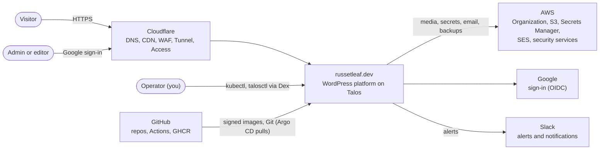
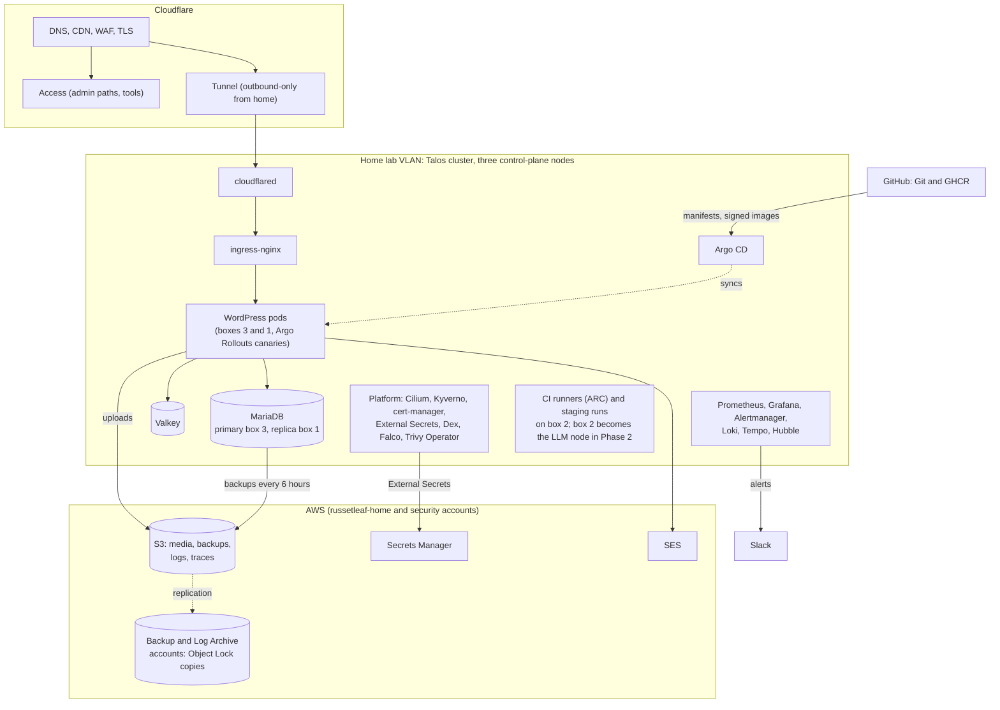

# Phase 1 design: russetleaf.dev on Talos

**Phase 1** builds **russetleaf.dev**: a production-grade WordPress site running 24/7 on a three-node, highly available Talos Kubernetes cluster at home, published through Cloudflare, using real AWS services where they're cheap (S3, Secrets Manager, SES) inside an AWS Organization built on the Security Reference Architecture. It's a complete project on its own.

- **Build plan:** [`plan.md`](plan.md)
- **Decisions:** this phase's ADRs, in the `adr/` folder and listed in the [overview's index](../overview.md#architecture-decision-records)
- **Shared design** (the phases, security by layer, threat model, compliance, repositories, effort): [`../overview.md`](../overview.md)
- **Later phases:** [Phase 2: AI summaries and MLOps](../phase-2-ai-mlops/design.md) and [Phase 3: russetleaf.com on EKS](../phase-3-russetleaf-com/design.md), both optional

Where a shared design choice gains AI components in Phase 2 or differs on russetleaf.com in Phase 3, this document says so in a short note; the details are in that phase's design.

## Architecture

Diagrams follow the [C4 model](https://c4model.com/): a **system context** view (who and what the system talks to), then a **container** view (the main running parts and how they connect).

### System context



### Containers



## AWS account structure and best practices (Security Reference Architecture)

The AWS side follows the **AWS Security Reference Architecture (SRA)**: separate accounts for management, security tooling, logs, backups, shared infrastructure and each workload, organization-wide guardrails, and centralized security services. The reasoning is recorded in `docs/phase-1-russetleaf-dev/adr/1019-aws-multi-account-sra.md`.

### Accounts and organizational units (OUs)

| Account | OU | Purpose |
|---|---|---|
| **Management** (dedicated, new) | Root | Only AWS Organizations, IAM Identity Center, consolidated billing (budgets, cost allocation tags), SCPs and tag policies. **No workloads, no Terraform state.** |
| **Security Tooling** | Security | **Delegated administrator** for GuardDuty, Security Hub, IAM Access Analyzer and AWS Config aggregation (and Inspector, if used); findings routed to Slack from here |
| **Log Archive** | Security | The **organization CloudTrail trail**, Config history and VPC flow logs, in **S3 Object Lock** buckets with KMS encryption |
| **Backup** | Security | The cross-region, immutable data copies (database backups, media, Terraform state, repo mirrors) from ADR 1018 |
| **russetleaf-infra** | Infrastructure | **Terraform state** and the CI deployment entry points (the GitHub OIDC provider and roles); nothing else runs here |
| **russetleaf-home** | Workloads | The AWS resources russetleaf.dev uses (S3, Secrets Manager, SES; SQS and Bedrock from Phase 2); this is the **existing account**, which joins the Organization |
| **russetleaf-com** | Workloads | russetleaf.com: the always-on edge (`envs/aws-edge`) and the demo stack (`envs/aws`). **Created in Phase 3.** |

Separate workload accounts limit how far a compromise can spread, and give each site its own costs, quotas (e.g. the GPU quota) and limits. Accounts are free. All of it is managed by Terraform in `russetleaf-infra/envs/org/` (Organization, OUs, accounts, SCPs, Identity Center, tag policies) and `russetleaf-infra/envs/security/` (the security services), applied from your workstation with management-account and Security Tooling access.

**Cross-account access the design needs** (each a narrow, explicit grant): the russetleaf.com seed Job reads russetleaf.dev's backup and media buckets (bucket policies in `russetleaf-home`); every account's backup-bound buckets replicate into the Backup account; CI roles in each account read and write Terraform state in `russetleaf-infra`.

### Organization-wide guardrails

- **Service control policies (SCPs)** on the OUs:
    - deny leaving the Organization
    - deny disabling or modifying CloudTrail, GuardDuty, Config, Security Hub and Access Analyzer
    - allow only **us-east-1** and **us-west-2** (global services such as IAM, CloudFront, Route 53 excepted)
    - deny actions by member accounts' root users
    - deny creating IAM users and access keys, with a narrow, named exception in `russetleaf-home` for the home cluster's scoped keys until keyless OIDC access (Phase 1 step 9.1, ADR 1033) removes them
    - deny deleting or weakening the Log Archive and Backup buckets (and their Object Lock settings)
- **Centralized root access management:** root credentials are **removed from member accounts**, so only the management account's root login needs to be in the break-glass kit.
- **IAM Identity Center** for all human access: permission sets for **admin**, **read-only** and **break-glass**, with MFA required; no IAM users for people.
- **Tag policies** enforcing `Project`, `Site`, `Env` and `ManagedBy` values.
- **Alternate security contacts** set on every account (security, billing, operations).
- **Budgets** on each account plus a consolidated budget in the management account; **cost allocation tags** activated in the management account (they apply organization-wide).

### Centralized security services (delegated to Security Tooling)

- **Security Hub** with the **AWS Foundational Security Best Practices** and **CIS AWS Foundations** standards enabled in every account, aggregating findings from GuardDuty, Access Analyzer, Config and Inspector. **Critical and high** findings go through EventBridge, SNS and Amazon Q Developer to `#rl-security` (critical also to `#rl-critical`). It's the **continuous** posture check; **Prowler** stays as a free monthly **second opinion** (ADR 1007, updated).
- **AWS Config** with **focused recording** (key resource types such as IAM, S3, security groups, KMS, EKS, RDS, rather than everything, to keep costs down, since the demo stack creates many short-lived resources) and a **conformance pack** (e.g. Operational Best Practices for CIS), aggregated in Security Tooling.
- **IAM Access Analyzer:** organization-wide **external-access** findings (free), plus **policy checks in the Terraform pipeline** (`validate-policy` and its custom checks that flag new public or cross-account access) before anything is applied.
- **GuardDuty** at organization level, with EKS audit-log monitoring (auto-enabled for new accounts).
- **CloudTrail** as a single **organization trail** delivering to Log Archive, with log-file validation.
- **Optional:** **Inspector** for the EKS nodes during demos (images are on GHCR, so its registry scanning matters less). **Macie** and **Detective** aren't used (little sensitive data; extra cost).

### Account- and resource-level best practices

- **S3:** account-level Block Public Access; bucket policies **requiring TLS** (`aws:SecureTransport`); Object Ownership set to bucket-owner-enforced (no ACLs).
- **Encryption:** EBS encryption by default; **KMS customer-managed keys** for the Log Archive and Backup buckets (about $1/key/month); block public access for EBS snapshots and AMIs.
- **EKS API endpoint (Phase 3):** public but **restricted to the home network's address** from the start (private access also on, for the nodes); the AWS **demo workflows run on the home ARC runners**, so they come from that address too (ADR 1030).
- **EKS nodes (Phase 3):** **IMDSv2 required** with a **hop limit of 1** in Karpenter's node class, so pods can't reach the node's instance credentials (they use Pod Identity instead).
- **VPC (russetleaf-com, Phase 3):** **VPC endpoints** for S3, STS, SQS, Secrets Manager and Bedrock (private traffic, lower NAT costs); **VPC flow logs** to Log Archive during demos; default security groups with no rules; default VPCs removed.
- **AWS Well-Architected review:** a review of the design with the free **Well-Architected Tool** (Security pillar first), with the report kept in `docs/` and revisited yearly.

### Cost

Accounts, SCPs, Identity Center, tag policies and Access Analyzer's external-access findings are free. **Security Hub, Config and KMS** add roughly **$5–15/month**, depending mostly on how many resources Config records (focused recording keeps the demo stack's churn in check). That brought the always-on total to about $15–35/month; with box 3's electricity (ADR 1020) it's now about **$18–40/month**. That figure is the **whole** always-on cost (the security services are already included in it, not added on top). With about 20 demo hours a month (~$20), the total is **$30–60/month**; keeping demos to about 10 hours keeps it **under $50**.

## Security foundations

How every control maps to the 4 C's (Cloud, Cluster, Container, Code) is in the overview's [Security by layer](../overview.md#security-by-layer-the-4-cs), alongside the threat model, platform security and compliance views. These are the Phase 1 foundations beyond the AWS accounts.

### SaaS account hardening

The project depends on more than AWS: **GitHub** (code, CI, packages, attestations), **Cloudflare** (DNS, tunnel, WAF, Access), **Google Cloud** (sign-in), **Slack** (alerts) and the **domain registrars**. Each gets:

- **Phishing-resistant sign-in:** passkeys or hardware security keys, with recovery codes in the break-glass kit.
- **Least privilege:** GitHub's default workflow token **read-only** (jobs request more only when needed, e.g. `packages: write` in release jobs only), only verified or allow-listed Actions, required reviews and environment protections, managed with Terraform's **GitHub provider** where possible; Cloudflare **API tokens scoped** to the zones and permissions each job needs.
- **Registrar lock** and 2FA on both domains (alongside DNSSEC).
- **Audit logs** reviewed (GitHub, Cloudflare), and a **quarterly access review** across all providers.

### Home network and boot

- **A lab VLAN** (or a separate router subnet): the cluster can reach the internet (for Cloudflare, AWS, GitHub) and your workstation can reach the cluster, but the cluster **can't reach household devices** and nothing comes in from outside (the Cloudflare Tunnel is outbound-only).
- **Secure Boot** with Talos's Secure Boot images, so only signed Talos boot components run; combined with the **TPM-sealed disk encryption** (ADR 1031), disks only unlock on the expected, untampered system.
- **BIOS passwords** on all three nodes.

### Artifact integrity

- **Helm charts are signed** with cosign like the images, verified in CI before the version-bump pull request, and **pinned by digest** in `russetleaf-gitops` (a tag can be overwritten in GHCR; a digest can't).
- **Mirrored third-party images:** a scheduled workflow copies the critical upstream images (Cilium, Argo CD, Kyverno, MariaDB, cert-manager and others) **by digest** into GHCR after verifying the publishers' signatures where they exist, and re-signs them; the clusters pull from the mirror, protecting against upstream deletions and Docker Hub rate limits.
- **Hash-pinned dependencies:** uv's lock file with hashes (Python) and `composer.lock` (PHP), so a compromised package version can't be swapped in.

### Web application security

- **HTTP security headers** on both sites: **HSTS** (set at Cloudflare and with a CloudFront response-headers policy), **Content-Security-Policy** (report-only first, with reports collected, then enforced), `X-Content-Type-Options: nosniff`, `frame-ancestors` (or X-Frame-Options), Referrer-Policy and Permissions-Policy.
- **DAST:** an OWASP **ZAP** baseline scan of staging in the promotion gate (failing on high-risk findings), and once against russetleaf.com during a demo (Phase 3).
- **WordPress hardening:** anonymous **user enumeration blocked** (author archives and the REST `users` endpoint), **auth keys and salts** from Secrets Manager and rotated on a schedule, XML-RPC off, file modifications off.
- **OWASP ASVS:** the control matrix (Phase 1 step 8.5) maps the site's controls to ASVS requirements.

## What production-ready adds

### Performance

- **Object cache** (ElastiCache Redis or Valkey) with a Redis object-cache plugin. This cuts database load sharply.
- **PHP OPcache** (enabled in the custom WordPress image).

### Security

- **No human WordPress passwords:** admins sign in with Google (OIDC), and the admin area sits behind Cloudflare Access (home) or the ALB's OIDC rule (AWS); see [Admin sign-in with Google](#admin-sign-in-with-google).
- Other secrets (API tokens, SMTP credentials, the Slack token) in **AWS Secrets Manager**, synced into the cluster by **External Secrets Operator**.
- **Encryption in transit:** TLS on every sensitive connection, plus Cilium's **WireGuard** encryption for pod traffic between nodes. No service mesh, by a recorded decision; see [Service mesh (Istio): not used, by decision](#service-mesh-istio-not-used-by-decision).
- **CiliumNetworkPolicies** (Cilium on both clusters): default-deny in each application namespace, then only the connections each workload needs (e.g. only WordPress may reach the database), with outbound traffic to AWS allowed **by DNS name**; see [Networking: Cilium and Hubble](#networking-cilium-and-hubble).
- `DISALLOW_FILE_MODS` set to `true` (no plugin or theme installs from the admin screen).

### Supply chain and policy

- CI builds each image, generates an **SBOM** (a list of every package in the image) with **Syft**, scans it with **Trivy**, **signs** it with **cosign** (keyless, using GitHub's OIDC identity), attaches the SBOM to the image as a **signed attestation** (`cosign attest`, e.g. in SPDX JSON format), and adds a signed **SLSA build provenance** attestation (`actions/attest-build-provenance`). The full set of checks before and after the build is in [Image build pipeline](#image-build-pipeline-russetleaf-wordpress-russetleaf-llm-summarizer). The attestation is stored in GHCR next to the image and recorded in Sigstore's transparency log, so anyone can check which packages a given image contains, and that the list came from the project's own CI.
- **Kyverno** policies in the cluster (each named after its equivalent in the official Kyverno policy library):

| Policy | Kyverno equivalent | What it enforces here |
|---|---|---|
| Signed images | Image verification (`verifyImages`, cosign keyless) | Only images signed by the `russetleaf-wordpress` release workflow (and, from Phase 2, `russetleaf-llm-summarizer`'s) run as the project's own workloads; tags are replaced with **digests** at admission (`mutateDigest`), so a re-pushed tag can't change what runs |
| SBOM attestations | Image verification with an `attestations` check | The project's own images must also carry a **signed SBOM attestation** from the same release workflow; an image without one is rejected |
| Build provenance | Image verification with an `attestations` check for **SLSA provenance** | The project's own images must also carry a **SLSA build provenance** attestation from GitHub's attestation action, issued to the project's **reusable build workflow** (check Kyverno's current support for GitHub attestation bundles) |
| Signed upstream images | Image verification (`verifyImages`) per upstream publisher | Third-party images from publishers that sign with cosign (e.g. **Kyverno** and **Cilium**; check each upstream's current practice before relying on it) must carry a valid signature from **that publisher's** release identity, so a tampered or substituted upstream image is rejected, not just one from an unknown registry. Images from publishers that don't sign stay covered by the registry allow-list and digest pinning. The list of verified publishers and their identities is kept in the policy, and new entries start in audit mode. Kyverno's own namespace is excluded from these checks, so Kyverno can always start (otherwise it could block itself) |
| Allowed registries | **Restrict Image Registries** (`restrict-image-registries`) | Every container (including init and ephemeral containers) comes from `ghcr.io/<you>/*` or an explicit list of upstream registries used by the platform charts (Cilium, Falco, Argo CD, MariaDB, ...); on EKS, also AWS's own add-on registries |
| No `latest` tag | **Disallow Latest Tag** (`disallow-latest-tag`) | Every image has an explicit tag or digest |
| Required labels | **Require Labels** (`require-labels`), plus a **mutate** rule | Workloads carry `app.kubernetes.io/name`, `app.kubernetes.io/part-of` and `env`; the mutate rule fills in `env` from the namespace, so the validate rule is only a backstop. These labels drive alert routing, OpenCost and policy selectors |
| Requests and limits | **Require Requests and Limits** (`require-requests-limits`) | CPU and memory **requests** and a **memory limit** on every container. **CPU limits are deliberately not required by default** (they cause throttling even on idle nodes); they're used only where a neighbor needs protecting: llama.cpp and the CI runners on box 2 (to protect etcd) and k6 load generators. See `docs/phase-1-russetleaf-dev/adr/1026-cpu-limits.md` |
| No privileged containers | **Disallow Privileged Containers** (`disallow-privileged-containers`), within Kyverno's **Pod Security Standards** `baseline` rule set | No privileged containers, host paths or host namespaces (network, PID, IPC). Talos already enforces Pod Security `baseline`; Kyverno adds reporting, CI tests and narrow exceptions |
| Pod Security `restricted` (app namespaces) | Kyverno's **Pod Security Standards `restricted`** rule set, for application namespaces | Everything in the `restricted` profile (non-root, no privilege escalation, all capabilities dropped, seccomp), matching the namespaces' Pod Security Admission `restricted` labels |
| Secrets as files | **Secrets Not From Env Vars** (`secrets-not-from-env-vars`) | Secrets are mounted as files, not passed as environment variables (which leak into process listings, crash dumps and child processes) |
| User namespaces (app namespaces) | A validate rule on `hostUsers` | Application pods set `hostUsers: false`, so root in a container maps to an unprivileged user on the node (enabled once the Kubernetes and Talos versions support it) |
| No service-account token by default | A **mutate** rule | Sets `automountServiceAccountToken: false` unless the workload is on the list that needs the Kubernetes API |
| Run as non-root | **Require Run As Non-Root** (`require-run-as-nonroot`), from the Pod Security `restricted` set | Containers run as a non-root user. The WordPress image runs Apache as `www-data` on port 8080 (non-root processes can't use port 80) |
| seccomp profile | **Restrict Seccomp (Strict)** (`restrict-seccomp-strict`), from the Pod Security `restricted` set | Every container runs with `seccompProfile: RuntimeDefault`, which blocks dozens of rarely needed, risky system calls at no cost; see [Sandboxed runtimes](#sandboxed-runtimes-gvisor) |
| Sandboxed CI runners (home) | A validate rule on `runtimeClassName` | Pods in the ARC runners' namespace must use the `gvisor` RuntimeClass |
| Read-only root filesystem | **Require Read-Only Root Filesystem** (`require-ro-rootfs`) | Containers can't write to their own filesystem. WordPress gets small writable `emptyDir` volumes for `/tmp`, Apache's run and lock directories, PHP sessions and, only if the chosen offload plugin writes uploads locally first, the uploads directory. Backs up the Falco rule on writes to `/var/www/html` |
| Health probes | **Require Pod Probes** (`require-pod-probes`) | Readiness and liveness probes on every long-running workload; Argo Rollouts, the HPA and Kubernetes' own restarts depend on them |
| No NodePorts | **Disallow NodePort** (`restrict-nodeport`), plus a rule blocking `LoadBalancer` Services | Nothing needs them: traffic arrives through the Cloudflare Tunnel at home and through the ALB (created from an Ingress, target type `ip`) on AWS |
| Unique Ingress hosts | **Unique Ingress Host and Path** (`unique-ingress-host-and-path`), which looks up existing Ingresses before admitting a new one | Two Ingresses can't claim the same host and path (e.g. a staging or admin hostname colliding with production) |
| Namespace quotas | A **generate** rule | Every application namespace (WordPress, staging, tenants; the summarizer, gateway and model server from Phase 2) gets a **LimitRange** (default requests and memory limits) and a **ResourceQuota** (total CPU requests, memory, **ephemeral storage** and pod count; the LimitRange also sets default ephemeral-storage requests and limits), so a runaway HPA, KEDA scaling or misconfigured Deployment can't exhaust a node; HPAs and KEDA objects also set maximum replicas |
| No risky RBAC | A validate rule on Roles, ClusterRoles and bindings (ADR 1034) | Rejects `escalate`, `bind` and `impersonate`, access to `nodes/proxy`, wildcard verbs or resources, and bindings to `cluster-admin`, except a named allow-list (Kubernetes' own roles, Argo CD, `platform-admin`, and third-party components that need them, each with a reason) |
| No long-lived token Secrets | A validate rule | Rejects Secrets of type `kubernetes.io/service-account-token`; pods get short-lived projected tokens only |
| Default-deny networking | A **generate** rule | Every new application namespace gets the Cilium baseline allowances (see [Networking](#networking-cilium-and-hubble)) |

**Where each policy applies strictly:** the project's own workloads (WordPress and the staging Jobs; the summarizer and gateway from Phase 2; the seed Job in Phase 3) must pass **all** of them. Third-party platform components get narrow **`PolicyException`** resources only where they genuinely need it, for example: Cilium, Falco, local-path-provisioner, the NVIDIA device plugin and (on EKS) the VPC CNI and EBS CSI node agents need privileged access; some upstream images can't run with a read-only filesystem or as non-root. Each exception names the exact namespace and workload and is reviewed like any other change.

**Rollout:** every policy starts in **audit mode**; Policy Reporter's findings go to `#rl-security`; fix or add a justified exception for each; then switch to **enforce**.

- The **Kyverno CLI** (`kyverno test` and `kyverno apply`) runs the same policies in `russetleaf-gitops` CI against every manifest change, so violations fail the pull request before Argo CD ever deploys them. This covers the "policy checks before deploy" role often given to OPA, without a second policy engine.
- **Checkov** scans infrastructure and configuration code in **all four repos'** CI (see below), so insecure settings fail the pull request before anything is applied, built or deployed.

### Sandboxed runtimes (gVisor)

Normally every container shares the node's Linux kernel, so a kernel exploit from inside one container could compromise the whole node. Two layers reduce that risk:

1. **seccomp `RuntimeDefault` for every workload** (both sites): the container runtime's default seccomp profile blocks dozens of rarely needed, risky system calls. It costs nothing in performance or memory and is required by Kyverno (see the policy table above).
2. **gVisor for the highest-risk workloads** (home only): gVisor runs a pod on a kernel written in user space (`runsc`), which intercepts the container's system calls, so the pod never talks to the host kernel directly. Pods opt in with a **RuntimeClass** (`runtimeClassName: gvisor`).

| Workload | gVisor? | Why |
|---|---|---|
| **ARC self-hosted CI runners** | **Yes (enforced)** | They run code from pull requests, the classic risk for self-hosted runners. The evaluation and staging jobs are plain Python and CLI tools, which gVisor handles well. A Kyverno rule requires `runtimeClassName: gvisor` in the runners' namespace |
| **WordPress** | **Trial**, kept only if performance is acceptable | Internet-facing PHP; plugin vulnerabilities are WordPress's most common attack route. gVisor slows workloads that make many system calls and do lots of file I/O, so a before-and-after load test decides |
| Platform components (and, from Phase 2, the summarizer and gateway) | No | Project code or trusted infrastructure (Cilium, Falco and other node agents need host access) |

**How it's installed (home):** Talos's official **gVisor system extension**, added to the Talos image for each node (through Talos's Image Factory, managed in `russetleaf-infra/envs/home`), plus a `RuntimeClass` named `gvisor` in `russetleaf-gitops`.

**Effects on other tools:**

- **Falco** must have its **gVisor event source** turned on, or it sees much less inside gVisor pods.
- **Cilium** network policies and Hubble keep working: gVisor pods still use the normal pod network interface.

**Kata Containers** (a lightweight VM per pod) was considered and not used: each pod's VM needs its own memory, which 8 GB nodes can't spare, and on AWS it needs hardware virtualization inside the instance (historically bare-metal instances only).

The reasoning is recorded in `docs/phase-1-russetleaf-dev/adr/1009-gvisor-sandboxing.md`.

### Kubernetes component hardening

Each Kubernetes component has explicit controls and a repeatable check, recorded in `docs/phase-1-russetleaf-dev/adr/1031-kubernetes-component-hardening.md` (which has the full table). The additions beyond the sections above:

- **Pod Security Admission labels on every namespace, on both clusters** (EKS doesn't enforce Pod Security by default): `restricted` for application namespaces (WordPress, staging, tenants; the AI namespaces from Phase 2), `baseline` for most platform services, `privileged` only for node agents (Cilium, Falco, Alloy, the storage provisioner, the NVIDIA device plugin), with the **PSA version pinned** (`enforce-version`) so Kubernetes upgrades don't silently change enforcement. Kyverno's **`restricted`** policy set enforces the same for application namespaces, so two independent controls apply.
- **Service-account tokens off by default:** a Kyverno rule sets `automountServiceAccountToken: false` unless a workload needs the Kubernetes API (operators, Argo CD, KEDA, External Secrets).
- **Encryption at rest:** Secrets in etcd (Talos's built-in encryption at home; **EKS envelope encryption with a customer-managed KMS key**); **Talos disk encryption** of the system-state and data partitions on every home node, **sealed to the TPM**; etcd snapshots stored only in the KMS-encrypted backup bucket, readable only by the backup role.
- **kubelet:** `seccompDefault: true` (RuntimeDefault even for pods that don't ask), the read-only port off, certificate rotation, **serving certificates signed by the cluster CA** (so metrics-server and Prometheus verify TLS; ADR 1035), a **per-pod PID limit** (`podPidsLimit`, so a fork bomb can't exhaust a node) and **hard eviction thresholds** for memory, disk and inodes, alongside `systemReserved` and `kubeReserved` (ADR 1034).
- **Control-plane settings verified at home** (profiling off, local-only binding, NodeRestriction, per-controller service-account credentials) with `talosctl`, in `docs/talos-hardening.md`.
- **Talos host firewall:** the Kubernetes API (6443) and Talos API (50000) reachable only from the LAN and the workstation.

### Identity and access to the clusters

How **people** sign in and what they may do, recorded in `docs/phase-1-russetleaf-dev/adr/1033-identity-and-access.md`:

- **OIDC sign-in on the home cluster:** **Dex** (OIDC provider, with a Google connector) issues short-lived tokens; the API server trusts Dex through Kubernetes' structured authentication configuration; people use **kubelogin**. On EKS, people sign in through **IAM Identity Center**, mapped to **access entries** with the EKS view, edit and cluster-admin access policies.
- **Human roles:** `platform-admin`, `operator` (deploy, restart, view logs; no RBAC or Secret changes) and `read-only` ClusterRoles bound to Dex groups or users. **No day-to-day cluster-admin**; Argo CD's service account is the identity that changes production.
- **Break-glass:** the Talos-generated admin kubeconfig (a cluster-admin client certificate that can't be revoked) lives only in the break-glass kit; **`KubeBreakGlassAdminUsed`** alerts `#rl-security` and `#rl-critical` whenever it's used. Day-to-day Talos API access uses the read-only **`os:reader`** role.
- **SSO inside the admin tools:** Argo CD, Grafana and Backstage sign in through Dex with roles mapped from groups, behind Cloudflare Access as well.

### Intrusion detection and prevention

Falco is one layer among several. The design combines **prevention** (stopping attacks) and **detection** (noticing them) at every layer, so no single tool has to catch everything. The reasoning is recorded in `docs/phase-1-russetleaf-dev/adr/1017-intrusion-detection-and-prevention.md`.

| Layer | Prevention | Detection |
|---|---|---|
| **Edge / HTTP** (traffic from the internet) | **Cloudflare WAF** with its free **managed rule set**, a **rate-limiting rule** on `/wp-login.php` and **`/xmlrpc.php` blocked** (home); **AWS WAF** with managed rules (core, known bad inputs, WordPress, IP reputation) and login rate limiting (AWS); Cloudflare Access / ALB login in front of the admin area; Google sign-in, no passwords; XML-RPC also disabled inside WordPress | WAF logs; external uptime checks |
| **Inside the cluster** (traffic between pods) | **Default-deny CiliumNetworkPolicies**, DNS-name egress rules, WireGuard encryption | **Hubble** policy drops (`HubblePolicyDropsSpike`) |
| **Kubernetes API** | RBAC (Node and RBAC authorization only), Google/edge-protected admin tools, no anonymous access | **API audit logs** with alert rules (below) |
| **Admission** | **Kyverno**: signed images with SBOM and provenance, Pod Security, non-root, read-only filesystem, seccomp | Policy Reporter |
| **Runtime** | seccomp, **gVisor** (CI runners), read-only filesystems, lean images; **Tetragon** enforcement (optional) | **Falco**: shells, processes not on the allow-list, writes to code, unexpected egress |
| **AWS account** | IAM least privilege, no long-lived keys in the clusters (except home's scoped keys), `prevent_destroy` | **CloudTrail** and **GuardDuty** (below) |
| **Posture** | — | Trivy Operator, Kubescape, kube-bench, Prowler |

**Kubernetes API audit monitoring:**

- **Home:** Talos's API server **audit logging** with a focused audit policy (metadata for most requests; full detail for Secrets, RBAC, `exec` and `attach`). Alloy collects the audit log from all three control-plane nodes into **Loki**, and **Loki alert rules** (to `#rl-security`, with runbooks) flag suspicious activity. Because **Argo CD makes all normal changes**, a change to production resources by anyone else stands out. Audit logs are also archived for **1 year** in the **Log Archive account's Object Lock bucket** (Alloy writes a copy), together with **Argo CD's audit events** (who synced or changed what); see ADR 1033.

| Alert | Fires when |
|---|---|
| `KubeExecIntoProdPod` | Someone runs `exec` or `attach` in a production pod (outside a recorded break-glass) |
| `KubeUnexpectedSecretRead` | A Secret is read by an identity other than the workloads and controllers expected to read it |
| `KubeRBACChangedOutsideArgoCD` | A Role, ClusterRole or binding is changed by anything other than Argo CD |
| `KubeAnonymousOrForbiddenSpike` | A burst of anonymous or forbidden requests |
| `KubeWorkloadCreatedOutsideArgoCD` | A Pod, Deployment, DaemonSet, StatefulSet, Job or CronJob is created in a production or platform namespace by anyone other than Argo CD and the expected controllers (persistence; ADR 1034) |
| `KubeAdmissionWebhookChanged` | A validating or mutating webhook configuration is created, changed or deleted by anyone other than Argo CD and the components that manage their own webhooks (Kyverno, cert-manager's CA injector) |
| `KubeTokenSecretCreated` | A long-lived service-account token Secret is created (Kyverno should already block it) |
| `KubeAuditLogMissing` | No audit events have arrived for 15 minutes (the monitoring itself is broken) |

**AWS account threat detection (always on, shared by both sites):**

- **CloudTrail:** a single **organization trail** (management events, all accounts and regions) delivered to the **Log Archive** account's Object Lock bucket, with log-file validation (proves logs weren't altered). The first trail's management events are free; storage costs pennies. See [AWS account structure](#aws-account-structure-and-best-practices-security-reference-architecture).
- **GuardDuty** (organization-wide, administered from the **Security Tooling** account): detects compromised credentials, unusual API calls, crypto-mining, and contact with known-malicious addresses, plus EKS audit-log monitoring whenever the demo cluster exists. About **$1–5/month** for an account this size after the 30-day free trial (check current pricing).
- **Findings to Slack:** GuardDuty findings (medium severity and above) and **Security Hub** critical and high findings go through **EventBridge → SNS → Amazon Q Developer** (in Security Tooling) to `#rl-security` (high or critical severity also to `#rl-critical`).

**Optional: CrowdSec.** CrowdSec analyses the ingress logs and **bans abusive IP addresses** through a Cloudflare "bouncer" (a modern, shared-intelligence fail2ban). With the three-node cluster's extra memory it's now realistic at home (about 100–200 MB of memory).

**Deliberately not used: a network IDS** (Suricata or Zeek) inside the cluster. It needs a lot of CPU and memory, and the traffic it would inspect is already covered: TLS ends at Cloudflare and the ALB, where the WAFs inspect it, and Cilium and Hubble cover traffic inside the cluster. A home-network IDS on the router (e.g. OPNsense with Suricata) is worthwhile but outside this project.

### Process allow-listing

The goal of process allow-listing is "**only these programs may run in this container**". It's done with Falco (detection, both sites) rather than AppArmor or SELinux profiles. The reasoning is recorded in `docs/phase-1-russetleaf-dev/adr/1015-process-allow-listing.md`.

| Mechanism | Used? | Why |
|---|---|---|
| **seccomp `RuntimeDefault`** | **Yes** (both sites, required by Kyverno) | A kernel feature that works the same on Talos and EKS; blocks risky system calls at no cost |
| **Falco process allow-list rules** | **Yes** (both sites) | Per-workload lists of expected programs; anything else raises an alert. No extra memory: Falco already runs |
| **Fewer programs in the images** | **Yes** | The read-only root filesystem, non-root user, and images without download tools (`curl`, `wget`) or package managers leave little for an attacker to run; container-structure-test checks this |
| **Tetragon enforcement** | **Optional** (tried on EKS first, then at home, where the three-node cluster now has the memory) | Cilium's eBPF runtime-security tool can **kill a process the moment it starts** if it isn't on the allow-list, blocking rather than reporting; integrates with Cilium and Hubble; roughly 100–300 MB per node |
| **Custom per-workload seccomp profiles** | **Optional (Advanced tier)** | The Security Profiles Operator records the exact system calls each app uses and builds a tight profile; works on both clusters, but a missed call breaks the app after an update |
| **AppArmor** | **No** | Talos doesn't ship it, and EKS's Amazon Linux 2023 nodes don't use it |
| **Custom SELinux policies** | **No** | Talos's SELinux support is limited (check its current status) and AL2023 typically runs SELinux in permissive mode; writing container policies is a large effort for little gain here |

**The allow-lists** (Falco rules in `platform/falco/`, alerting `#rl-security`):

| Workload | Expected processes | Anything else |
|---|---|---|
| WordPress | `apache2`, `php`, and **`bash` only as the container's first process, running the image's entrypoint scripts** (`docker-entrypoint.sh`, `apache2-foreground`); any other shell alerts | Alert (e.g. a shell, `curl`, `wget`, a crypto miner) |

The lists are kept in Git next to the rules, and **tested**: starting any unlisted process in each workload must raise an alert. When an image legitimately starts a new program (e.g. after an update), the release pull request updates the list.

### Infrastructure and configuration scanning (Checkov)

**Checkov** (free, open source, no account needed) is the project's scanner for infrastructure-as-code and configuration. Snyk isn't used: it's a commercial platform whose free tier limits monthly scans, and it would overlap with Checkov (configuration) and Trivy (images and dependencies) without adding coverage.

| Repo | What Checkov scans |
|---|---|
| `russetleaf-infra` | **Terraform** source, plus the **plan** (`terraform show -json` output), which catches problems that only appear once variables and modules are resolved |
| `russetleaf-gitops` | The **rendered Kubernetes manifests** for every overlay (the output of Helm and Kustomize, i.e. exactly what Argo CD would apply), and the Helm values |
| `russetleaf-wordpress` | The **Dockerfile**, the WordPress **Helm chart** |
| All four | **GitHub Actions workflows**: actions not pinned to a commit, over-broad `permissions`, untrusted input used in scripts (script injection) |

How it's run:

- **Same version everywhere:** pinned in each repo's `.mise.toml` (installed with `uv`), so local runs and CI match.
- **Fails the pull request** on any failed check that hasn't been explicitly skipped. Skips are written inline (`checkov:skip=<check ID>: <reason>`) or in the repo's `.checkov.yaml`, **always with a reason**, and reviewed like any other change.
- **Results on GitHub:** findings are uploaded as **SARIF** to GitHub's **code scanning**, so they appear inline on pull requests and in each repo's Security tab. Code scanning is free for **public** repos, and the repos are public from the start (ADR 1030), so SARIF upload is on from the first pipeline.
- **Overlap with Kyverno is intended:** Checkov checks manifests *before* they're merged, using its own rule set; Kyverno enforces the project's policies *at admission* in the cluster (and its CLI tests the same policies in CI).

### Terraform pipeline (`russetleaf-infra`)

All Terraform runs through **GitHub Actions** (apart from the first local applies of `bootstrap/` and `envs/home`), with every check passing before anything reaches AWS, Cloudflare or Talos.

| Stage | Tool | What it does |
|---|---|---|
| Before each commit | **pre-commit-terraform** hooks (plus gitleaks) | Runs fmt, validate, tflint, terraform-docs, Checkov and the secret scan locally, so most problems never reach CI |
| Formatting | `terraform fmt -check` | Fails on unformatted code |
| Validation | `terraform validate` | Syntax and internal consistency |
| Linting | **tflint** with the **`tflint-ruleset-aws`** plugin | Catches mistakes and AWS-specific errors (invalid instance types, deprecated settings) before AWS rejects them |
| Static security analysis | **Checkov**, including **custom policies** | Insecure settings in the source and the plan (SARIF to GitHub code scanning), plus project rules: every resource tagged `Project`/`Site`/`Env`, only `us-east-1`, only approved instance families, Block Public Access on every S3 bucket. Custom policies keep one policy tool for Terraform, as Kyverno is for Kubernetes (no OPA/Conftest) |
| Module tests | **`terraform test`** | Tests the shared modules, with mocked providers where possible |
| Secret scanning | **gitleaks**, plus **GitHub secret scanning with push protection** (free on public repos) | Push protection blocks a commit containing a recognized secret before it's pushed |
| Plan | `terraform plan -out` | The plan is **saved** as a short-lived, private workflow artifact (plan files can contain secret values) and posted as a pull-request comment |
| Plan analysis | **Checkov on the plan**; **Infracost** | Checks the resolved plan; Infracost comments the **monthly cost difference** of the change on the pull request (open-source CLI; check current terms for CI use) |
| IAM policy checks | **IAM Access Analyzer** (`validate-policy` and its custom policy checks) | Flags invalid policies and **new public or cross-account access** in the plan before it's applied |
| Approval | **GitHub Environment** `apply`, with required reviewers, limited to `main` | The OIDC *apply* role trusts only this environment, so nothing else can apply |
| Apply | `terraform apply <saved plan>` | Applies **exactly the plan that was reviewed**, never a fresh one |
| Drift | Scheduled `terraform plan` (weekly) | Alerts if anything changed outside Terraform |
| Documentation | **terraform-docs** | Generates each module's inputs and outputs into its README |
| Provider integrity | `.terraform.lock.hcl` with hashes for **every platform** (`terraform providers lock -platform=linux_amd64 -platform=<workstation>`) | CI and local runs use the same verified providers |

**Pull request flow:** fmt → validate → tflint (+ AWS ruleset) → Checkov (source + custom policies) → `terraform test` → plan (saved) → Checkov on the plan → Infracost comment → plan comment → gitleaks. **After merge:** approval in the `apply` environment → apply the saved plan. For `envs/aws`, applies are done only by the demo workflows (never on merge), so merging never starts a paid stack.

**Deliberately not used:** tfsec or Trivy's Terraform scanning (they overlap heavily with Checkov); Atlantis, Terraform Cloud or Spacelift (GitHub Actions with OIDC, Environments and saved plans covers a single maintainer); OPA/Conftest (Checkov custom policies cover the project's rules).

### Image build pipeline (`russetleaf-wordpress`, `russetleaf-llm-summarizer`)

Both images are built in **GitHub Actions** and only reach GHCR after passing code, dependency, build and image checks; every release is signed, attested and recorded in the **Rekor** transparency log. The reasoning for the less obvious choices is in `docs/phase-1-russetleaf-dev/adr/1013-image-supply-chain.md`.

| Stage | Tool | What it does |
|---|---|---|
| Secret scanning | **gitleaks** (pre-commit and CI); **GitHub secret scanning with push protection** (public repos) | Stops secrets entering the repo |
| Dockerfile linting | **hadolint** (includes ShellCheck for `RUN` lines) | Dockerfile correctness and best practices |
| Language linting | **ruff** and **mypy** (Python, summarizer); **PHP_CodeSniffer with the WordPress Coding Standards** and **PHPStan** (PHP, `russetleaf-wordpress`'s must-use plugins and `db.php`) | Style, types and bugs; the WordPress standards include security checks (output escaping, nonces, input sanitization) |
| SAST | **Semgrep Community Edition** (Python and PHP, open-source security rules) | Security bugs in the project's own code |
| Dependency checks | `composer audit`, **pip-audit**; GitHub's **dependency-review action** (public repos) | Known-vulnerable dependencies, before building; the dependency review blocks a pull request that adds one |
| WordPress plugin vulnerabilities | **WPScan** (`russetleaf-wordpress`) | Known plugin and theme vulnerabilities |
| Build configuration | **Checkov** (Dockerfile, Helm chart, workflows); **zizmor** (GitHub Actions workflow security: untrusted input in scripts, risky triggers, credential exposure) | Insecure build and CI configuration |
| Chart checks | `helm lint` and `ct lint` (chart-testing) | Chart correctness |
| Build | Docker Buildx | Builds the image (base images pinned by digest) |
| Image checks | **container-structure-test** | The built image runs as non-root, listens on port 8080, has the expected files and no leftover tools |
| Image scanning | **Trivy** with its **vulnerability**, **secret** and **misconfiguration** scanners | Fails on critical vulnerabilities and on any secret baked into a layer; accepted vulnerabilities go in signed **OpenVEX** statements (`.vex/`, each with a justification and review date, attached to the image as an attestation); `.trivyignore` only for secret and misconfiguration findings (ADR 1035); Trivy's **CIS Docker Benchmark** compliance check on each image (ADR 1036) |
| Tests | Unit tests, Compose smoke test, kind integration tests; the **evaluation gate** (summarizer) | Behavior |
| Publish | Push **by digest** to GHCR (image and chart) | Only after everything above passes |
| Sign | **cosign** keyless (GitHub OIDC → Fulcio certificate) | Signature recorded in **Rekor** |
| SBOM | **Syft** SBOM, attached with **cosign attest** | Attestation recorded in **Rekor** |
| Build provenance | GitHub's **`actions/attest-build-provenance`**, with the build run as a **reusable workflow** | A signed **SLSA provenance** record of how and where the image was built (repo, commit, workflow, runner), stored with the image and, on public repos, recorded in **Rekor**. On its own this is **SLSA Build Level 2**; running the build in a reusable workflow (a shared build workflow each repo's release calls) reaches **Build Level 3** as GitHub documents it |
| Verify | `cosign verify`, `cosign verify-attestation`, `gh attestation verify` on the pushed digest | A broken signature or attestation fails the release, not the deploy |
| Chart signing | **cosign** on the Helm chart (OCI) | Charts are signed like images, verified in CI before the version-bump pull request, and pinned **by digest** in `russetleaf-gitops` |
| Permissions | Workflow token **read-only by default** | `packages: write` and signing permissions granted only to the release jobs |
| Release notes | GitHub release | Image and chart **digests** plus **Rekor log entry** links, so anyone can audit the transparency log (e.g. with `rekor-cli`) |
| Repo practices | **OpenSSF Scorecard** (weekly, all four repos) | Scores branch protection, pinned dependencies, token permissions, signed releases and more; badge on each README |

**Pull request flow:** gitleaks → hadolint → ruff/mypy or PHPCS/PHPStan → Semgrep → `composer audit` / pip-audit → dependency review → Checkov → zizmor → `helm lint` / `ct lint` → unit tests → build → container-structure-test → Trivy → kind integration tests (+ evaluation gate). **Release:** the same checks → push by digest → cosign sign → SBOM attestation → SLSA provenance → verify → release notes → version-bump pull request on `russetleaf-gitops`. **Weekly:** scheduled rebuild, WPScan, Scorecard.

**Deliberately not used:** CodeQL (free on public repos but doesn't support PHP; Semgrep covers both languages), Docker Scout, Snyk Container and Grype (overlap with Trivy), Chainguard/Wolfi base images (free tier offers only `latest` tags, which conflicts with pinned versions; worth revisiting).

### Runtime security and compliance

- **Falco** watches running containers (using its modern eBPF driver) and alerts on suspicious behavior. Kyverno only checks resources when they're created; Falco covers what happens after. Custom rules for this design:
    - a **shell started** in a WordPress pod (and, from Phase 2, a summarizer or gateway pod), which normally never happens
    - **any process not on a workload's allow-list** (e.g. anything other than `apache2` and `php` in WordPress); see [Process allow-listing](#process-allow-listing)
    - **files written under `/var/www/html`**, since WordPress code is built into the image and `DISALLOW_FILE_MODS` is set
- **Falcosidekick** sends Falco alerts to Alertmanager, Grafana and Slack (`#rl-security`). (On AWS, GuardDuty EKS Runtime Monitoring is the managed alternative; Falco runs the same on both clusters.)
- **Falco runs continuously, not on a schedule:** it's a DaemonSet (one pod per node) watching system calls live, so alerts arrive within seconds. Because nothing re-runs it if it stops, **Falco's own health is monitored**: Falco's and Falcosidekick's metrics are scraped by Prometheus (ServiceMonitors), with these alerts (runbooks in `docs/runbooks/`):

| Alert | Fires when | Goes to |
|---|---|---|
| `FalcoNotRunning` | The Falco DaemonSet has fewer ready pods than nodes for 10 minutes (from kube-state-metrics), i.e. a node is unprotected | `#rl-security` + `#rl-critical` |
| `FalcosidekickOutputErrors` | Falcosidekick fails to deliver alerts to Alertmanager or Slack | `#rl-security` |
| `FalcoEventsDropped` | Falco reports dropped system-call events (it can't keep up, so detections may be missed) | `#rl-security` |

- **API server authorization: only Node and RBAC; ABAC and `AlwaysAllow` off** on both clusters.
    - **Home (Talos):** Talos configures the API server with Kubernetes' structured authorization config file (`--authorization-config`), enabling only the **Node** and **RBAC** authorizers. The Talos machine config in `russetleaf-infra` must **never override** it (no custom authorization config, no ABAC policy file). Talos's defaults also turn off anonymous access to the kubelet and use webhook authorization for it (verified on box 1: `kubelet.yaml` has `authentication.anonymous.enabled: false` and `authorization.mode: Webhook`, and an anonymous request to the kubelet API on port 10250 returns **401 Unauthorized**). Checked with `talosctl -n <control-plane-ip> read /system/config/kubernetes/kube-apiserver/authorization-config.yaml`, which must list only `Node` and `RBAC`; documented in `docs/talos-hardening.md`.
    - **Both:** the Kubescape CLI scans flag risky RBAC, such as bindings that grant permissions to `system:anonymous` or `system:authenticated`.
- **Trivy Operator** runs continuously in the cluster, producing CIS compliance reports, vulnerability reports for running images, and configuration audits. Its **compliance results are published as Prometheus metrics** on both clusters, feeding a **Grafana "Compliance" dashboard** that shows both sites side by side, and a `ComplianceFailuresIncreased` alert to `#rl-security` when the number of failing CIS controls rises. This is the continuous compliance signal; kube-bench adds deeper node-level checks on EKS.
- **Kubescape CLI**, run on demand (monthly at home, once per AWS demo on EKS) from the workstation or the in-cluster CI runners, with **nothing installed in the cluster**: scores each cluster against the **NSA-CISA** and **MITRE ATT&CK** frameworks and analyzes **RBAC** for risky permissions, the one area no other tool here covers. Reports are saved in `docs/` in `russetleaf-gitops`. It complements kube-bench rather than replacing it: kube-bench checks node and control-plane configuration directly on the nodes; Kubescape checks workloads and permissions through the Kubernetes API. The in-cluster Kubescape operator is deliberately not used (0.5–1 GB of memory, mostly duplicating Trivy Operator and Falco); see `docs/phase-1-russetleaf-dev/adr/1003-kubescape-cli-not-operator.md`.
- **Security Hub** (with the AWS Foundational Security Best Practices and CIS standards) is the **continuous** check of every account's configuration; see [AWS account structure](#aws-account-structure-and-best-practices-security-reference-architecture).
- **Prowler**, as a free **second opinion** across **all the accounts**: a scheduled GitHub Actions workflow in `russetleaf-infra` runs it **monthly**, plus once per AWS demo with the stack up, using a **read-only audit role** in each account through GitHub OIDC. It checks the account's actual settings (IAM users and keys, root MFA, CloudTrail, S3 public access, security groups, encryption defaults) against **CIS AWS Foundations** and **AWS Foundational Security Best Practices**, catching anything configured outside Terraform. Reports are kept as workflow artifacts with a summary in `docs/security/` and a short message to `#rl-security`. Deepfence ThreatMapper was considered and not used (its console needs more memory than box 1 has, and it duplicates the tools above); see `docs/phase-1-russetleaf-dev/adr/1007-prowler-not-threatmapper.md`.

### Stateless operation

- **Custom WordPress image** with plugins and themes built in, built by the `russetleaf-wordpress` repo's CI, pushed to the registry, and deployed by Argo CD.
- **Media uploads offloaded to S3** (S3-Uploads or WP Offload Media, chosen in Phase 1 step 5.1), so WordPress pods need no persistent volume (`persistence.enabled: false`). Not EFS, by decision; see [Media storage: S3, not EFS](#media-storage-s3-not-efs-by-decision).
- **WP-Cron turned off** in WordPress (`DISABLE_WP_CRON`) and run as a **Kubernetes CronJob** instead.
- **Outgoing email through Amazon SES** with an SMTP plugin; each site has its own SES domain identity with DKIM.

### Media storage: S3, not EFS (by decision)

Many WordPress-on-AWS guides, including AWS's own reference architecture, put `wp-content` on **EFS**, a shared network filesystem mounted by every server. This project deliberately doesn't. Media goes to **S3**, and WordPress's code (core, plugins, themes) is **built into the container image**. The reasoning is recorded as an ADR, `docs/phase-1-russetleaf-dev/adr/1002-s3-media-not-efs.md` in `russetleaf-gitops`.

**Two production patterns, for two kinds of site:**

- **EFS (shared `wp-content`):** traditional or lift-and-shift WordPress on EC2 Auto Scaling groups. It needs no changes to WordPress, so admin-screen plugin installs, caching plugins and plugins that write files all just work. The right choice when site owners install plugins themselves.
- **S3 media + immutable images:** containerized, GitOps-managed WordPress, the approach taken by large platforms such as WordPress VIP and Human Made's Altis (which publishes the open-source S3-Uploads plugin for it). This project is this kind of site.

| | EFS (shared `wp-content`) | S3 media + code in the image (this design) |
|---|---|---|
| What's running | Can change at runtime (admin installs, plugin updates, edited files), so it drifts from Git | **Exactly what's in Git**: a signed, scanned image, pinned by digest |
| Rollback | Rolling back the image doesn't roll back files changed on EFS | Roll back the image version; done |
| Security | A writable code directory is where attackers hide web shells, and they persist across restarts | Read-only root filesystem (Kyverno), Falco alerts on writes to `/var/www/html`; a compromised pod is replaced clean |
| Performance | PHP reads many small files per request, each over the network (needs careful OPcache tuning) | Code is on local disk in the image; media is served by the CDN straight from S3 |
| Cost | ~$0.30/GB-month, plus throughput charges at scale | ~$0.023/GB-month; the CDN serves media without touching the pods |
| Home lab | No EFS at home; would need an NFS server (more load on 8 GB) | The same S3 approach works identically at home |
| Staging, ci, promotion | A shared filesystem per environment, kept in sync somehow | Each environment points at its own bucket |

**What it costs:** no plugin installs from the admin screen (every plugin change is a new image through CI and staging, which is the point here); plugins that write files (some caching, form and backup plugins) need checking or a writable scratch volume; the media offload plugin becomes a key dependency.

**When EFS would be the better choice** (also in the ADR): non-technical editors need to install plugins themselves, or the site relies on plugins that must write to `wp-content` and can't be replaced.

**Offload plugin:** two candidates, compared in Phase 1 step 5.1:

- **S3-Uploads** (Human Made, open source): stores uploads **directly in S3** through a PHP stream wrapper, so nothing is written locally. The best fit for a read-only container.
- **WP Offload Media Lite** (Delicious Brains): writes each upload to the local uploads directory first, then copies it to S3 (and can delete the local copy). Needs a writable `emptyDir` for uploads.

Whichever is chosen must also work with a **custom S3 endpoint**, so the ci tests can use the LocalStack or MinIO stand-ins.

### Backup and recovery

- Daily **logical backups** of the russetleaf.dev database to S3; see [russetleaf.dev database backups](#russetleafdev-database-backups).
- **S3 versioning**, plus cross-region replication if you need disaster recovery.
- A **restore you have actually tested**.

### Delivery and operations

- **Infrastructure as code** (Terraform) for the AWS accounts and resources, Cloudflare and the Talos cluster.
- **GitOps** (Argo CD) for what runs in the cluster, with **self-heal on by default** (manual sync only for Cilium and the staging Applications), **`ignoreDifferences`** for fields that controllers legitimately change (replica counts set by HPAs and KEDA), and an **`ArgoCDAppOutOfSync`** alert (Prometheus, from Argo CD's `argocd_app_info` metric) when an app stays out of sync or degraded for 15 minutes, which catches drift that self-heal can't fix. AppProjects **warn about orphaned resources** (objects in managed namespaces that Argo CD doesn't own), since self-heal only reverts what Argo CD manages (ADR 1034).
- **Internal certificates** from **cert-manager** with an internal CA, and **trust-manager** distributing the CA bundle (MariaDB TLS and other internal endpoints); public certificates stay with Cloudflare and ACM. See `docs/phase-1-russetleaf-dev/adr/1028-internal-pki.md`.
- **Cost visibility** with **OpenCost** (cost per namespace, workload and node; Phase 2 adds cost per summary and Bedrock spend), and **AWS billing** for actual costs, with cost alerts and reports in `#rl-costs`; see [Cost monitoring and alerts](#cost-monitoring-and-alerts).
- **Progressive delivery** with **Argo Rollouts**: new WordPress versions (and, from Phase 2, summarizer versions) go out as canaries (e.g. 10% → 50% → 100%). An analysis step checks Prometheus metrics (error rate, latency) at each stage and **rolls back automatically** if they get worse. The metrics come from **CloudWatch** on AWS (ALB 5xx rate and response time, through Argo Rollouts' CloudWatch provider) and from **ingress-nginx's Prometheus metrics** at home.
- **Metrics, logs and alerts**: Prometheus, **Loki** (logs, collected by Grafana Alloy; see [Logging](#logging-loki--alloy)), Grafana and Alertmanager, with every alert routed to **Slack** by site and topic; see [Alerting and notifications](#alerting-and-notifications-slack).
- **Deployment notifications**: Argo CD and Argo Rollouts post syncs, failures, canary steps and rollbacks to `#rl-deploys`.
- **AWS Budgets alerts** (Phase 2 adds one on Bedrock spending, in case a bug calls the model in a loop).
- **Tagging**: every AWS resource gets `Project`, `Site`, `Env` and `ManagedBy` tags (plus `Stack=edge|demo` on russetleaf.com in Phase 3) through the AWS provider's `default_tags`, so leftovers can be found and costs split per site.

### WordPress image and Helm chart

The site uses a **custom image built on the official `wordpress` image** and a **small Helm chart of its own** (Deployment/Rollout, Service, Ingress, HPA, PDB, WP-Cron CronJob), both maintained in the `russetleaf-wordpress` repo and released together. The Bitnami WordPress chart isn't used: it only works with Bitnami-format images, and Bitnami cut back its free images in 2025. Owning the chart removes that dependency and keeps every setting visible.

**Repos and packages are public early** (ADR 1030): the repos are made public in Phase 1 step 1.1, after a secret scan, which gives free GitHub-hosted CI minutes, and the GHCR packages are made public at first push.

**Where images and charts are hosted:** on **GitHub Container Registry (GHCR)** under the project's GitHub account: `ghcr.io/<github-user>/russetleaf-wordpress` and `ghcr.io/<github-user>/russetleaf-llm-summarizer`, each holding its image and its Helm chart (as an OCI artifact). Each package is linked to the repo whose CI publishes it. **GHCR packages have their own visibility setting, separate from the repo's:** a package stays **private** even after its repo is made public, until its visibility is changed in the package's settings. While packages are private, both clusters need credentials to pull them: an image pull secret for the kubelet, and OCI repository credentials for Argo CD (both from a GitHub token with `read:packages` only, kept in Secrets Manager and synced by External Secrets). Once the packages are public, both can be removed. While packages are private, GitHub's free-plan limits for private packages apply (roughly 500 MB of storage and limited transfer), so either make the packages public early or delete old untagged versions automatically. Why GHCR rather than ECR is recorded in `docs/phase-1-russetleaf-dev/adr/1004-ghcr-not-ecr.md`. **Access and cleanup (ADR 1035):** each package accepts writes only from its own repo's Actions (no personal tokens with `write:packages`); a monthly cleanup workflow deletes untagged versions older than 90 days but never a digest referenced in `russetleaf-gitops` in the last 90 days or one of the last 10 releases, so rollbacks always find their image.

## Networking: Cilium and Hubble

Both clusters run **Cilium** (the choice and its alternatives are recorded in `docs/phase-1-russetleaf-dev/adr/1027-cilium-cni.md`), so they share one networking story: the same policy types, the same network-flow visibility (**Hubble**), and the same Grafana dashboards and alerts.

### How Cilium runs on each cluster

| | Talos (russetleaf.dev) | EKS (russetleaf.com, Phase 3) |
|---|---|---|
| Mode | **Full CNI**: replaces Talos's default Flannel **and kube-proxy** | **Chaining mode** with the Amazon VPC CNI: the VPC CNI still gives pods their VPC IP addresses; Cilium adds policy enforcement and Hubble on top |
| Key settings | Talos machine config `cluster.network.cni.name: none` and `cluster.proxy.disabled: true`; Cilium `kubeProxyReplacement: true`, `k8sServiceHost: localhost`, `k8sServicePort: 7445` (Talos's KubePrism API endpoint), plus Talos's documented cgroup and capability settings | `cni.chainingMode: aws-cni`, `cni.exclusive: false`, `enableIPv4Masquerade: false`, `routingMode: native`; the VPC CNI's own network policy enforcement stays **off**, so only one component enforces policies |
| Installed by | Terraform (Helm provider) right after the cluster bootstraps, because nothing (including Argo CD) can run without a CNI; Argo CD then manages it from `platform/cilium/` | Terraform (Helm provider) right after the cluster and its managed node group are created; Argo CD then manages it |
| New nodes | Fixed hardware | Karpenter NodePools add the startup taint `node.cilium.io/agent-not-ready=true:NoExecute`, so no pod lands on a new node before Cilium is ready on it |

Terraform installs Cilium only once (later changes are ignored by Terraform, using `lifecycle { ignore_changes }`); from then on, the values in `russetleaf-gitops/platform/cilium/` (with `overlays/home` and `overlays/aws`) are the source of truth, and Cilium upgrades go through Git like everything else.

### Policies: CiliumNetworkPolicies, not plain NetworkPolicies

The project uses **`CiliumClusterwideNetworkPolicy`** and **`CiliumNetworkPolicy`** resources instead of standard Kubernetes `NetworkPolicy`, because they can do three things standard policies can't:

- **Filter outbound traffic by DNS name** (`toFQDNs`). AWS service IP addresses change constantly, so IP-based rules can't say "WordPress may reach S3". FQDN rules can.
- **Use cluster-wide baselines**: one `CiliumClusterwideNetworkPolicy` sets **default-deny** for every application namespace and allows DNS to CoreDNS (with Cilium's DNS proxy turned on, which FQDN rules need).
- **Filter at layer 7** (HTTP methods and paths) where it's worth it, e.g. the summarizer may only call WordPress's REST API.

Each component's policies live in its `base/` (shared by both sites), with per-site differences in the overlays. A summary of the allowed traffic:

| Workload | Allowed inbound | Allowed outbound |
|---|---|---|
| WordPress | From the ingress (ingress-nginx at home; the ALB on AWS), Prometheus | Database (MariaDB in-cluster / RDS Proxy endpoint), Valkey / ElastiCache, and by DNS name only: `*.s3.<region>.amazonaws.com`, `sqs.<region>.amazonaws.com`, `email-smtp.<region>.amazonaws.com`, `sts.<region>.amazonaws.com`, and Google's login endpoints (`accounts.google.com`, `oauth2.googleapis.com`, `www.googleapis.com`) |
| MariaDB (home) | WordPress, the backup Job, Prometheus | `*.s3.<region>.amazonaws.com` (backups) |
| Argo CD | Ingress (UI and API, behind Cloudflare Access), Prometheus | GitHub and GHCR (by DNS name), the API servers it manages, Dex |
| External Secrets | Prometheus | `secretsmanager.<region>.amazonaws.com`, `sts.<region>.amazonaws.com`, the API server |
| cert-manager, Kyverno, KEDA and other operators | The API server (webhooks), Prometheus | The API server (plus specific external endpoints where needed, e.g. KEDA → SQS) |
| cloudflared (home) | — | Cloudflare's tunnel endpoints (by DNS name), ingress-nginx |

Example (WordPress outbound, simplified):

```yaml
apiVersion: cilium.io/v2
kind: CiliumNetworkPolicy
metadata:
  name: wordpress-egress
spec:
  endpointSelector:
    matchLabels:
      app.kubernetes.io/name: wordpress
  egress:
    - toEndpoints:                       # database and cache (home overlay; AWS uses toFQDNs for RDS Proxy/ElastiCache)
        - matchLabels: {app.kubernetes.io/name: mariadb}
        - matchLabels: {app.kubernetes.io/name: valkey}
    - toFQDNs:                           # AWS APIs by name, not IP
        - matchPattern: "*.s3.us-east-1.amazonaws.com"
        - matchName: "sqs.us-east-1.amazonaws.com"
        - matchName: "email-smtp.us-east-1.amazonaws.com"
        - matchName: "sts.us-east-1.amazonaws.com"
      toPorts:
        - ports: [{port: "443", protocol: TCP}, {port: "587", protocol: TCP}]
```

**Guardrails:**

- **Platform namespaces are default-deny too** (Argo CD, monitoring, logging, External Secrets, Kyverno, cert-manager, Dex, KEDA, Argo Rollouts and others), each with least-privilege egress: e.g. Argo CD → GitHub, GHCR and the API server; External Secrets → Secrets Manager and the API server; cert-manager → the API server (ADR 1033).
- A **Kyverno generate rule** adds the default-deny baseline's per-namespace allowances when a new application namespace is created, so no namespace is ever left open.
- Policies are tested in CI: rendered and schema-checked with the Cilium CRD schemas (kubeconform), and exercised in the ci kind cluster (which also runs Cilium).
- Falco's "unexpected outbound connection" rule **detects**; the FQDN egress policies **prevent**. Each covers the other's gaps.

### Encryption in transit: Cilium WireGuard

Sensitive connections already use TLS at the application level (WordPress → database, everything → AWS APIs, CloudFront → ALB). On top of that, Cilium's **transparent encryption** encrypts **all pod-to-pod traffic between nodes** with **WireGuard**, with no changes to the applications:

```yaml
encryption:
  enabled: true
  type: wireguard
  nodeEncryption: false        # pod traffic only; node-to-node host traffic is left as is
```

- **Home:** the Talos kernel includes WireGuard, so this is a Cilium setting only. WireGuard encrypts traffic **between** nodes; on the home lab, that's traffic between boxes 1, 2 and 3 (e.g. WordPress ↔ the MariaDB primary, MariaDB replication, ARC runners ↔ the gateway). Traffic between pods on the same node never leaves the machine.
- **Cost:** a small amount of CPU for encryption, almost no memory.
- **Check:** `cilium encrypt status` (or `cilium status`) shows WireGuard enabled with a peer for each other node.

### Service mesh (Istio): not used, by decision

The project deliberately has **no service mesh**. The reasoning is recorded as an **architecture decision record (ADR)**, `docs/phase-1-russetleaf-dev/adr/1001-no-service-mesh.md` in `russetleaf-gitops`:

| What a mesh like Istio would add | How this design already covers it |
|---|---|
| mTLS between services | Cilium WireGuard encryption between nodes, plus TLS on every sensitive connection; per-connection service *identity* checks are the one thing not covered |
| Layer-7 authorization | CiliumNetworkPolicies with layer-7 rules |
| Traffic shifting for canaries | Argo Rollouts (through ingress-nginx and the ALB) for code; the LiteLLM gateway for models |
| Retries, timeouts, circuit breaking | The SQS queue with retries and a dead-letter queue; LiteLLM's retries and fallbacks |
| Per-service request metrics | Hubble HTTP metrics, ingress/ALB metrics, and the apps' own OpenTelemetry metrics |

**Why not:** about four services talk to each other (WordPress, summarizer, gateway, model server), so a mesh's benefits are small. Its costs are not: classic Istio adds a proxy to every pod (roughly 50–100 MB each) plus `istiod` (~300–500 MB), which would take a large share of the home cluster's memory; even Istio's lighter **ambient mode** (no per-pod proxies) adds a few hundred MB, a second policy system overlapping Cilium's, and more to upgrade and debug.

**When this would change** (also in the ADR): many more services calling each other, a requirement to verify service identity on every connection (e.g. a compliance rule), or traffic between several clusters.

**Optional experiment:** try **Istio ambient mode** in a local kind cluster with Cilium (Phase 1 step 6.4), or on EKS during a demo where memory isn't tight (Phase 3 step 5.3), and add the findings (memory used, setup issues with Cilium, what it added) to the ADR. Neither site depends on it.

### Hubble: network-flow visibility

- **Hubble** (built into the Cilium agent), **Hubble Relay** (cluster-wide view) and **Hubble UI** are enabled on both clusters. Hubble UI is behind **Cloudflare Access** at home and reached by `kubectl port-forward` on EKS.
- The `hubble` CLI shows live flows, e.g. `hubble observe --verdict DROPPED --namespace wordpress`, which is the first thing to run when a new policy blocks something it shouldn't.

### Hubble and Cilium metrics in Prometheus

Cilium Helm values (both clusters; the label set is kept small to limit memory and storage use):

```yaml
prometheus:
  enabled: true                       # Cilium agent metrics
  serviceMonitor:
    enabled: true
operator:
  prometheus:
    enabled: true                     # Cilium operator metrics
    serviceMonitor:
      enabled: true
hubble:
  enabled: true
  relay:
    enabled: true
  ui:
    enabled: true
  metrics:
    enableOpenMetrics: true
    enabled:
      - dns
      - drop
      - tcp
      - flow
      - port-distribution
      - "httpV2:exemplars=true;labelsContext=source_namespace,source_workload,destination_namespace,destination_workload,traffic_direction"
    serviceMonitor:
      enabled: true
    dashboards:
      enabled: true                   # Grafana dashboards as ConfigMaps, picked up by Grafana's sidecar
      namespace: monitoring
dashboards:
  enabled: true                       # Cilium agent/operator dashboards
  namespace: monitoring
```

What else is needed for this to work:

- **Install order:** the ServiceMonitor resource type comes from the Prometheus Operator, which arrives after Cilium. Install the **`prometheus-operator-crds`** chart (from the **prometheus-community** Helm repository, `https://prometheus-community.github.io/helm-charts`) in the first Argo CD sync wave, and have Terraform's bootstrap install of Cilium keep its ServiceMonitors **off**; the Argo CD-managed Cilium values then turn them on.
- **Prometheus must look in Cilium's namespace:** in kube-prometheus-stack, set `serviceMonitorSelectorNilUsesHelmValues: false` (and the same for PodMonitors and rules) so Prometheus picks up ServiceMonitors from every namespace, including `kube-system` where Cilium runs.
- **Grafana must load the dashboards:** keep kube-prometheus-stack's Grafana dashboard sidecar watching all namespaces (or the `monitoring` namespace the dashboards are written to), with its default `grafana_dashboard: "1"` label.
- **Layer-7 metrics** (`httpV2`) only appear for traffic that a layer-7 policy rule inspects (e.g. summarizer → WordPress REST API). That's intended: full HTTP visibility everywhere would cost memory box 1 doesn't have.

**Alerts** (`PrometheusRule`s in `platform/cilium/`, with runbooks, routed by the usual `site` and `team` labels):

| Alert | Fires when | Goes to |
|---|---|---|
| `CiliumAgentNotReady` | A node's Cilium agent is down or not ready | `#rl-critical` + site channel |
| `HubblePolicyDropsSpike` | `hubble_drop_total{reason="POLICY_DENIED"}` rises sharply for a workload (a new policy blocking real traffic, or something probing) | `#rl-security` |
| `CiliumEndpointRegenerationFailing` | Policy updates fail to apply to pods | Site channel |
| `HubbleDNSErrors` | DNS errors (e.g. `NXDOMAIN`, `SERVFAIL`) rise, which often breaks FQDN rules | Site channel |

**Memory:** the Cilium agent uses roughly 150–300 MB per node, the operator, Hubble Relay and Hubble UI about 200 MB together. On Talos this partly replaces Flannel and kube-proxy. Hubble UI can be scaled to zero when not in use.

## Database access and credentials

The goal is that **no application holds a long-lived database password** where it can be avoided, and that any password that can't be avoided is **generated by a machine, never seen by a person, and rotated**. At home that means operator-generated passwords; russetleaf.com (Phase 3) goes further, with IAM authentication through RDS Proxy (see the Phase 3 design).

### russetleaf.dev: operator-generated passwords

IAM authentication doesn't exist for a self-hosted MariaDB, so the home lab removes the *human* from the password instead:

- **MariaDB Operator generates the passwords** (for the `wordpress` user, the backup user and the root user) into **Kubernetes Secrets**, using its `User` and `Grant` resources. They're random, never typed, never in Git and never in Secrets Manager. (Check the operator version supports generating the Secret; otherwise a small Job creates a random Secret before the `User` is applied.)
- **WordPress reads the generated Secret directly** (same namespace), so there's no External Secrets step for the database.
- **Rotation:** every few months, delete the generated Secret's value and let it be regenerated (or use the operator's rotation feature, if your version has one), then restart WordPress through its Rollout. Done as a scheduled, tested procedure, not by hand.
- **TLS between WordPress and MariaDB:** turn on TLS in MariaDB Operator (with certificates from the operator or cert-manager) and require it for the `wordpress` user, so credentials never cross the network in clear text, even inside the cluster.
- **Staging** has its own MariaDB with its own generated passwords; nothing is shared with production.
- **Optional later:** fully passwordless at home with **client certificates** (MariaDB's `REQUIRE X509`, certificates issued by cert-manager). Confirm MariaDB Operator supports certificate-based users before planning on it.

## Admin sign-in with Google

Admins and editors sign in to WordPress with their **Google accounts**, using **OpenID Connect (OIDC)**; there are no WordPress passwords for people. Site visitors don't log in. The admin area is also protected **at the edge**, so attackers can't even reach the login page. The reasoning is recorded in `docs/phase-1-russetleaf-dev/adr/1008-google-sign-in-for-admins.md`.

### How it works

| Piece | russetleaf.dev (home) | russetleaf.com (AWS, Phase 3) |
|---|---|---|
| **Edge layer** (in front of `/wp-admin/*` and `/wp-login.php`) | **Cloudflare Access**, with **Google** as its login provider (already used for Grafana, Argo CD and Hubble UI) | The **ALB's built-in OIDC authentication** rule with Google, on those paths only (a separate Ingress in the same ALB group) |
| **WordPress login** | An **OIDC client plugin** built into the image, with Google as the provider | Same plugin and image |
| **Google OAuth client** | Its own client, redirect URLs for russetleaf.dev and staging.russetleaf.dev | Its own client, redirect URL for russetleaf.com |
| **Client secret** | Secrets Manager → External Secrets | Secrets Manager → External Secrets |

An admin signs in once with Google at the edge, then once more (one click, no password) in WordPress.

**Google Cloud setup (free):** one Google Cloud project with an OAuth consent screen using only the basic scopes (`openid`, `email`, `profile`), and an OAuth client per site (and one for local testing). With only basic scopes, Google's app review isn't usually required; until the app is published, only listed test users can sign in (check Google's current rules). OAuth clients for web apps are created in the Google Cloud console and documented in `russetleaf-infra`'s README, since they can't be fully managed with Terraform; their secrets are stored in Secrets Manager.

**The plugin:** a generic OIDC client plugin (e.g. "OpenID Connect Generic Client"; check current maintenance before choosing), pinned in `composer.json` (through WPackagist) and configured entirely from **environment variables and constants** (client ID, client secret, endpoints, allowed emails), never from the admin screen.

### Rules

- **Allow-list:** only listed email addresses (or one Google Workspace domain) get a WordPress account; anyone else is refused, even with a valid Google login.
- **No password logins for people:** password login on `/wp-login.php` is turned off for all user accounts.
- **Application passwords stay enabled for the REST API**, because staging's smoke tests (and, from Phase 2, the post-summarizer) log in that way. Whatever turns off password logins must not block application passwords.
- **Break-glass access:** if Google sign-in is unavailable, an admin is recovered with `wp-cli` inside the cluster (e.g. a one-off Job or `kubectl exec`), never by re-enabling password logins.

### Supporting changes

- **CiliumNetworkPolicy:** WordPress may reach Google's login endpoints by DNS name (`accounts.google.com`, `oauth2.googleapis.com`, `www.googleapis.com`).
- **ci tests:** a **mock OIDC provider** (e.g. Dex or a mock OAuth2 server) in the kind cluster, so sign-in is tested without real Google accounts.

### Cost

**$0.** Google's OAuth for basic sign-in is free, the plugin is open source, Cloudflare Access is free for up to 50 users, and the ALB's OIDC rule adds no charge. **No AWS components are required**; Secrets Manager (already in use) holds the client secrets. Amazon Cognito isn't needed.

## Site design and branding

russetleaf.dev is the portfolio's front door, so it gets a **custom design and a logo**, built the same way as everything else: in Git, reviewed, and shipped in the image. The reasoning is recorded in `docs/phase-1-russetleaf-dev/adr/1025-site-design-in-git.md`.

### A block theme kept in Git

Modern WordPress **block themes** are styled through `theme.json` (colors, typography, spacing), templates and patterns. The **Site Editor** can change them, but it saves those changes **in the database**, which would let the live site drift from Git. So:

1. **Design locally** in the Docker Compose WordPress, using the Site Editor and AI help.
2. **Export to files** with the **Create Block Theme** plugin (from the WordPress team) as the project's own theme, `russetleaf`.
3. **Commit** it to `russetleaf-wordpress/themes/russetleaf/` and build it into the image like any other theme; the same image serves both sites.
4. **Lock the Site Editor in production:** a small must-use plugin removes the ability to change the theme's templates and global styles, so the design only changes through a pull request (and the staging and promotion pipeline).

### Using AI to design it quickly

- **A short design brief** (audience, tone, colors, the russet-leaf idea, a few sites you like) given to Claude, which generates the block theme: `theme.json` (palette, typography, spacing, a dark-mode variant), templates (home, post, page, archive, 404) and patterns (a hero section, post cards, an "about this project" section linking the repos and ADRs).
- **Iterate with screenshots:** run it locally, take screenshots and show them to Claude, which can read images and suggest concrete changes.

### Logo and brand assets

- **Logo design:** a simple mark (e.g. a stylized russet leaf) plus a "RussetLeaf" wordmark, produced as **SVG** (vector, crisp at any size, tiny, easy to edit). The quickest route is to have Claude write the SVG directly and iterate on it; an AI image generator (e.g. Ideogram, ChatGPT's image generation, Adobe Firefly, Midjourney) can be used to explore concepts first, but its raster output then needs **vectorizing** (e.g. Inkscape's trace) and cleaning up.
- **Derived assets:** favicon set, WordPress site icon, Apple touch icon, and an **Open Graph share image** for links on social media, all generated from the SVG; the theme's **palette is derived from the logo**.
- **Checks before public use:** the image generator's **commercial-use terms** (if one was used); that purely AI-generated images may not be protectable by copyright in some jurisdictions; and a quick **trademark search** for "RussetLeaf".
- Brand assets live in `russetleaf-wordpress/brand/` (source SVG, exported icons, the palette).

### Front-end quality gates

In `russetleaf-wordpress` CI and the staging gate:

- **Visual regression tests:** **Playwright** screenshots of key pages (home, a post, an archive, light and dark mode, mobile and desktop widths) compared with approved baselines; any unexpected change fails the check until a new baseline is approved in the pull request.
- **Accessibility checks:** **axe-core** (through Playwright) on the same pages, failing on serious issues (contrast, headings, alt text, keyboard navigation).
- **Lighthouse CI** performance budgets (page weight, Largest Contentful Paint, total blocking time), complementing the k6 load tests.

## WordPress monitoring

Prometheus **scrapes** (pulls) metrics from HTTP endpoints; nothing pushes to it. As in most production setups, WordPress is monitored mainly through **exporters around it** (ingress, web server, database, cache, synthetic probes), plus one small **custom metrics plugin** for the few things only WordPress knows. No third-party "WordPress Prometheus" plugin is used: the ones available tend to be small, sparsely maintained, and export generic counts that aren't useful for alerting.

### What's monitored, and how

| Layer | What it tells you | russetleaf.dev (home) | russetleaf.com (AWS, Phase 3) |
|---|---|---|---|
| Requests (rate, errors, latency) | Is the site healthy for visitors? | ingress-nginx metrics | ALB metrics from CloudWatch |
| Web server / PHP | Busy vs idle Apache workers, saturation | **apache_exporter** sidecar reading Apache's `mod_status` page (localhost only) | Same |
| Database | Connections, slow queries, errors | **MariaDB Operator's built-in metrics** (mysqld-exporter sidecar) | RDS and RDS Proxy metrics from CloudWatch |
| Object cache | Hit ratio, memory, evictions | **redis_exporter** (works with Valkey) | ElastiCache metrics from CloudWatch |
| Synthetic checks inside the cluster | Do key pages and the REST API respond correctly? | **blackbox_exporter** probing `/`, `/wp-login.php` and `/wp-json/` | Same |
| WordPress itself | Application health | **Custom metrics plugin** (below) | Same |
| Request traces | Which code or query is slow, and where a summary job spent its time | OpenTelemetry → Alloy → Tempo, **always on** (sampled) | Same, **on for every demo** |

(If the image is ever switched from Apache to PHP-FPM + nginx, use **php-fpm_exporter** instead of apache_exporter.)

### The custom metrics plugin

A must-use plugin in `russetleaf-wordpress` (`mu-plugins/metrics/`) exposes a handful of metrics specific to this project:

| Metric | Meaning | Used for |
|---|---|---|
| `wordpress_cron_overdue_events` | WP-Cron events past their due time | Shows whether the WP-Cron CronJob is running; alert if it keeps growing |
| `wordpress_object_cache_hit_ratio` | From the Redis Object Cache plugin's stats | Warns when caching stops working (database load rises) |
| `wordpress_info{version, php_version, image_version}` | What's actually running | Checking rollouts; spotting version drift between sites |
| `wordpress_posts_published`, `wordpress_comments_pending`, `wordpress_users` | Counts | Dashboards only |

How it's built safely:

- **Never on the public site.** Metrics are served on a **separate internal port** (a second Apache listener, e.g. 9117), not under the public site's URLs. The ingress never routes to that port, and a **CiliumNetworkPolicy** allows only Prometheus to reach it.
- **Cheap to scrape.** Values are cached for about a minute (in Valkey or a WordPress transient), so a scrape doesn't run database queries each time.
- **Shipped with the chart:** the WordPress chart includes the apache_exporter sidecar, a `ServiceMonitor` for both the exporter and the metrics port, and `PrometheusRule` alerts with runbooks (`WordPressCronBacklog`, `WordPressObjectCacheHitRatioLow`, `WordPressApacheWorkersSaturated`, `WordPressSyntheticProbeFailing`).
- **Tested:** a unit test for the output format, and a ci test that scrapes the endpoint in the kind cluster.

### Request tracing

Traces of page requests are covered in [Tracing (Tempo + OpenTelemetry)](#tracing-tempo--opentelemetry): always on at home (sampled). Phase 2 extends them through the AI summary pipeline.

### Cost and memory

$0. The exporters are small (roughly 20–50 MB each); the custom plugin adds nothing measurable. Only Tempo (see the tracing section) uses noticeable memory.

## Logging (Loki + Alloy)

Both sites send all logs to **Grafana Loki**, collected by **Grafana Alloy**, so logs survive pod restarts, evictions and deleted staging runs, and can be searched in Grafana next to the metrics. The reasoning is recorded in `docs/phase-1-russetleaf-dev/adr/1005-loki-alloy-for-logs.md`.

### Components

| Piece | What it does | Configuration |
|---|---|---|
| **Loki** (single-binary mode) | Stores and indexes logs; queried from Grafana | Index and log data in an **S3 bucket** per site (lifecycle rules matching retention), a small local cache volume; **7-day retention** at home, **14 days** for russetleaf.com (its bucket is in the always-on edge stack, so demo logs can be reviewed afterwards); multi-tenancy off |
| **Grafana Alloy** (DaemonSet, one per node) | Collects every container's logs and sends them to Loki | Adds a **small, fixed label set**: `site`, `env`, `cluster`, `namespace`, `app`, `container`. Everything else (pod name, request IDs) stays in the log line or as structured metadata, because Loki's cost grows with the number of label combinations. Drops noisy debug lines and health-check access logs before sending. Masks obvious secrets (tokens, passwords in query strings) |
| **Talos system logs** (home) | Kubelet, etcd and Talos service logs from the nodes themselves | Talos's machine logging setting sends them as JSON to Alloy on each node (a host port), so node-level problems are searchable too |
| **Log-based alerts** | Alerts on log patterns that metrics can't see | Loki's **ruler** evaluates log queries and sends alerts to the same **Alertmanager → Slack** routing (by `site`, `env` and `team`) |
| **Grafana correlation** | From a metric spike to that pod's logs for the same time window (and to its traces, if Tempo is on) | Loki added as a Grafana data source, with links between dashboards, logs and traces |

Alloy needs to read log files on each node and listen on a host port for Talos's logs, so it gets a narrow **Kyverno `PolicyException`** (host paths and the host port only), like the other node-level agents.

### Log-based alerts (examples)

| Alert | Fires when | Goes to |
|---|---|---|
| `WordPressPHPFatalErrors` | PHP fatal errors appear in WordPress logs more than a few times in 5 minutes | Site channel |
| `LokiIngestionErrors` | Alloy can't deliver logs to Loki | Site channel |

Each has a runbook in `docs/runbooks/` and a test of its log query.

### Privacy

Logs can contain visitors' IP addresses and occasionally email addresses. Short retention (7 and 14 days), masking in Alloy, and access to Grafana only through Cloudflare Access (home) or port-forward (AWS) keep that in check. **Security logs are separate:** the API audit log, Argo CD audit events and runtime-security events go to a separate Loki tenant (`security`), visible only in a Grafana **Security** organization whose members are platform admins (ADR 1035). Staging logs come from scrubbed data. The full record of personal data, its retention and how requests are handled is in [Compliance and privacy](../overview.md#compliance-and-privacy).

### Cost and memory

- **Money:** a few cents a month per site for the S3 buckets.
- **Memory:** Loki in single-binary mode is roughly 200–500 MB, Alloy about 100–200 MB per node. With three nodes there's room for it; still keep retention short, drop noise at the collector and keep labels few.

## Tracing (Tempo + OpenTelemetry)

Traces show how a single request or job moved through the system: which services it touched, what each one did, and how long each step took. Phase 1 traces **page requests** (WordPress, database and cache calls); Phase 2 extends traces through the **AI summary pipeline**. The reasoning is recorded in `docs/phase-1-russetleaf-dev/adr/1006-tempo-tracing.md`.

### When tracing is on

| | russetleaf.com (AWS, Phase 3) | russetleaf.dev (home) |
|---|---|---|
| Tempo running | **On for every demo**: EKS has memory to spare, and a live end-to-end trace is a strong demo | **Always on** (box 3 has the memory), with sampling to keep volume low |
| Sampling | 100% of traces (demo traffic is low) | Parent-based, ~10% of page requests; 100% of summary jobs (they're rare) |
| Retention | 7 days, in an S3 bucket in the always-on edge stack (so demo traces can be reviewed afterwards) | 3 days, in an S3 bucket |

The instrumentation is **always built into the images**; it only sends traces when an OpenTelemetry endpoint is configured. Turning tracing on or off is a values change in the overlay, not a new image.

### What's traced

| Component | How it's instrumented | Spans it produces |
|---|---|---|
| **WordPress** | OpenTelemetry's **PHP extension** plus **Composer packages** (the SDK, the OTLP exporter, and auto-instrumentation packages for WordPress, database access and HTTP calls from the OpenTelemetry PHP contrib project; check current package names), installed at image build. **No WordPress plugin** is involved: it's enabled by environment variables (`OTEL_PHP_AUTOLOAD_ENABLED`, `OTEL_SERVICE_NAME`, `OTEL_EXPORTER_OTLP_ENDPOINT`, sampler settings) | The page request, WordPress hooks, database queries, outgoing calls (S3, SQS) |

### Collection and storage

- **Grafana Alloy** (already running on every node for logs) also receives traces over **OTLP** and forwards them to Tempo. No separate collector is needed.
- **Grafana Tempo** in single-binary mode, storing traces in an **S3 bucket** per site, with a small local volume.
- **Grafana correlation:** trace IDs are included in the services' log lines, so Grafana links **traces ↔ logs** (Loki) and **metrics → traces** (exemplars on latency graphs).

### Privacy

Spans record **metadata only** (routes, durations, status, query timings), never post content or personal data. Phase 2 keeps the same rule for model calls.

### Cost and memory

- **Money:** a few cents a month per site for S3 storage.
- **Memory:** Tempo in single-binary mode is roughly 200–500 MB (only while it's on at home); the instrumentation adds a little CPU per request when sending.

## Alerting and notifications (Slack)

Every alert and operational event from both sites goes to **Slack**, routed by **site** and **topic**, so problems reach a person instead of sitting in a dashboard.

### Slack workspace and channels

One Slack workspace for the project. The free plan is enough: it keeps 90 days of message history and allows up to 10 apps, and this design uses about five (the custom bot below, GitHub, Amazon Q Developer, the uptime checker and the heartbeat service).

| Channel | What goes there | Sources |
|---|---|---|
| `#rl-critical` | Critical alerts from **both** sites: site down, database down, backups failing, monitoring dead. The only channel with phone notifications on. | Alertmanager (both clusters), dead man's switch, external uptime checks |
| `#rl-dev-alerts` | All russetleaf.dev warnings and criticals | Alertmanager (home), Cloudflare notifications, uptime checks |
| `#rl-deploys` | Syncs, failed syncs, unhealthy apps, canary progress and automatic rollbacks, merged version-bump pull requests | Argo CD Notifications, Argo Rollouts notifications, GitHub |
| `#rl-security` | Falco alerts, Kyverno policy violations, critical vulnerabilities in running images, Kubernetes API audit alerts, GuardDuty and Security Hub findings | Falcosidekick, Policy Reporter (Kyverno's reporting add-on), Trivy Operator metrics → Alertmanager, Loki ruler, EventBridge → SNS → Amazon Q Developer |
| `#rl-costs` | AWS Budgets, Cost Anomaly Detection, Bedrock budget, OpenCost-based alerts (`GPUNodeRunningLong`, `NamespaceDailyCostSpike`), the weekly OpenCost summary, the per-demo actual-cost report, the demo safety net | Amazon Q Developer in chat applications (formerly AWS Chatbot), Alertmanager, scheduled workflows |
| `#rl-staging` | Staging test runs: started, passed, failed (with results); staging alerts | `staging-test` workflow, Alertmanager (`env=staging`) |

Every message carries a **`site=dev` or `site=com` label** (or a `[dev]` / `[com]` prefix), so the shared channels still show which site it came from.

### How alerts are routed

- **Site and environment labels:** each cluster's Prometheus adds `site` (`dev` or `com`) and `cluster` (`talos-home` or `eks`) to everything it sends, as external labels. Workloads carry an `env` label (`staging` or `prod`), which alerts inherit.
- **Alertmanager routing:**
    - `severity=critical` → `#rl-critical` **and** the site's channel
    - `severity=warning` → the site's channel
    - alerts labeled `team=security`, `team=mlops` or `team=cost` → `#rl-security`, `#rl-mlops` or `#rl-costs`
    - `env=staging` alerts → `#rl-staging` only (never `#rl-critical`)
    - grouped by alert name and site, with repeat intervals (e.g. 4 hours for warnings, 1 hour for criticals) so ongoing problems don't spam the channel
- **Inhibition rules:** when a site is down, its downstream alerts (WordPress errors, summarizer failures, etc.) are suppressed, so the one alert that matters stands out.
- **One Slack app for the clusters:** a custom Slack app (e.g. "russetleaf-bot") with a bot token, used by Alertmanager, Argo CD Notifications, Argo Rollouts, Falcosidekick and Policy Reporter. The token lives in **Secrets Manager** and reaches each cluster through External Secrets; it's never in Git.

### Watching from outside the clusters

A cluster can't report that it's completely down, so two outside checks back up Alertmanager:

- **Dead man's switch:** Alertmanager's always-firing `Watchdog` alert pings a free heartbeat service (e.g. healthchecks.io) every few minutes. If the pings stop (cluster down, Alertmanager broken, home internet out), the heartbeat service posts to `#rl-critical`.
- **External uptime checks** (e.g. UptimeRobot or Better Stack free plans), every few minutes:
    - russetleaf.dev must return 200

### AWS and Cloudflare alerts

- **AWS:** CloudWatch alarms (ALB 5xx, RDS CPU/storage/connections, ElastiCache memory), AWS Budgets and Cost Anomaly Detection publish to **SNS** topics, which **Amazon Q Developer in chat applications** forwards to Slack. All of it is defined in `russetleaf-infra` Terraform (an `alerting` module).
- **Cloudflare:** notifications for tunnel health and security events go to a Slack webhook (`#rl-dev-alerts`).

### Alerts as code

- Alert rules are `PrometheusRule` resources in Git (in each component's `base/`, plus the summarizer's chart), tested in CI with **`promtool test rules`**.
- Every alert has `severity`, `summary`, `description` and a **`runbook_url`** pointing to `docs/runbooks/<alert>.md` in `russetleaf-gitops`: what it means, how to check, how to fix.
- **Every alert must be actionable.** If nobody would act on it, it's a dashboard panel, not an alert. A monthly review removes or tunes noisy alerts.
- Alertmanager's routing config lives in `platform/monitoring/` (with `overlays/home` and `overlays/aws` setting the site-specific receivers).

### Cost

**$0.** Slack's free plan, the heartbeat service and the uptime checker's free plans, Amazon Q Developer in chat applications, and SNS at this volume are all free.

## Environments and promotion

Changes never go straight to a live site. Every change to the WordPress image or the shared manifests (and, from Phase 2, the summarizer) moves through **local → ci → staging → prod**. In Phase 3, versions reach russetleaf.com only after they've run on russetleaf.dev.

**Naming:** "dev" in russetleaf.dev is part of the domain name, not an environment. russetleaf.dev is the home lab's **production** site. Environments are labeled explicitly everywhere (Kubernetes labels, Prometheus external labels, AWS tags) with `env=local|ci|staging|prod`, alongside `site=dev|com`.

### The environments

| Environment | Where it runs | Purpose | When it runs | Cost |
|---|---|---|---|---|
| **local** | Your Ubuntu workstation: Docker Compose, plus a local Kubernetes cluster (kind, or Talos in Docker with `talosctl cluster create`) | Fast build-and-try loop for the image, charts and summarizer; rehearse Talos upgrades and manifest changes | On demand | $0 |
| **ci** | A temporary **kind** cluster inside GitHub Actions, created for each pull request | Install the changed charts and run integration tests against **LocalStack** (local stand-ins for S3, SQS and Secrets Manager) and a **mock LLM** (LiteLLM's mock responses), so no AWS account or model is needed | Minutes per pull request | $0 (GitHub-hosted runners are free for public repos) |
| **staging** | The home cluster, in its own namespaces, at `staging.russetleaf.dev` behind Cloudflare Access | Run each new version against **real** AWS services and real models, with real (scrubbed) content, before production | **On demand only (scale-to-zero):** created for each promotion, deleted when tests finish | ~$0–1/month; ~0.7–1 GB of memory (on box 1), only while running |
| **prod (home)** | russetleaf.dev | The live site | 24/7 | see the home lab costs |

### ci: test clusters in GitHub Actions

- **Charts and images** (`russetleaf-wordpress`, `russetleaf-llm-summarizer`): each pull request creates a kind cluster, installs the chart with the `ci` values (LocalStack endpoints, mock LLM, test credentials), and runs integration tests:
    - WordPress: the site installs and loads, an upload lands in the LocalStack S3 bucket, publishing a post sends a message to the LocalStack SQS queue
- **Manifests** (`russetleaf-gitops`): pull requests render and validate every overlay (as before), and changes to shared platform components are installed into a kind cluster to check they start.
- **LocalStack note:** LocalStack's free-tier terms have changed over time. If its current terms don't suit, use **MinIO** (S3) and **ElasticMQ** (SQS) instead, with a plain Kubernetes Secret in place of Secrets Manager.

### staging: on-demand, scale-to-zero

Staging exists **only while it's being tested** (scale-to-zero): it keeps the cluster lean and shows an on-demand environment pattern, even though the three-node cluster could now afford an always-on copy (see `docs/phase-1-russetleaf-dev/adr/1029-on-demand-staging.md`):

- **Staging Argo CD Applications** (WordPress and a small MariaDB; the summarizer from Phase 2) are in Git under `overlays/home-staging`, but with **auto-sync off**. When idle, nothing is deployed and staging uses no memory.
- **The `staging-test` workflow** (in `russetleaf-gitops`, on the in-cluster ARC runners, using an Argo CD account limited to the staging project) runs each time a staging version changes:
    1. Syncs the staging Applications and waits until they're healthy.
    2. Runs the **data Job**: copies the latest russetleaf.dev production backup from S3, imports it into the staging MariaDB, and **scrubs personal data** (user emails, commenter names and emails, application passwords) before anything else touches it.
    3. Runs the **smoke-test Job**: the home page and a few posts load, an upload goes to the staging S3 bucket (Phase 2 adds: publishing a post produces a summary through the real gateway and Bedrock).
    4. Load-tests the **current production version and the candidate back to back in staging** (three runs each, comparing medians): a release more than about 20% slower, or over the error threshold, **fails** (see [Performance and stress testing](#performance-and-stress-testing)).
    5. **Soaks** briefly (e.g. 30 minutes), checking Prometheus for errors and crash loops.
    6. Records the results, then **deletes** the staging Applications and their volumes (with cascade), returning staging to zero.
- **Separate everything at runtime:** staging has its own namespaces, MariaDB instance (no Valkey, to save memory), media bucket and Secrets Manager entries (Phase 2 adds its own SQS queue and a **LiteLLM key with its own small Bedrock budget**, sharing the gateway and model with production). Its IAM key can **read** the production backup bucket but write only to staging resources.
- **Alerts:** `env=staging` alerts go only to `#rl-staging`, never to `#rl-critical`.

### How a change is promoted

1. **Pull request** in `russetleaf-wordpress` or `russetleaf-llm-summarizer`: unit tests, the **ci** kind-cluster tests, and (for the summarizer) the evaluation gate on the home runners.
2. **Release:** CI builds, scans, signs and publishes the image and chart, then the bot opens a pull request bumping the version in **`overlays/home-staging`**. It **merges automatically** once `russetleaf-gitops` CI passes.
3. **Staging test:** the merge starts the `staging-test` workflow (above). Results are posted to `#rl-staging`.
4. **Promotion to prod:** if staging passed, the bot opens a pull request bumping the same version in **`overlays/home`** (russetleaf.dev; and `overlays/aws` for russetleaf.com in Phase 3), with the staging results and release notes attached. **You review and merge.** If staging failed, the bot posts the failure to `#rl-staging` and `#rl-deploys`, and nothing is promoted.
5. **Production rollout:** Argo CD syncs russetleaf.dev, and the Argo Rollouts canary is the last check. In Phase 3, the next russetleaf.com demo deploys the same version.

Infrastructure changes follow the same idea with different tools: Terraform modules are tested with **`terraform test`** in CI, Talos version upgrades are rehearsed on a **local Talos-in-Docker cluster** first, and `envs/home` changes are planned in CI before being applied.

**Kargo (optional, later):** Kargo, a GitOps promotion tool from the makers of Argo CD, can replace the promotion workflows with a visual pipeline (stages, verification, approvals). It's a good portfolio addition, but its controllers are always on, so add it only if box 1 has memory to spare. The workflows above are the lightweight default.

## Performance and stress testing

Performance is tested on purpose, at several levels, not just checked for correctness. The reasoning is recorded in `docs/phase-1-russetleaf-dev/adr/1024-performance-and-stress-testing.md`.

### Test types

| Test | Load profile | Where | What it shows |
|---|---|---|---|
| **Smoke** | 1–2 virtual users for about a minute | Every staging run | The scripts work; baseline numbers |
| **Load** | Expected traffic for about 15 minutes | Staging; home and EKS production at quiet times | The latency and error SLOs are met at normal load |
| **Stress / breakpoint** | Ramp up until errors or latency pass their limits | Home staging; EKS during a demo | The **breaking point**, the **first bottleneck**, **how** it fails (errors or slowdown), and whether it **recovers on its own** once load drops |
| **Spike** | A sudden jump to about 10× normal traffic | EKS (HPA and Karpenter); home | How fast it scales up; whether canary and SLO alerts trip correctly |
| **Soak** | Moderate load for 4–8 hours | Home staging, overnight | Memory leaks, connection-pool exhaustion, growing queues |

### How it's run

- **k6** scripts (home page, posts, search, the REST API, admin sign-in through a test identity provider in staging) live in `russetleaf-gitops/perf/`, with **thresholds in code** (e.g. 95th-percentile latency under 1 second, errors under 1%) so each run passes or fails.
- **The k6 Operator** runs tests **inside the cluster**, distributed across pods and aimed at the ingress, so tests aren't limited by your home internet connection and don't go through Cloudflare. Its namespace gets a CiliumNetworkPolicy allowing only the ingress as a target, and its images go on the Kyverno registry allow-list.
- **Edge tests** (through Cloudflare or CloudFront, to test caching and the WAFs themselves) use a narrow, **temporary WAF allow rule** for the test source, applied through Terraform and removed afterwards, so the WAFs are tested deliberately rather than tripped by accident.
- **Results** go to **Prometheus** (k6's remote-write output), shown in Grafana beside the system metrics (CPU, memory, database, queue depth, Bedrock calls) for the same time window, and are summarized in `docs/performance/`.

### Performance regression gate

The `staging-test` workflow also load-tests the **current production version and the candidate back to back in staging**: same hardware and conditions, minutes apart, a few minutes at expected traffic, **three runs each**, comparing the **medians** of 95th-percentile latency and error rate. A candidate more than about **20% slower**, or above the error threshold, **fails promotion**, in the same way an exhausted error budget does. The gate **waits** while box 2 is busy with a summarization burst or a stress test is running, so shared-cluster load doesn't cause false failures. The comparison is attached to the promotion pull request; production baselines (measured after each promotion) are kept for trends and the capacity plan.

### How results are used

- **SLO targets** (ADR 1021) are set from measured capacity, not guesses.
- The **capacity and cost plan** (strategy documents) uses the home stress and spike results, with the AWS cost of the same capacity calculated on paper (**cost per 1,000 visitors**); Phase 3 replaces the estimate with EKS measurements.
- Each stress test's **first bottleneck** gets an action item (or an explanation of why it's acceptable); the **AI burst** test sets the KEDA limits and the Bedrock budget alert thresholds.

## Cost monitoring and alerts

Costs are tracked from two angles that complement each other. The reasoning is recorded in `docs/phase-1-russetleaf-dev/adr/1012-opencost-and-aws-billing.md`.

| | **AWS billing** (the actual bill) | **OpenCost** (allocation inside the cluster) |
|---|---|---|
| What it measures | What AWS actually charges: EKS, EC2, RDS, NAT, S3, Bedrock, everything | How each cluster's cost splits across namespaces, workloads and nodes, estimated from **list prices** (AWS on-demand/spot prices on EKS; custom prices for the home hardware, e.g. electricity per node) |
| Where | AWS Budgets, Cost Anomaly Detection, Cost Explorer | Both clusters, using each cluster's Prometheus |
| Strength | Exact, and covers everything outside Kubernetes | Shows *which workload* costs what (e.g. the GPU node's share, cost per summary) |
| Limitation | Doesn't see inside the cluster; Cost Explorer data lags about 24 hours | Estimates, not the bill; on EKS its data is **lost at every `demo-down`** (it lives in the demo cluster's Prometheus) |

**OpenCost on both sites, not Kubecost.** Kubecost (now owned by IBM) is built on OpenCost and adds billing reconciliation and its own alerts, but needs more components and memory, and would differ between sites. The per-demo Cost Explorer report below covers reconciliation more simply, and alerts come from Prometheus like everything else.

### Cost alerts (all to `#rl-costs`)

| Alert | Source | Fires when |
|---|---|---|
| Monthly budget thresholds | **AWS Budgets** → SNS → Amazon Q Developer | Spend passes set levels (e.g. $25 for the account; $20 and $40 for the demo stack) |
| Unusual spend | **Cost Anomaly Detection** → SNS → Amazon Q Developer | AWS detects an unexpected cost pattern |
| `NamespaceDailyCostSpike` (both) | **OpenCost metrics** → Prometheus → Alertmanager | A namespace's estimated daily cost jumps well above its recent average (e.g. a runaway summarizer scaling out) |

The OpenCost alerts are `PrometheusRule`s in `platform/opencost/`, labeled `team=cost` so Alertmanager routes them to `#rl-costs`, each with a runbook.

### Cost reports

| Report | How | Where |
|---|---|---|
| **Weekly allocation summary** (home) | A scheduled GitHub Actions workflow on the in-cluster runners queries OpenCost's API (last 7 days, grouped by namespace) | Top namespaces and their costs posted to `#rl-costs` |
| **Monthly review** | AWS Budgets, Cost Explorer (by `Site`), OpenCost dashboards, Bedrock spend | Ongoing-operations task in both plans |

### Cost allocation tags must be activated

AWS only lets Budgets and Cost Explorer filter by your own tags (`Project`, `Site`, `Env`, `Stack`, `ManagedBy`) after they're **activated as cost allocation tags** in the Billing console, or with Terraform (`aws_ce_cost_allocation_tag`, in `russetleaf-infra/bootstrap/`). A tag can only be activated after it has appeared on at least one resource, activation can take up to a day to show, and costs are only tagged from activation onwards, so activate them early.

## Update strategy

Every update, from a WordPress plugin to a Kubernetes version, arrives as a **pull request**, is **tested by CI**, and is **promoted with the same safety nets** as any other change. Nothing updates itself in place: WordPress's own auto-updates are off (`DISALLOW_FILE_MODS`, `AUTOMATIC_UPDATER_DISABLED`), images are pinned by digest, and charts and Terraform versions are pinned. The reasoning is recorded in `docs/phase-1-russetleaf-dev/adr/1011-update-strategy.md`.

### By layer

| Layer | How updates arrive | How they're tested and rolled out | Cadence |
|---|---|---|---|
| **WordPress core, plugins, themes** (`russetleaf-wordpress`) | **Renovate** pull requests. Plugins and themes are managed with **Composer through WPackagist** (a Composer mirror of the WordPress.org plugin and theme directories), so Renovate can track them | Build → kind ci tests → **staging** → promotion PR to prod → Argo Rollouts canary | Weekly; **security releases within 48 hours** |
| **Base images** (official `wordpress`, Python) | Renovate updates the **pinned digests**; a **weekly scheduled rebuild** picks up OS patches even without code changes | Same pipeline as above | Weekly |
| **Platform components** (Cilium, Argo CD, Kyverno, Falco, Loki, Tempo, etc.) | Renovate in `russetleaf-gitops`, **grouped** into one pull request per component | **Patch versions:** auto-merge once CI passes. **Minor and major versions:** read the changelog, try on a **local Talos-in-Docker cluster** first, merge by hand. (Staging doesn't help here: platform components are shared by staging and prod.) | Weekly review; minors monthly |
| **Talos and Kubernetes** (home) | Versions bumped in `russetleaf-infra/envs/home` (Renovate tracks them with a custom version rule) | Take an **etcd snapshot** and an on-demand MariaDB backup; rehearse on a local Talos cluster; check Cilium and other components support the new Kubernetes version; upgrade **Talos one node at a time** (box 2, box 1, then box 3), checking etcd health between nodes, so the site stays up throughout, then Kubernetes (`talosctl upgrade-k8s`). Roll back with `talosctl rollback` | Talos patches monthly; Kubernetes minor versions within a few months of release, staying **within the supported window** |
| **Terraform providers and modules** | Renovate (with the lock file) | CI plan, Checkov, `terraform test` | Monthly |
| **CLI tools and GitHub Actions** | Renovate (`.mise.toml`; actions pinned to commit hashes) | CI | Monthly; patches auto-merge |
| **Workstation** (Ubuntu) | Unattended security upgrades | — | Automatic |

### Renovate settings (all four repos)

- **Schedule:** pull requests opened on a weekly window (e.g. early Monday), except **security** updates, which open immediately.
- **Grouping:** one pull request per platform component or related set (e.g. all Cilium charts and images together), to keep reviews small and rollbacks clean.
- **Auto-merge:** **patch** updates for platform charts, CLI tools and GitHub Actions merge automatically once CI passes; everything else waits for review.
- **Dependency Dashboard:** Renovate's dashboard issue in each repo lists every pending update, so nothing is silently ignored.
- **Custom version rules** for versions Renovate can't find by itself (Talos and Kubernetes versions in Terraform, the EKS AMI version).

### Vulnerability-driven updates

- **WordPress plugin vulnerabilities:** Trivy scans operating-system and language packages but doesn't know about WordPress plugin vulnerabilities, which are WordPress's main risk. **WPScan** (free API token, limited daily requests) runs in `russetleaf-wordpress` CI and on a **weekly schedule** against the current plugin and theme list, failing the build or alerting `#rl-security` on a known vulnerability. That alert starts the 48-hour security release.
- **Running images:** Trivy Operator alerts on new critical vulnerabilities in what's already deployed.
- **AWS and cluster posture:** Prowler and Kubescape reports surface outdated or insecure settings.

### Version-age report

A **monthly scheduled workflow** in `russetleaf-gitops` checks running versions (Talos, Kubernetes, EKS, MariaDB, Valkey, and major platform charts) against their **end-of-life dates** (e.g. from the endoflife.date API) and posts anything within 90 days of end of support to `#rl-deploys`. Renovate's Dependency Dashboard covers everything else.

### Safety nets for every update

- **Before:** backups (etcd snapshot, on-demand MariaDB backup) and changelogs read for anything minor or major.
- **During:** ci kind tests, staging (for applications), the Argo Rollouts canary with automatic rollback, Kyverno and Checkov checks.
- **After:** alerts, the `wordpress_info` version metric (which also catches version drift between the two sites), and a quick Grafana review.
- **Rollback:** a Git revert (applications and platform), `talosctl rollback` (Talos), or restoring from a snapshot or backup (data).

### Cadence

- **Weekly:** review and merge Renovate pull requests (patches mostly automatic); scheduled image rebuild; WPScan run.
- **Monthly:** Talos patches; platform minor versions; version-age report; a short maintenance note in the decision log.
- **Quarterly:** Kubernetes minor upgrade at home, after rehearsing locally.
- **Out of band:** security releases within 48 hours.

## Disaster recovery

Recovering from losses bigger than a bad change (a destroyed home lab, a compromised or lost AWS account, a regional outage, a lost GitHub or Cloudflare account) is covered by **`docs/phase-1-russetleaf-dev/disaster-recovery.md`**: an inventory of every asset and where its copy is, scenarios with data-loss and recovery-time targets and procedures, the bootstrap order from zero, and drills. The decisions are recorded in `docs/phase-1-russetleaf-dev/adr/1018-disaster-recovery.md`. In short:

- **Rebuild from code** wherever possible (Terraform, GitOps, image builds).
- **Copy what can't be rebuilt outside the workload accounts and region:** the **Backup** account (Security OU) holds **S3 Object Lock** buckets in **us-west-2** (30-day retention) receiving **replicated** copies of the database backups, Terraform state and media (CloudTrail logs already live in the **Log Archive** account's locked buckets); russetleaf.com's database is dumped at every `demo-down` and replicated the same way; the four repos are **mirrored daily** as `git bundle`s.
- **Regenerate secrets** rather than copy them, except account access and the Talos secrets bundle, which live in a **break-glass kit** (password manager plus a printed copy of the essentials).
- **Drills:** monthly restores, quarterly restores from the backup account, and a **yearly full "home lab destroyed" rebuild** using only the break-glass kit and the backups.
- **Cost:** a few cents a month.

## Rollback strategy

Every change can be undone, and the way to undo it is decided **before** it's needed. The reasoning is recorded in `docs/phase-1-russetleaf-dev/adr/1016-rollback-strategy.md`, and each layer has a step-by-step runbook in `docs/runbooks/rollback-<layer>.md`.

### Decision rules

- **Roll back first, investigate after.** If a production change causes user-facing errors (e.g. error rate or latency alerts, failed uptime checks) that don't clear within **5 minutes**, roll it back. Debug in staging, not production.
- **Fix forward only when** rolling back is riskier than the fix (e.g. after a database schema change; see below), or the fix is trivial, already tested and can ship within **15 minutes**.
- **The default rollback is a Git revert.** Every deployed state lives in Git, so reverting the commit (through a pull request, or directly on `main` in an emergency) returns the cluster to the previous state through Argo CD.
- **Every rollback is recorded:** a note in the decision log (what, why, how long), and a follow-up issue for the root cause.

### By layer

| Layer | Trigger | Mechanism | Started by | Expected time |
|---|---|---|---|---|
| **Application release** (WordPress, summarizer) during the canary | Canary analysis fails (error rate, latency) | **Argo Rollouts aborts** and returns traffic to the previous version | Automatic | Seconds to a minute |
| **Application release** after promotion | Alerts or uptime check after the canary finished | **Git revert** of the version bump in `overlays/home` (and `overlays/aws`); Argo CD syncs | You | A few minutes |
| **Platform component** (Cilium, Kyverno, Argo CD, Loki, ...) | Component unhealthy, or workloads failing after an upgrade | **Git revert** of the chart version or values; see the high-risk components below | You | Minutes |
| **Configuration** (overlays, policies, routing) | Anything broken after a merge | **Git revert** | You | Minutes |
| **Infrastructure** (Terraform) | Problems after an apply | **Git revert**, then review the **new saved plan**; **stop if it destroys stateful resources** (below) | You, through the `apply` environment | Minutes to an hour |
| **Talos** (home) | Node unhealthy after a Talos upgrade | **`talosctl rollback`** on the affected node (Talos keeps the previous version) | You | Minutes per node |
| **Kubernetes version** (home) | Cluster problems after `talosctl upgrade-k8s` | Minor-version **downgrades aren't supported by Kubernetes**: restore from the **etcd snapshot** taken before the upgrade (which is why upgrades are rehearsed locally first) | You | An hour or more |
| **Secrets** | A rotation broke a service | Point External Secrets at the **previous version** in Secrets Manager (`AWSPREVIOUS`), then fix the rotation | You | Minutes |
| **Data** | Data loss or corruption | Restore MariaDB from S3 backups (≤ 6 hours old), RDS from snapshots or point-in-time restore, S3 objects from **previous versions** | You | 15 minutes to a few hours |

### Database schema changes: back up first, then decide

WordPress core upgrades (and some plugin updates) **change the database structure** the first time new code runs. Rolling the image back afterwards can leave old code running against a newer schema.

- **Detection:** CI compares WordPress's database version (`$wp_db_version`) between the old and new images, and plugins flag schema changes in their release notes; such releases are labeled **`schema-change`**.
- **Before promotion:** for a `schema-change` release, the promotion workflow runs an **on-demand MariaDB backup** (and, on AWS, takes a manual RDS snapshot before the demo uses the new version) and waits for it to succeed before the version bump can be merged.
- **If it goes wrong:** either **restore the pre-release backup and roll back the image** (losing any changes made since the release), or **fix forward**. Decide within the 15-minute window above; for a portfolio site, restoring is usually simpler.
- Staging runs every schema change on a copy of production data first, so most problems are caught there.

### High-risk platform components

Some components can make normal rollback impossible if they break, because rollback itself depends on them:

- **Cilium (networking):** if an upgrade breaks pod networking, Argo CD can't sync a revert. The Cilium Application uses **manual sync** (not auto-sync), and the recovery path is from the workstation: `helm rollback cilium` against the API server (which runs on the host network, so it stays reachable), then a Git revert to match. `talosctl` access is independent of Cilium.
- **Kyverno (admission):** a broken policy or a down Kyverno can block every deployment, including the fix. Kyverno's webhooks **exclude** `kube-system`, `kyverno` and `argocd`, so Argo CD and Kyverno itself can always be repaired; in an emergency, deleting Kyverno's webhook configurations lets deployments through until Kyverno is healthy again (Kyverno recreates them). New policies always start in audit mode. Kyverno's admission controller runs **three replicas** across the nodes and security policies **fail closed** with short timeouts; **ValidatingAdmissionPolicy** backstops (allowed registries, no `cluster-admin` bindings, no token Secrets) still apply while Kyverno's webhooks are removed (ADR 1035).
- **Argo CD:** if Argo CD itself is broken, revert with `helm rollback` from the workstation, then re-sync.
- **External Secrets:** if it stops syncing, existing Kubernetes Secrets keep working; revert the chart, and use `AWSPREVIOUS` for bad secret values.

### Terraform: protect what can't be recreated

Reverting Terraform code doesn't always undo infrastructure cleanly. Stateful resources carry **`lifecycle { prevent_destroy = true }`**, so no plan (including a revert's) can delete them without a deliberate code change: the Terraform state bucket, the media, backup, log, trace and model mirror buckets, the Route 53 hosted zone, the CloudFront distribution and the Secrets Manager entries. RDS final snapshots aren't managed by Terraform, so they survive any plan.

### Rollback drills

- **Monthly, in staging:** roll back a release (Git revert), abort a canary, and restore a backup, timing each.
- **Once per quarter at home:** rehearse a Talos rollback on a local Talos-in-Docker cluster, and the Cilium and Kyverno recovery paths in a kind cluster.
- Times are recorded in the decision log and compared with the expected times above.

## Home lab: hardware, backups and costs

The full AWS stack costs too much to run 24/7 as a portfolio project. Instead:

- Keep the **complete AWS design in Terraform on GitHub**, with CI, so anyone can review it.
- Run **russetleaf.dev all the time on a three-node, highly available home Talos cluster**, published through a Cloudflare Tunnel.
- Use **real AWS services where they're cheap** (S3, Secrets Manager, SES, IAM; SQS and Bedrock from Phase 2).
- In Phase 3 (optional), bring up **russetleaf.com's full AWS stack only for short demos**; see the Phase 3 design.

### Home hardware

| Node | Hardware | Role |
|---|---|---|
| Box 3 | **Intel i5-8500T** (6 cores, 35 W), **16 GB** RAM, NVMe SSD | Talos **control plane** + **main workloads**: Argo CD, monitoring, Loki, Tempo, platform services, a WordPress replica, the **MariaDB primary** |
| Box 1 | Intel i3, 8 GB RAM, **SSD required** | Talos **control plane** + **secondary workloads**: a WordPress replica, the **MariaDB replica**, second ingress-nginx and cloudflared replicas, staging runs |
| Box 2 | Intel i3, 8 GB RAM, **SSD required** | Talos **control plane** + general workloads: the CI runners and staging runs. In Phase 2 it becomes the **dedicated LLM node** (label and taint; see the Phase 2 design) |

All three nodes are **control-plane nodes** that also run workloads, so etcd keeps quorum and the Kubernetes API stays up when any one node fails; **Talos's shared virtual IP** gives the API a single address that moves to a healthy node. The layout is recorded in `docs/phase-1-russetleaf-dev/adr/1020-three-node-ha-home-cluster.md`.

**Disk encryption:** Talos encrypts each node's system-state and data partitions, **sealed to the node's TPM 2.0** (ADR 1031).

**Disks:** all three nodes must use **SSD or NVMe** storage, because etcd runs on every node and is sensitive to disk latency. Check boxes 1 and 2; a spinning disk should be replaced with an inexpensive SATA SSD before installing Talos.

**Memory budget** (Phase 1, estimates with every tier installed, including Advanced; Phase 2's additions are in its design doc):

| Node | Main memory users | Estimated use |
|---|---|---|
| Box 3 (16 GB) | Talos control plane and etcd (~1.5 GB), Prometheus/Grafana/Alertmanager (~2 GB), Argo CD (~0.7 GB), Loki and Tempo (~0.8 GB), platform services (Kyverno, External Secrets, Trivy Operator, OpenCost, Argo Rollouts: ~2 GB), node agents (Cilium, Falco, Alloy: ~0.7 GB), MariaDB primary and a WordPress replica (~1.3 GB), Backstage with PostgreSQL (~1.2 GB), Chaos Mesh, CrowdSec and Tetragon (~0.6 GB) | **~11–14 GB** |
| Box 1 (8 GB) | Talos control plane and etcd (~1.5 GB), node agents (~0.7 GB), a WordPress replica, the MariaDB replica, ingress-nginx and cloudflared replicas (~1.5 GB), staging runs while they exist (~1 GB) | **~4.5–5 GB** |
| Box 2 (8 GB) | Talos control plane and etcd (~1.5 GB), node agents (~0.7 GB), CI runners while running (~0.5–1 GB), and overflow from box 3 (e.g. Backstage) if needed | **~3–5 GB** (Phase 2 adds the model: ~6.5–7 GB) |

**Rule:** if box 3 passes about **85%** memory use, move Backstage (or, in Phase 2, MLflow) to box 1 or box 2 (which has the headroom), or upgrade box 3 to 32 GB (i5-8500T mini PCs take up to 64 GB). The plan checks memory at the steps that add large components.

**Memory:** about **32 GB** in total, so the earlier squeeze on box 1 is gone. Requests and memory limits on everything (Kyverno requires them) still keep a busy pod from starving the others, and the extra room allows **Tempo always on**, **CrowdSec** and **Tetragon** at home, and longer Prometheus retention (e.g. 15 days).

**BIOS settings on every node:** power on after AC loss (so nodes restart by themselves after a power cut), virtualization enabled, current BIOS.

**Availability:** the cluster survives the loss of any one node: the database fails over to its replica, WordPress, ingress-nginx and cloudflared run on more than one node, and Talos and Kubernetes upgrades roll through the nodes without downtime. It's **not** protected against a home power or internet outage; a **UPS** is recommended. Recovery targets are in `docs/phase-1-russetleaf-dev/adr/1014-availability-levels.md`.

Two parts of the AWS design deliberately don't run at home:

- **Karpenter** needs a cloud provider to create nodes; the home nodes are fixed hardware.
- **kube-bench** looks for config files and processes where most Linux distributions keep them, and Talos doesn't, so many checks fail or come back "not applicable". Talos is hardened by default (no shell or SSH, read-only system, API-only management, only Node and RBAC authorization on the API server, no anonymous kubelet access), so the home lab documents how Talos meets the CIS benchmark instead, and relies on Trivy Operator's compliance reports and metrics for continuous checks (see `docs/phase-3-russetleaf-com/adr/3001-kube-bench-eks-only.md`).

### russetleaf.dev database backups

The database is protected in two ways. Against a **node failure**, MariaDB Operator runs **primary–replica replication** (primary on box 3, replica on box 1) with **automatic failover**, so at most a few seconds of changes are lost. Against **disasters** (data deleted or corrupted, or the whole home lab lost), these **backups** run **every 6 hours**, so at most 6 hours of posts and settings can be lost. Volumes are on local disks with no replicated storage (no Ceph or Longhorn; see `docs/phase-1-russetleaf-dev/adr/1010-local-storage-no-ceph.md`).

**MariaDB Operator** (not Talos) backs up the russetleaf.dev database. Talos has its own snapshot feature, but it only covers the cluster's internal state (etcd), not application data. The operator's `Backup` resource, deployed by Argo CD from `russetleaf-gitops/platform/mariadb/`, runs a scheduled dump and uploads it to S3.

| Setting | Value |
|---|---|
| Backup type | **Logical** (`mariadb-dump`, plain SQL, gzip-compressed). It can be restored into the home MariaDB **and** into RDS for MariaDB. Physical backups (`mariadb-backup`) can't be restored into RDS. |
| Schedule | **Every 6 hours**, giving a recovery point of at most 6 hours of lost changes (the home cluster has no replicated storage; see `docs/phase-1-russetleaf-dev/adr/1010-local-storage-no-ceph.md`) |
| Retention | 14 days (the operator's `maxRetention`), plus an S3 lifecycle rule as a safety net |
| Bucket | `russetleaf-dev-db-backups` (example name), created in `russetleaf-infra/envs/home` with the `s3-backups` module: versioning on, encryption on, public access blocked, objects and old versions expire after 30 days |
| Credentials | IAM key allowed only to write to and read from that bucket, kept in Secrets Manager and synced by External Secrets (or a keyless IAM role once keyless OIDC access (Phase 1 step 9.1) is done) |
| Monitoring | The `Backup` runs as a Kubernetes CronJob, so kube-state-metrics reports its last success. Alertmanager alerts if the last successful backup is more than 7 hours old. |
| Restore test | Monthly: restore the latest backup into a scratch MariaDB instance in the cluster (the operator's `Restore` resource, or a new `MariaDB` that bootstraps from the backup), check the post count, then delete it |
| Cost | Under $1/month (dumps of a small site are a few MB each, four a day, kept 14 days) |

Example `Backup` resource (outline; check field names against the operator version you install):

```yaml
apiVersion: k8s.mariadb.com/v1alpha1
kind: Backup
metadata:
  name: russetleaf-dev-6h
  namespace: wordpress
spec:
  mariaDbRef:
    name: mariadb
  schedule:
    cron: "0 */6 * * *"         # every 6 hours
  maxRetention: 336h            # 14 days
  compression: gzip
  storage:
    s3:
      bucket: russetleaf-dev-db-backups
      prefix: mariadb
      endpoint: s3.us-east-1.amazonaws.com
      region: us-east-1
      accessKeyIdSecretKeyRef:
        name: mariadb-backup-s3     # synced from Secrets Manager by External Secrets
        key: access-key-id
      secretAccessKeySecretKeyRef:
        name: mariadb-backup-s3
        key: secret-access-key
      tls:
        enabled: true
```

**Media is backed up separately:** uploads live in russetleaf.dev's S3 media bucket, which has versioning on, so deleted or overwritten files can be recovered from older versions.

### Home component mapping and costs

The cost column is what russetleaf.dev costs to run 24/7 in Phase 1. The russetleaf.com column shows the Phase 3 equivalent of each component for comparison.

| Component | russetleaf.dev (home, 24/7) | russetleaf.com (AWS, Phase 3) | Est. monthly cost (USD) |
|---|---|---|---|
| Kubernetes | Talos: three control-plane nodes (box 3: i5-8500T, 16 GB; boxes 1 and 2: i3, 8 GB) with a virtual IP | EKS: general + GPU Karpenter NodePools | ~$3–5 (electricity for box 3) |
| Node autoscaling | None (fixed hardware) | Karpenter | $0 |
| Ingress / edge | Cloudflare Tunnel + Cloudflare WAF (free plan) → ingress-nginx | CloudFront (always on) → ALB + AWS WAF | $0 |
| DNS | Cloudflare (russetleaf.dev) | Route 53 (russetleaf.com) + ExternalDNS | $0 |
| Offline page | n/a | S3 + CloudFront error fallback, pointing to russetleaf.dev | (in the edge row below) |
| Database | MariaDB in-cluster (MariaDB Operator), primary–replica replication with automatic failover, operator-generated passwords, TLS | RDS for MariaDB Multi-AZ behind RDS Proxy (IAM auth), restored from snapshot | $0 |
| Object cache | Valkey in-cluster | ElastiCache Valkey | $0 |
| Volumes | local-path-provisioner (no Ceph or Longhorn; see ADR 1010) | EBS | $0 |
| Media | **Real S3 bucket** (russetleaf.dev) + offload plugin | Its own S3 bucket (always on) + CloudFront | ~$1 |
| Secrets | **Real AWS Secrets Manager** + External Secrets Operator | Same | ~$2 |
| Container images | GHCR (free) | GHCR (optional ECR pull-through cache) | $0 |
| Monitoring | kube-prometheus-stack (Prometheus, Grafana, Alertmanager) | Same, or Amazon Managed Prometheus | $0 |
| Database backups | MariaDB Operator logical backups to **S3** every 6 hours (14-day retention) | RDS automated backups + final snapshot on destroy | <$1 |
| Progressive delivery | Argo Rollouts | Same | $0 |
| Supply chain and policy | cosign, Syft, Trivy, Kyverno CLI in CI; Kyverno in the cluster | Same | $0 |
| Networking and policies | Cilium (full CNI, no kube-proxy), CiliumNetworkPolicies, Hubble | Cilium (chaining with the VPC CNI), CiliumNetworkPolicies, Hubble | $0 |
| Email | Amazon SES (russetleaf.dev identity) | Amazon SES (russetleaf.com identity) | <$1 |
| Runtime security | Falco + Falcosidekick | Same (or GuardDuty EKS Runtime Monitoring) | $0 |
| Compliance | Talos hardened defaults (documented) + Trivy Operator | kube-bench (EKS profile) + Trivy Operator | $0 |
| Cost visibility | OpenCost | OpenCost or Kubecost EKS bundle | $0 |
| Staging (on demand) | Created per promotion on the home cluster, deleted after tests; own bucket and secrets (Phase 2 adds a queue and a small Bedrock budget) | None (AWS versions are tested at home first) | ~$0–1 |
| ci test clusters | kind in GitHub Actions with LocalStack (Phase 2 adds a mock LLM) | Same | $0 |
| Logs | Loki (single binary, S3 storage) + Alloy, 7-day retention | Same, 14-day retention | <$1 |
| Alerting | Alertmanager → Slack, dead man's switch, uptime checks, Cloudflare notifications | Same, plus CloudWatch alarms via SNS and Amazon Q Developer | $0 |
| Account threat detection | Organization CloudTrail + GuardDuty (always on) | Same organization | ~$1–5 |
| AWS security services (SRA) | Security Hub, Config, KMS keys (organization-wide; GuardDuty and CloudTrail above) | Same organization | ~$5–15 |
| Disaster recovery copies | Backup account: Object Lock buckets in us-west-2, replication, daily repo mirrors | Same (shared) | <$1 |
| **Total (24/7)** | | | **~$14–$33 / month** |

## Engineering practices

These practices go beyond building the system: running the platform as a product for other engineers, letting reliability targets drive decisions, measuring delivery, and setting technical direction in writing. They're Phase 1's Advanced tier.

### SLOs and error budgets that drive decisions

- **Service level objectives** (SLOs) with their indicators (SLIs):

| Service | SLI | SLO (28-day window) |
|---|---|---|
| russetleaf.dev site | Successful requests (non-5xx) at ingress-nginx | 99.5% |
| russetleaf.dev site | Page requests served under 1 second | 95% |
| Kubernetes API (home) | Successful API requests | 99.9% |

- **Where the SLIs are measured:** availability and latency are measured at the **ingress inside the cluster**, so a home internet outage (which the cluster can't fix) doesn't burn the error budget; the external uptime check still alerts on such outages. **Documented external incidents** (e.g. an ISP or Bedrock outage) can be excluded from the budget through the policy's exclusion process (an annotation with a link to the incident record).
- **Sloth** generates the Prometheus recording rules and **multi-window, multi-burn-rate alerts** from short SLO definitions in Git; these replace many of the earlier threshold alerts (page on fast burn to `#rl-critical`, ticket on slow burn to the site channel).
- **An error-budget policy, enforced in automation:** when an SLO's budget for the window is exhausted, the `promote-to-prod` workflow **blocks promotions** except changes labeled `fix` or `reliability`, until the budget recovers; the policy document explains the rule and its exceptions. See `docs/phase-1-russetleaf-dev/adr/1021-slos-and-error-budgets.md`.
- **Grafana SLO dashboards** show each objective, the remaining budget and the burn rate.

### Delivery measurement (DORA metrics)

A scheduled workflow computes the four **DORA metrics** from GitHub (pull requests, releases), Argo CD (syncs) and the incident and rollback records: **deployment frequency**, **lead time for changes**, **change failure rate** and **time to restore**. It publishes them to Prometheus for a Grafana dashboard with monthly trends, reviewed in the monthly operations review.

### Internal developer platform: golden paths and multi-tenancy

- **Backstage** (on box 3, with a small PostgreSQL database run by the CloudNativePG operator) as the **developer portal**: a **service catalog** of every component and its owner, **TechDocs** built from the repos' documentation, and links to dashboards, runbooks and SLOs.
- **A software template (golden path)** that creates a **new service** with everything the platform expects: a repo with the CI pipeline (linting, SAST, tests, signed and attested images), a Helm chart that passes the Kyverno policies, CiliumNetworkPolicies, SLO definitions, a Grafana dashboard and alerts, a runbook stub, and registration with Argo CD through an **ApplicationSet**, all from one form.
- **Proof:** a **second, different service** is created from the template (e.g. a small Go API serving post statistics or checking for broken links), and the **time from template to first production deploy** is measured and published.
- **Multi-tenancy:** each team (or service) gets a **namespace**, an **Argo CD project**, **resource quotas and limit ranges**, scoped **RBAC**, per-tenant Kyverno policies, and **cost showback** per tenant (OpenCost). See `docs/phase-1-russetleaf-dev/adr/1022-internal-developer-platform.md`.

### Fleet management: one Argo CD for several clusters

The home Argo CD becomes the **hub** for other clusters. In Phase 1 the spoke is a **local Talos-in-Docker cluster** on the workstation (`talosctl cluster create`), registered with the hub through an Argo CD cluster secret with a scoped service account; **ApplicationSets with cluster generators** deploy a small overlay to it automatically, and removing the registration cleans it up. In Phase 3, `demo-up` registers EKS the same way (IAM authentication) as a second spoke. Recorded in ADR 1022.

### Reliability practice: chaos experiments and postmortems

- **Chaos Mesh** runs **scheduled experiments**, each with a written hypothesis and expected outcome: kill the MariaDB primary, kill a WordPress pod mid-canary, fill a node's disk, partition box 2 from the others (Phase 2 adds latency injected into model calls). Results go into `docs/chaos/`.
- **Blameless postmortems** (`docs/postmortems/`, from a template: summary, impact, timeline, root causes, what went well, action items with owners) for every real incident and notable drill; at least two from the build itself.
- **SLO-based paging** (above) and runbook standards: every page links a runbook. See `docs/phase-1-russetleaf-dev/adr/1023-reliability-practice.md`.

### Security architecture documents

- **Threat model** (`docs/security/threat-model.md`): a **STRIDE** analysis of the whole system (trust boundaries, data flows, threats, mitigations), linked to the ADRs and controls, building on [Kubernetes threat model coverage](../overview.md#kubernetes-threat-model-coverage) and cross-checked against its eight threat areas.
- **Control matrix** (`docs/security/controls-matrix.md`): the implemented controls organized by **NIST Cybersecurity Framework 2.0** functions and mapped to the **CIS Controls** (and SOC 2-style criteria), with **NIST SP 800-190** and **SSDF** checklists, the CIS benchmark results and the **MITRE ATT&CK** detection map as evidence (policy, configuration, report or test). See [Compliance and privacy](../overview.md#compliance-and-privacy).

### Strategy documents

ADRs record decisions; these set direction:

- **Technical roadmap** (`docs/strategy/roadmap.md`): what comes next, in what order, and why.
- **Capacity and cost plan** (`docs/strategy/capacity-plan.md`): **load tests at home** (k6) showing how the HPA responds on fixed nodes, the limits found, and an estimated **cost per 1,000 visitors** on AWS at different traffic levels (replaced by EKS measurements in Phase 3).
- **Migration plan** (`docs/strategy/migration-plan.md`): e.g. moving russetleaf.dev fully into AWS, or going multi-region: phases, risks, rollback points.
- **Build-vs-buy analysis** (`docs/strategy/build-vs-buy.md`): the self-hosted stack compared with managed alternatives (e.g. Grafana Cloud, managed Argo CD, Kubecost, Security Hub-only), with costs and trade-offs.

### Public writing

A series of **articles on russetleaf.dev** explaining the design decisions (the ADRs are the raw material): S3 rather than EFS, no service mesh, the SRA account structure, evaluation gates for LLMs, error-budget-gated promotion. The site is then both the system and the evidence of communicating it.

### Cost and memory

Backstage (~1–1.5 GB with its database), Chaos Mesh and Sloth's rules fit on the three-node cluster (mostly box 3). About **$0**.
