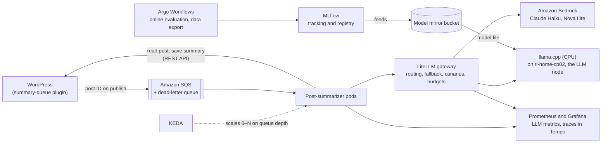
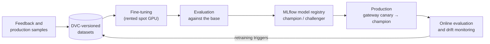

# Phase 2 design: AI post summaries and MLOps

**Phase 2** adds **AI-generated post summaries** to russetleaf.dev, run as an event-driven, monitored and tested LLM service with an MLOps lifecycle: an LLM gateway in front of Amazon Bedrock and a self-hosted model, an evaluation gate in CI, experiment tracking and a model registry, guardrails, online evaluation and drift monitoring, and a feedback loop. It needs Phase 1 and is optional.

- **Build plan:** [`plan.md`](plan.md)
- **Decisions:** this phase's ADRs, in the `adr/` folder and listed in the [overview's index](../overview.md#architecture-decision-records)
- **Builds on:** [Phase 1 design](../phase-1-russetleaf-dev/design.md); shared design in [`../overview.md`](../overview.md)

## What Phase 2 adds to Phase 1

- A fourth repo, **`russetleaf-llm-summarizer`** (prompts, evaluation set, the summarizer service and its chart).
- **`rl-home-cp02` becomes the dedicated LLM node** (label `workload=llm`, taint `dedicated=llm:NoSchedule`) running llama.cpp, with the CI runners next to it.
- AWS resources in russetleaf-home: the **SQS** summary queue and dead-letter queue, **Bedrock** access with a budget, the **model mirror bucket**, and staging equivalents.
- WordPress changes in `russetleaf-wordpress`: the **summary-queue must-use plugin**, the `wordpress_posts_without_summary` metric and its alert, the **AI summary box** in the theme, and the summarizer's application password.
- **Model training:** fine-tuning on a rented spot GPU in AWS, a fine-tuned challenger served at home, and retraining proposed when drift or quality alerts persist ([ADR 2005](adr/2005-fine-tuning-on-a-rented-gpu.md)).
- Platform additions: KEDA, LiteLLM, MLflow, Argo Workflows and kagent (an AI operations assistant), plus the AI rows in Phase 1's shared sections (policies, network rules, Falco rules, tracing, alerts, SLOs, costs); see [AI components in the shared platform](#ai-components-in-the-shared-platform).

## Architecture

### Containers (what Phase 2 adds)



## AI post summaries

### How it works (event-driven)

1. When a post is published or updated, a small **must-use plugin** in the custom WordPress image sends the post ID to an **SQS queue**.
2. **KEDA** watches the queue and scales the **post-summarizer** Deployment from **0 to N pods** based on how many messages are waiting. With nothing to do, no summarizer pods run.
3. The summarizer reads the post through the **WordPress REST API** and sends the text to the **LLM gateway**, which picks a model (see below). The summarizer writes the summary back as the post excerpt or a custom field.
4. Failed messages are retried and, after several attempts, moved to an **SQS dead-letter queue**, which has an alert on it.
5. A daily **CronJob sweep** re-queues any posts still missing a summary, as a backstop.

The summarizer authenticates to WordPress with an **application password** stored in **Secrets Manager** and synced by External Secrets. It reaches SQS through **EKS Pod Identity** (scoped IAM keys at home). **Bedrock model access** must be enabled for each chosen model in the region.

### LLM gateway and model serving

- **LiteLLM** runs in the cluster as the single entry point for all model calls. It gives the summarizer one OpenAI-compatible API, whichever model answers.
- Models behind the gateway:
    - **Amazon Bedrock: Claude Haiku** (default)
    - **Amazon Bedrock: Amazon Nova Lite** (lower-cost alternative)
    - **Self-hosted model** served by **llama.cpp** (OpenAI-compatible server), e.g. a 3B model such as Qwen2.5-3B or Llama 3.2 3B, 4-bit quantized
- The gateway handles:
    - **routing and fallback** (e.g. Bedrock first, the self-hosted model if Bedrock fails or is throttled)
    - **canary splits** for model changes (e.g. send 10% of requests to a new model, then compare quality scores and cost before switching)
    - **rate limits and spending budgets** per app
- The self-hosted model runs on a **dedicated LLM node**, `rl-home-cp02`:
    - The nodes carry the label `workload=llm` and the taint `dedicated=llm:NoSchedule`, so only the model server (plus cluster-wide agents such as node-exporter) runs there.
    - The model server Deployment has a matching **toleration** and **node selector**.
    - Model files are downloaded once by an init container from each site's **model mirror bucket** in S3 (so rebuilds do not depend on Hugging Face) into a volume on the node.
    - The model **stays loaded**, since the node is dedicated to it; KEDA scales only the summarizer.

### Prompt versioning and evaluation in CI

The summarizer is its own repo, `russetleaf-llm-summarizer`, built to stand alone as an MLOps project (see [Repository structure](../overview.md#repository-structure-four-repos)).

- The summarizer prompts and model settings live in `russetleaf-llm-summarizer/prompts/`, with a **version number** that the summarizer records alongside each summary.
- A fixed **evaluation set** of 20–30 sample posts lives in `russetleaf-llm-summarizer/evals/`.
- The gateway's **routing settings** (which models run in production, fallbacks, canary weights) are deployment config, so they live in `russetleaf-gitops`. A routing change there should link to the evaluation report that justifies it.
- On every `russetleaf-llm-summarizer` pull request that changes a prompt, the model list being evaluated, or the summarizer code, a GitHub Actions job:
    - generates summaries for the evaluation set **with each model behind the gateway**
    - scores them with **rule-based checks** (length, required keywords, no made-up links) and an **LLM-as-judge** call that grades how faithful each summary is to its post
    - posts the scores **per model** as a **PR comment**, comparing them with the main branch
    - **fails the check** if quality drops below a set threshold
- The job runs on **self-hosted GitHub Actions runners inside the cluster**, managed by **Actions Runner Controller (ARC)**, so it can reach the gateway and the self-hosted model. Runners are **ephemeral** (a fresh pod per job), and jobs from pull requests opened from forks require manual approval, since the repo is public.
- The same gate runs again on a **release tag**. Only if it passes does CI publish the image and Helm chart, attach the evaluation report to the GitHub release, update `MODEL_CARD.md`, and open a version-bump pull request on `russetleaf-gitops`.
- New code rolls out through the Argo Rollouts canary; new models roll out through the gateway's canary split.

### LLM monitoring

The summarizer reports **OpenTelemetry metrics** to Prometheus, labeled by model and prompt version:

- input and output **tokens**
- **latency** per model call
- **errors**, throttling and **gateway fallbacks**
- estimated **cost per summary** and per day
- **queue depth** and age of the oldest message (from SQS)

Prometheus also collects the gateway's metrics (requests, spend and fallbacks per model) and **llama.cpp's built-in metrics** (tokens per second, requests waiting). A **Grafana dashboard** shows these alongside the WordPress metrics, the LLM node's CPU and memory, and the LLM node's cost from OpenCost. **Alertmanager** alerts on error spikes, messages in the dead-letter queue, the self-hosted model being down, and daily Bedrock spend over a set limit, posting them to `#rl-mlops` (and `#rl-critical` for criticals). The Argo Rollouts canary analysis uses the same metrics.

## MLOps lifecycle

The summary pipeline covers the **whole machine-learning lifecycle**, not just inference: **data → training → evaluation → registry → deployment → monitoring → retraining**. The reasoning is recorded in [ADR 2001](adr/2001-mlops-lifecycle.md).



### Experiment tracking and model registry (MLflow)

- **MLflow** runs on the home cluster (on `rl-home-cp03`), with its metadata in MariaDB and its artifacts in an S3 bucket.
- **Every evaluation run is an MLflow run:** the CI evaluation gate, the online evaluation and every fine-tuning run log their **parameters** (Git commit, prompt version, model and its registry version, dataset version), **metrics** (rule-check pass rate, judge scores, latency, cost per summary) and **artifacts** (reports, sample outputs).
- **Registered models**, with lineage back to the runs that produced them:
    - `summarizer-config`: the prompt, model choice and generation settings as one versioned unit
    - `local-summarizer`: the self-hosted model's file (base or fine-tuned, in llama.cpp's GGUF format)
- **Aliases** mark the roles: `champion` (production) and `challenger` (in the gateway canary). Promotion is a reviewed change: the pipeline proposes it, a pull request on `russetleaf-gitops` changes the gateway's routing to the registered version, and the MLflow alias is updated when it merges.
- The model mirror bucket keeps serving files to llama.cpp; it is fed **from the registry**, so every file in use has a registry entry.

### Guardrails

Post content is untrusted input, so the summarizer treats it as data:

- **Prompt-injection defences:** post text is clearly delimited and labeled as content to summarize, never instructions; the system prompt says so and is never echoed back.
- **Output validation** before anything is saved: length limits, plain text only, no URLs, no instructions or role-play, no text from the system prompt; a failing summary is retried once and then left unsaved with an alert.
- **Personal-data redaction:** email addresses, phone numbers and similar patterns are removed from post text before it leaves the cluster for Bedrock.
- **Adversarial evaluation cases:** the evaluation set includes posts containing injection attempts and personal data; the CI gate fails if any guardrail is bypassed.
- Guardrail outcomes (blocked, retried, redacted) are metrics in Prometheus, with an alert on unusual spikes.

### Online evaluation and drift monitoring

- A **daily job** (Argo Workflows at home) samples a few percent of the day's new summaries, scores them with the same rule checks and judge as the CI gate, and logs the results to **MLflow** and to **Prometheus**.
- It also tracks **input drift**: post length, language and topic distribution compared with the evaluation set.
- **Grafana** shows quality and drift trends per model and prompt version; **Alertmanager** sends `SummaryQualityDegraded` and `InputDriftDetected` to `#rl-mlops`.
- A sustained drop starts the response: compare the champion and challenger in the evaluation set, roll back routing ([ADR 1016](../phase-1-russetleaf-dev/adr/1016-rollback-strategy.md)), or trigger retraining.

### Fine-tuning pipeline (distillation)

- **Goal:** improve the small self-hosted model by **fine-tuning** it (LoRA) on high-quality example summaries, then compare it with the base model ([ADR 2005](adr/2005-fine-tuning-on-a-rented-gpu.md)).
- **Where it runs:** the home lab has no GPU, so each run uses **one rented spot GPU instance** in the russetleaf-home account, started from a Terraform-managed launch template by the `train` workflow and terminated when the run ends (a few dollars per run). Its instance profile can only read the training data and write to the MLflow artifact bucket.
- **Training data:** curated summaries from the feedback loop and the evaluation set, plus summaries from a stronger **teacher** model. **Check the teacher's terms first:** some model providers' terms restrict using their outputs to train other models. An **open-weights teacher** avoids the question.
- **The pipeline** (`russetleaf-llm-summarizer/training/`, one container): fetch the versioned dataset (DVC) → fine-tune (LoRA) → **evaluate against the base model** on the evaluation set (including the adversarial cases) → convert to GGUF → **register** in MLflow as a `local-summarizer` version with its scores → if it beats the champion, propose it as the **challenger**.
- **Deployment:** the challenger enters the gateway **canary** at home; online evaluation compares it with the champion; promotion to champion is a reviewed pull request.
- **Drift-triggered retraining:** sustained drift or quality alerts (drift reports from **Evidently**), or enough new feedback, open a **retraining pull request** with the report and the proposed dataset version; merging it starts a training run. A person always decides.

### Data versioning and feedback

- **DVC** versions the evaluation set, the adversarial cases and the training sets, with an S3 remote; MLflow runs record the dataset version they used, so every result can be traced back to its exact data.
- **Feedback loop:** a small must-use plugin adds an **editor-only rating** (helpful / not helpful, with an optional note) to each summary in the WordPress admin, stored as post metadata. A nightly job exports ratings (with the summary's model and prompt version) to the DVC-tracked dataset; poor-rated summaries become new evaluation cases, and good ones become training candidates.

### Cost

MLflow, Argo Workflows and the online-evaluation job run on the home cluster (`rl-home-cp03` has the memory); the extra Bedrock calls for daily judging cost cents a month; each fine-tuning run costs **a few dollars** of spot GPU time on EKS. Each fine-tuning run costs a few dollars of spot GPU time.

### Rolling back bad AI summaries

Rolling back a prompt or model does not fix summaries already saved. Each summary is stored with its **prompt version and model** (as post metadata), so a **re-summarize job** in `russetleaf-llm-summarizer` can find every post summarized by a bad version and **re-queue** it through SQS, regenerating the summaries with the restored version.

## Repository: `russetleaf-llm-summarizer`

### `russetleaf-llm-summarizer`: the standalone MLOps project

```
russetleaf-llm-summarizer/
  src/                      # SQS consumer, content source/sink adapters, OpenAI-compatible model client,
                            #   OpenTelemetry metrics
    adapters/wordpress/     # WordPress REST API adapter (the first of possibly several)
  prompts/                  # versioned prompts + model settings (the version is recorded with each summary)
  guardrails/               # input delimiting, personal-data redaction, output validation
  data/                     # DVC-tracked datasets (evaluation, adversarial cases, training, feedback exports)
  training/                 # fine-tuning (LoRA distillation) container: data → train → evaluate → register; runs on a rented spot GPU
                            #   vs base → GGUF → register in MLflow
  online-eval/              # daily sampled scoring of production summaries + input-drift checks
  evals/
    dataset/                # 20–30 sample posts + reference notes
    scorers/                # rule-based checks + LLM-as-judge prompt
    reports/                # saved results per release, compared across models
  chart/                    # Helm chart: Rollout, KEDA ScaledObject, sweep CronJob, ServiceAccount,
                            #   PrometheusRule alerts, Grafana dashboard ConfigMap
  docker/                   # Dockerfile (multi-stage, distroless or slim runtime base)
  demo/                     # docker compose: sample posts + local model or Bedrock, no Kubernetes needed
  ci/                       # kind config, ci chart values (LocalStack SQS, mock LLM), end-to-end tests
  MODEL_CARD.md             # models evaluated (including fine-tuned versions), scores, cost per summary, known
                            #   limitations, guardrails, links to MLflow runs and registry versions
  dvc.yaml, .dvc/           # data pipeline stages and the S3 remote
  .github/workflows/        # ruff, mypy, Semgrep, pip-audit, dependency review, hadolint, Checkov, zizmor, helm/ct
                            #   lint, unit tests, container-structure-test, Trivy, kind end-to-end tests (mock LLM),
                            #   evaluation gate (on ARC runners); weekly OpenSSF Scorecard;
                            #   on release: gate again, build image and chart, SBOM, scan, sign + attest SBOM and
                            #   SLSA provenance, verify, publish (release notes with digests and Rekor links),
                            #   open a chart-bump pull request on russetleaf-gitops (staging overlay)
```

Design choices that make it stand on its own:

- **Clear interfaces:** jobs come in from a queue (`{"post_id": ...}`), content is read and written through an **adapter** (WordPress is the first), and models are reached through any **OpenAI-compatible endpoint**. LiteLLM (and Bedrock through it) and llama.cpp both qualify, so the summarizer has no hard dependency on any one provider.
- **Its own Helm chart**, published to an OCI registry with the same version as the image. `russetleaf-gitops` only supplies values (queue URL, gateway URL, scaling limits, IAM role). The chart also ships the summarizer's alerts and Grafana dashboard, so whoever deploys it gets monitoring too.
- **Releases gated on quality:** a release tag runs the evaluation gate first; only a passing release is published, with its evaluation report attached to the GitHub release.
- **Model card:** reviewers see which models were compared (Claude Haiku, Nova Lite and the self-hosted model), the scores, the cost per summary and known limitations, without running anything.
- **Local demo:** `docker compose up` runs it against sample posts, so anyone can try it in minutes.
- **Self-hosted runners:** the evaluation gate runs on ARC runners in the home cluster, registered to this repo, because it needs to reach the gateway and the self-hosted model. Runners are ephemeral, and jobs from fork pull requests need manual approval.

### Where each AI component lives

| AI component | Repo |
|---|---|
| Summarizer code, prompts, guardrails, evaluation set and gate, online evaluation, fine-tuning pipeline, DVC datasets, model card, Helm chart, dashboard and alerts | `russetleaf-llm-summarizer` |
| MLflow, Argo Workflows | `russetleaf-gitops` (platform) |
| Summary feedback plugin | `russetleaf-wordpress` |
| Summarizer deployment settings per environment (queue URL, gateway URL, scaling, chart version) | `russetleaf-gitops` |
| LiteLLM gateway and its routing config (models, fallbacks, canary weights, budgets) | `russetleaf-gitops` |
| Self-hosted model server (llama.cpp Deployment, tolerations, home overlay) | `russetleaf-gitops` |
| `rl-home-cp02`'s Talos label and taint | `russetleaf-infra` |
| Bedrock model access, gateway IAM role, SQS queues, Bedrock budget alert | `russetleaf-infra` |
| SQS must-use plugin that queues posts | `russetleaf-wordpress` |

The self-hosted model is not a special case: its deployment is ordinary platform config in `russetleaf-gitops`, on a dedicated node defined in `russetleaf-infra`, and its quality is judged in `russetleaf-llm-summarizer` alongside the Bedrock models.

## AI operations assistant (kagent)

Alongside the agents that help build the project ([ADR 2004](adr/2004-agentic-ai-delivery.md)), Phase 2 runs one agent that helps **operate** it ([ADR 2006](adr/2006-ai-operations-assistant.md)):

- **kagent** in the home cluster, with read-only tools for Kubernetes, Prometheus, Loki, Argo CD and Cilium.
- Its model calls go through the **LiteLLM gateway**, with its own key, budget and rate limits, so its cost appears on the LLM dashboards.
- When an important alert fires, it investigates and posts a **triage note** in the alert's Slack thread: likely cause, evidence and suggested next steps from the runbook. It never changes anything; the operator decides.
- Its diagnoses are checked against a small set of **incident scenarios** in staging, like the summarizer's evaluation gate.
- **Diagnosis with the project's own knowledge** ([ADR 2007](adr/2007-ai-diagnosis-and-remediation-proposals.md)): the docs, runbooks, postmortems and code are indexed (pgvector) so a diagnosis agent can cite the runbook and decisions behind its reasoning.
- **Fixes as pull requests:** when the runbook's fix is a Git change, a remediation agent opens an `ai-proposed` pull request with the evidence and how to undo it; the operator reviews and merges, Argo CD applies it, and a verification agent confirms the alert cleared. A CI check stops these pull requests from touching sensitive paths (RBAC, policies, secrets). Direct actions after approval in Slack are a possible later extension, not part of this design.

## AI components in the shared platform

These parts of Phase 1's shared platform sections exist only once the AI pipeline is added.

### Sandboxed runtimes (gVisor)

| Workload | gVisor? | Why |
|---|---|---|
| llama.cpp | Optional | Parses downloaded model files; CPU-only at home (gVisor's GPU support is limited) |

### Process allow-listing

| Workload | Expected processes | Anything else |
|---|---|---|
| Post-summarizer | `python` | Alert |
| LiteLLM gateway | `python` (LiteLLM) | Alert |
| llama.cpp | the `llama-server` binary (and the init container's download step) | Alert |

### Checkov

| Repo | What Checkov scans |
|---|---|
| `russetleaf-llm-summarizer` | The **Dockerfile**, the summarizer **Helm chart** |

### Runtime security and compliance scanning

    - **unexpected outbound connections** from the LLM nodes, which should only download model files (the CiliumNetworkPolicies also block these; Falco detects any attempt)

### Network policies

| Workload | Allowed inbound | Allowed outbound |
|---|---|---|
| Summarizer | Prometheus | WordPress REST API (layer 7: `GET`/`POST` on `/wp-json/*` only), the LiteLLM gateway, `sqs.<region>.amazonaws.com` |
| LiteLLM gateway | Summarizer, staging summarizer, ARC runners (evaluation), Prometheus | llama.cpp, `bedrock-runtime.<region>.amazonaws.com` |
| llama.cpp (LLM nodes) | LiteLLM gateway, Prometheus | The model mirror bucket's S3 endpoint only (init container); nothing else |

### Site design

- **Feature the AI summaries:** a styled "AI summary" box at the top of each post, with the model and prompt version in small print, so visitors see the MLOps work.

### WordPress metrics

| Metric | Meaning | Used for |
|---|---|---|
| `wordpress_posts_without_summary` | Published posts still missing an AI summary | The best end-to-end check that the summarizer pipeline works; alert if above zero for an hour |

### Log-based alerts

| Alert | Fires when | Goes to |
|---|---|---|
| `SummarizerExceptions` | The summarizer logs repeated unhandled exceptions | `#rl-mlops` |
| `BedrockThrottling` | The gateway logs Bedrock throttling or quota errors | `#rl-mlops` |

### Tracing

| Component | How it is instrumented | Spans it produces |
|---|---|---|
| **summary-queue must-use plugin** (custom) | Adds the current trace context (the W3C `traceparent` value) to each SQS message as a **message attribute** | The "queue summary" span |
| **Post-summarizer** | OpenTelemetry's **Python SDK** with auto-instrumentation for boto3 and HTTP clients; reads `traceparent` from each SQS message and continues the trace | Receiving the message, reading the post, the gateway call, saving the summary |
| **LiteLLM gateway** | LiteLLM's built-in **OpenTelemetry** support | Routing, fallback, and the model call, with attributes for the model used, tokens and latency |
| **Model calls** | Covered by the gateway's spans (Bedrock and llama.cpp are not instrumented themselves) | — |

One trace then shows: a post is published → queued → picked up by the summarizer (possibly minutes later) → sent through the gateway → answered by a specific model → summary saved. Because the queue makes the pipeline asynchronous, the summarizer's spans are linked to the publish trace through the message's trace context.

### Slack channels

| Channel | What goes there | Sources |
|---|---|---|
| `#rl-mlops` | Evaluation gate results, summarizer releases, Bedrock spend, dead-letter queue, model server down | GitHub, Alertmanager |

### ci tests

    - Summarizer: a queued post gets a (mock) summary written back to WordPress; a failing message ends up in the dead-letter queue

### Performance tests

| Test | Load profile | Where | What it shows |
|---|---|---|---|
| **AI pipeline burst** | 200–500 posts queued at once | Home staging | KEDA scale-out limits, Bedrock throttling and gateway fallback to llama.cpp, dead-letter-queue behavior, time to drain the queue, cost per burst |

### Cost alerts

| Alert | Source | Fires when |
|---|---|---|
| Bedrock spend | **AWS Budgets** (Bedrock filter) and the gateway's daily-spend metric | Bedrock spending passes its limit |

### Updates

| Layer | How updates arrive | How they are tested and rolled out | Cadence |
|---|---|---|---|
| **Summarizer dependencies** (Python) | Renovate (lock file) | Unit and kind tests, the **evaluation gate**, staging, promotion | Weekly |
| **Models** (Bedrock models, llama.cpp, the local model file) | AWS's **Bedrock model deprecation notices**; llama.cpp image via Renovate | **Evaluation gate** first, then a gateway **canary split**, then a routing change citing the evaluation report | When a new version appears or a deprecation date nears |

### Rollback

| Layer | Trigger | Mechanism | Started by | Expected time |
|---|---|---|---|---|
| **Models** (gateway routing) | Quality or cost problems in the canary or after a switch | **Git revert** of the routing weights in `platform/llm-gateway/`; then **re-summarize** affected posts (below) | Operator | Minutes, plus re-summarizing |

### Model placement on `rl-home-cp02`

**Protecting etcd:** etcd is sensitive to CPU starvation and disk latency. llama.cpp on `rl-home-cp02` gets a **CPU limit that leaves about one core free**, every node sets Talos's **system and kubelet reservations**, and every node uses an NVMe or SSD disk.

**The model:** `rl-home-cp02` has about **5–5.5 GB** free for the model once its control-plane components are running. A **3B model** (4-bit) is the best fit: about 2.5–3.5 GB of RAM, and roughly a minute per summary on its 4-core i5-6500T (measured in step 3.1). That is fine for a queue handling 10–20 posts a month. A 7–8B model would be tight on `rl-home-cp02`; moving the model to `rl-home-cp03` (6 cores, more memory) is a possible later experiment.

### SLOs

| Service | SLI | SLO (28-day window) |
|---|---|---|
| AI summaries | Posts summarized within 15 minutes of publishing (**freshness**) | 99% |
| AI summaries | Daily online-evaluation pass rate (quality) | 95% |

### Running costs

| Component | russetleaf.dev (home, 24/7) | russetleaf.com (AWS, Terraform in GitHub) | Est. monthly cost (USD) |
|---|---|---|---|
| AI post summaries | **Real SQS** + KEDA-scaled summarizer | — (not on russetleaf.com) | <$1 |
| LLM gateway | LiteLLM in-cluster, routing to **real Amazon Bedrock** and the self-hosted model | — (not on russetleaf.com) | ~$1–$2 (Bedrock tokens) |
| Self-hosted model | llama.cpp (CPU build) on `rl-home-cp02`, CPU-limited to protect etcd | — (not on russetleaf.com) | ~$2–$4 (electricity for `rl-home-cp02`) |
| Prompt evaluation | GitHub Actions on ARC runners in the cluster | — (not on russetleaf.com) | (included above) |
| MLOps lifecycle | MLflow, Argo Workflows, online evaluation with Evidently, feedback, DVC (home cluster); fine-tuning on a rented spot GPU | — (not on russetleaf.com) | ~$0 always on; a few $ per fine-tuning run |
