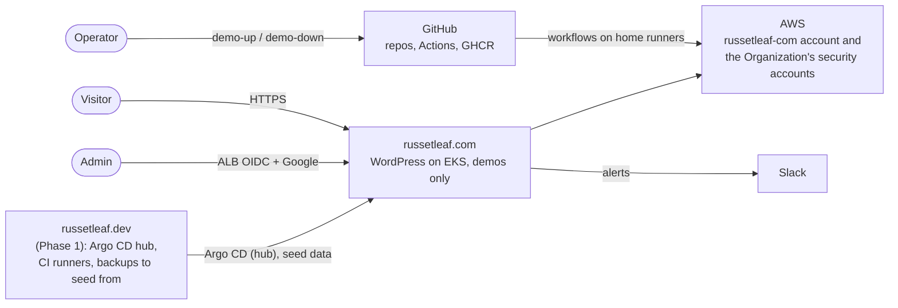
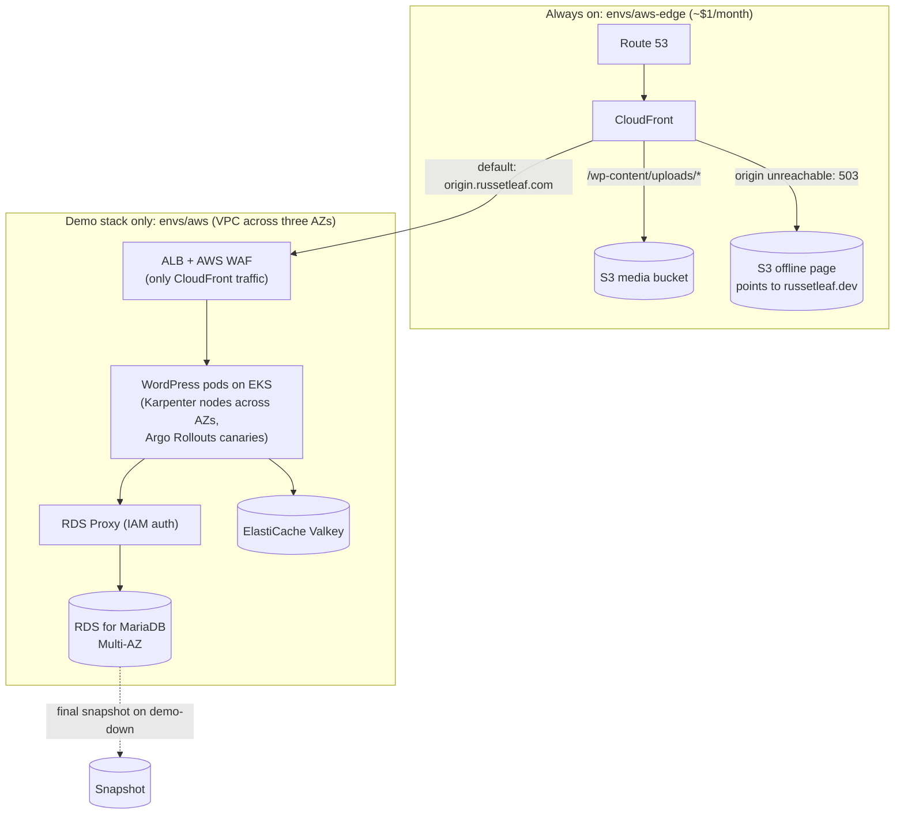
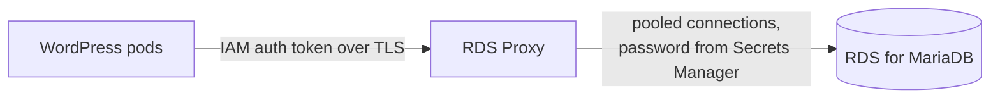

# Phase 3 design: russetleaf.com on EKS

**Phase 3** builds **russetleaf.com**: the same WordPress site on the full AWS production design (EKS with Karpenter, RDS for MariaDB behind RDS Proxy with IAM authentication, ElastiCache, CloudFront, ALB and AWS WAF), brought up only for demos, with an always-on CloudFront edge that shows an offline page the rest of the time. It needs Phase 1 and is optional. It is **independent of Phase 2**: russetleaf.com runs WordPress only. Posts seeded from russetleaf.dev keep the AI summaries Phase 2 generated there, but russetleaf.com generates none of its own, and the WordPress image's summary-queue plugin does nothing when no queue is configured.

- **Build plan:** [`plan.md`](plan.md)
- **Decisions:** this phase's ADRs, in the `adr/` folder and listed in the [overview's index](../overview.md#architecture-decision-records)
- **Builds on:** [Phase 1 design](../phase-1-russetleaf-dev/design.md) (and, optionally, [Phase 2](../phase-2-ai-mlops/design.md)); how the two sites compare is in the [overview](../overview.md#the-two-sites)

## Architecture

Diagrams follow the [C4 model](https://c4model.com/): system context, then containers.

### System context



### Containers



## Production design on AWS

### High availability

- **RDS for MariaDB** with **Multi-AZ** turned on. (Aurora does not offer MariaDB; if the site outgrew RDS, Aurora MySQL would be the next step, at the cost of switching engines.) **RDS Proxy** in front of it keeps failovers to seconds.
- At least **2–3 WordPress replicas** spread across availability zones, plus a **HorizontalPodAutoscaler** and **PodDisruptionBudgets**.
- EKS worker nodes in **multiple AZs**, provisioned by **Karpenter** (see Delivery and operations).
- **What this project actually runs:** this design is highly available within one region **while the demo runs**, with one deliberate demo cut (one NAT Gateway instead of three). The home lab, with three control-plane nodes, replicated MariaDB and spread workloads, **survives any single node failure**, but its home power supply and internet connection remain single points of failure ([ADR 1020](../phase-1-russetleaf-dev/adr/1020-three-node-ha-home-cluster.md)). Both are explained, with recovery targets and the changes (and costs) that would add HA, in [ADR 1014](../phase-1-russetleaf-dev/adr/1014-availability-levels.md).

### Traffic and edge

- **Application Load Balancer** through the AWS Load Balancer Controller, with **TLS certificates from ACM**. Its DNS name (`origin.russetleaf.com`) is managed by **ExternalDNS**.
- **CloudFront** in front of both the site and the S3 media. In this project CloudFront is **always on** (it costs almost nothing idle), so it can show an offline page when the demo stack is down; see [russetleaf.com between demos](#russetleafcom-between-demos).
- **The ALB accepts only CloudFront traffic:** its security group allows only AWS's CloudFront origin-facing IP list, and a listener rule requires a secret header that CloudFront adds to every request.
- **DNSSEC** on both domains: Cloudflare's one-click DNSSEC for russetleaf.dev, and Route 53 DNSSEC signing (with a KMS key, about $1/month) for russetleaf.com, with the DS records added at each registrar.
- **AWS WAF** on the ALB. A 24/7 production site would usually put WAF on CloudFront instead; here it sits on the ALB so it exists (and costs money) only during demos.

## Database access on AWS

### russetleaf.com: IAM authentication through RDS Proxy



- **WordPress has no database password.** On each new connection, a small **`db.php` drop-in** in the WordPress image creates a short-lived **IAM auth token** (valid 15 minutes) with the AWS SDK for PHP, using WordPress's **Pod Identity** role, and sends it in place of a password over **TLS**. Creating the token is a local signing step, not an AWS API call, and the drop-in reuses a token for several minutes.
- **The IAM check happens at RDS Proxy.** The proxy is set to `iam_auth = REQUIRED` and `require_tls = true`. WordPress's role is allowed `rds-db:connect` on the proxy's `wordpress` user only.
- **Behind the proxy, an ordinary database user.** The proxy logs in to RDS as `wordpress` with a password that Terraform generates and stores in **Secrets Manager**. Only the proxy's own IAM role can read it; no pod, person or Git repo ever holds it. It can be rotated automatically with Secrets Manager's rotation for MariaDB (the proxy picks up the new value).
- **Why a proxy, not IAM straight to RDS:** WordPress opens a new database connection on almost every page request. AWS recommends direct IAM database authentication only for apps making fewer than about 200 new connections per second, and each IAM-checked connection costs a little extra time. RDS Proxy keeps a pool of connections open to the database, so WordPress's connection churn hits the proxy, not the database. It also hides Multi-AZ failovers from WordPress: a failover takes seconds instead of waiting for DNS to change.
- **The master (admin) user:** `manage_master_user_password = true`, so **RDS generates the master password, stores it in Secrets Manager and rotates it**. Nobody chooses or sees it. It is used only by the one-off database setup Job (below) and for break-glass admin work.
- **Creating the `wordpress` user:** the RDS instance is in private subnets, so Terraform (running in GitHub Actions) cannot reach it. A small, idempotent **`db-setup` Job** in `overlays/aws` (an Argo CD PreSync hook) reads the master secret and the `wordpress` secret, then runs `CREATE USER IF NOT EXISTS` and `GRANT ... ON wordpress.*`. Because the user lives in the database, it survives demo teardowns in the final snapshot; the Job only does real work on the very first demo.
- **The seed Job** (seeding russetleaf.com from russetleaf.dev) connects the same way as WordPress: IAM token through the proxy, with `rds-db:connect` on its own Pod Identity role.

### Risk: confirm IAM tokens work from PHP first (with a fallback)

The one uncertain part of this design is whether **PHP's MariaDB client (mysqlnd)** can send an IAM auth token to RDS Proxy. The token is sent as a clear-text password over TLS, which some clients only allow with extra settings. This is checked by a **short, early test** (Phase 3 step 1.6) before any IAM-specific code is relied on: a small test pod with the WordPress image logs in to the proxy with a token. Until that test passes, the home lab builds only the `password` mode of the `db.php` drop-in.

**If the test fails, the fallback is password login to RDS Proxy with an automatically rotated secret.** It keeps almost every benefit:

| | IAM tokens (preferred) | Fallback: rotated password to the proxy |
|---|---|---|
| App credential | None; a 15-minute token signed by the Pod Identity role | A password, **generated by Secrets Manager**, never seen by a person |
| Proxy auth setting | `iam_auth = REQUIRED` | `iam_auth = DISABLED` (password checked by the proxy) |
| How WordPress gets it | Signs a token itself | **External Secrets** syncs the secret into a Kubernetes Secret |
| Rotation | Not needed (tokens expire) | **Secrets Manager automatic rotation** (e.g. every 30 days), using the **alternating-users** strategy: two database users (`wordpress_a`, `wordpress_b`), so the previous credentials keep working until the next rotation and nothing breaks mid-rotation |
| Picking up a new password | n/a | External Secrets refreshes the Secret; **Reloader** (or an Argo Rollouts restart) restarts WordPress so new pods use it |
| Connection pooling, fast failover, TLS | Yes | Yes (still through RDS Proxy) |
| Chart setting | `database.auth: iam` | `database.auth: password` (the same mode the home lab uses) |

Switching between the two is an **overlay change** in `russetleaf-gitops` (`database.auth` and the credential source) plus the proxy's auth setting in `russetleaf-infra`; the WordPress image supports both.

- **Cost:** RDS Proxy is billed per vCPU of the database instance, about $0.015 per vCPU-hour: roughly **$0.03/hour** for a db.t4g.medium (pennies per demo; about $22/month if it ran 24/7).

### How it fits the repos

| Repo | What changes |
|---|---|
| `russetleaf-wordpress` | The `db.php` drop-in (IAM token mode) and a chart setting **`database.auth: password | iam`** (default `password`), plus the RDS CA certificate bundle for TLS |
| `russetleaf-infra` | russetleaf.com: RDS Proxy (IAM required, TLS required), the `wordpress` secret and the proxy's role to read it, `manage_master_user_password`, `rds-db:connect` on the WordPress and seed-Job roles |
| `russetleaf-gitops` `overlays/aws` | `database.auth: iam`, the proxy endpoint, the `db-setup` PreSync Job, CiliumNetworkPolicy allowing WordPress → the proxy endpoint (by DNS name) |
| `russetleaf-gitops` `overlays/home`, `overlays/home-staging` | `database.auth: password`, pointing at the MariaDB Operator-generated Secret |
| `russetleaf-gitops` `base/` | Unchanged, except that **no database credential source lives in the base**: each overlay supplies its own |

The WordPress Rollout, Service, HPA and the rest of the base are the same for both sites; only where the credential comes from differs, which is exactly what overlays are for. A `russetleaf-wordpress` release adding the drop-in goes through ci → staging → prod like any other.

**In short:** in the cloud, the database trusts **IAM identities**, so the application has no secret at all; self-hosted, not every secret can be removed, so the design **minimizes, generates, isolates and rotates** them.

## Demo operations

### Demo noise control (russetleaf.com)

- `demo-down` creates an Alertmanager **silence** for russetleaf.com before tearing anything down, then posts "russetleaf.com demo stopped" to `#rl-com-alerts`.
- `demo-up` posts "russetleaf.com demo started" once the site returns 200. CloudWatch alarms are created with the demo stack and deleted with it.

## Example Helm values (outline)

These are illustrative russetleaf.com (AWS overlay) values for the project's own WordPress chart; the exact keys are defined when the chart is written. The russetleaf.dev overlay differs only in the site-specific settings: its domain, the in-cluster MariaDB and Valkey hosts, ingress-nginx instead of the ALB, its own bucket, queue and email settings, scoped keys instead of Pod Identity, and the Prometheus-based canary analysis.

```yaml
image:
  repository: ghcr.io/<github-user>/russetleaf-wordpress
  tag: "1.0.0"                     # bumped by the russetleaf-wordpress release bot

site:
  url: https://russetleaf.com      # sets WP_HOME and WP_SITEURL

replicas: 3
autoscaling:
  enabled: true
  minReplicas: 3
  maxReplicas: 10
podDisruptionBudget:
  minAvailable: 2
topologySpread: zone               # spread pods across availability zones

database:
  auth: iam                        # home overlays: password (Secret generated by MariaDB Operator)
  host: <proxy-name>.proxy-<id>.us-east-1.rds.amazonaws.com   # RDS Proxy endpoint
  port: 3306
  name: wordpress
  user: wordpress
  region: us-east-1                # for signing the IAM auth token
  tls: true
  caBundle: /etc/ssl/rds/global-bundle.pem   # RDS CA certificates, built into the image

cache:
  host: <valkey-endpoint>
  tls: true
  existingSecret: valkey-auth

media:
  bucket: russetleaf-com-media
  cdnDomain: russetleaf.com        # media served through CloudFront

email:
  smtpSecret: ses-smtp             # Amazon SES SMTP credentials

serviceAccount:
  create: true                     # AWS access (S3, SQS, SES) via EKS Pod Identity; no annotation needed

resources:                         # requests + memory limit required by Kyverno (no CPU limit, by design)
  requests:
    cpu: 250m
    memory: 256Mi
  limits:
    memory: 512Mi

wpCron:
  enabled: true                    # WP-Cron as a Kubernetes CronJob
  schedule: "*/5 * * * *"

ingress:
  className: alb
  host: origin.russetleaf.com      # CloudFront's origin; visitors use russetleaf.com
  annotations:
    alb.ingress.kubernetes.io/scheme: internet-facing
    alb.ingress.kubernetes.io/target-type: ip
    alb.ingress.kubernetes.io/listen-ports: '[{"HTTPS":443}]'
    alb.ingress.kubernetes.io/wafv2-acl-arn: <waf-web-acl-arn>
    external-dns.alpha.kubernetes.io/hostname: origin.russetleaf.com

rollout:
  canarySteps: [20, 50, 100]
  analysisTemplate: cloudwatch-alb # home overlay: prometheus-ingress-nginx

extraConfig: |
  define('DISALLOW_FILE_MODS', true);
  define('DISABLE_WP_CRON', true);
```

## Estimated monthly AWS costs

These are approximate prices for **us-east-1**, on demand unless noted, for a small-to-medium production site (roughly 1 TB/month of CDN traffic). Prices change over time, so confirm with the [AWS Pricing Calculator](https://calculator.aws/) before budgeting.

| Item | Assumed sizing | Est. monthly cost (USD) |
|---|---|---|
| EKS control plane | 1 cluster ($0.10/hr) | ~$73 |
| EKS worker nodes (EC2) | Karpenter general pool, ~3 × t3.medium equivalent across AZs (spot can lower this), plus a small managed node group for Karpenter | ~$91–$120 |
| EBS for worker nodes | 3 × 20 GB gp3 | ~$5 |
| RDS for MariaDB | db.t4g.medium, Multi-AZ (same price as RDS for MySQL) | ~$95 |
| RDS storage | 50 GB gp3, Multi-AZ | ~$12 |
| RDS Proxy | 2 vCPUs (db.t4g.medium) × ~$0.015/vCPU-hour | ~$22 |
| ElastiCache Valkey | 2 × cache.t4g.small (primary + replica) | ~$37 |
| Application Load Balancer | 1 ALB + light LCU usage | ~$22 |
| NAT Gateways | 3 (one per AZ) + light data processing; demos use 1 to save cost | ~$100 |
| Public IPv4 addresses | ~6 (ALB + NAT), $0.005/hr each | ~$22 |
| CloudFront | ~1 TB out / 10M requests (free tier or flat-rate plan) | $0–$15 |
| AWS WAF | 1 web ACL + a few managed rules | ~$10 |
| S3 (media) | ~50 GB + requests, versioning on | ~$2 |
| Secrets Manager | ~5 secrets | ~$2 |
| Container images | GHCR (free for public images); optional ECR pull-through cache | $0–$1 |
| CloudWatch (logs + Container Insights) | moderate log volume | ~$20 |
| Route 53 | 1 hosted zone + queries | ~$1 |
| ACM certificates | public certificates | $0 |
| SES | low email volume ($0.10 per 1,000) | <$1 |
| Amazon SQS + EventBridge | Karpenter's interruption queue (within free tiers) | <$1 |
| Argo Rollouts, Kyverno, Falco, Trivy Operator, OpenCost, Karpenter, Prometheus/Grafana | run on the existing worker nodes | $0 |
| kube-bench | One Job per node pool, every demo (in `demo-up`) | $0 |
| Loki log storage (S3) | 14-day retention, demo-hours volume | <$1 |
| Tempo trace storage (S3) | 7-day retention, demo-hours volume | <$1 |
| CloudTrail + GuardDuty | Organization trail (management events); GuardDuty incl. EKS audit-log monitoring | ~$1–5 |
| Security Hub + Config + KMS | Organization-wide standards; focused Config recording; KMS keys for logs and backups | ~$5–15 |
| Alerting (SNS, Amazon Q Developer in chat applications, Slack free plan) | CloudWatch alarms and budget alerts to Slack | $0 |
| **Total** | | **~$505–$555 / month** |

GuardDuty EKS Runtime Monitoring, if used instead of Falco, is billed per vCPU monitored and would add roughly $10–$20/month at this size. New AWS accounts usually have a **GPU instance quota of 0**, so request a quota increase for G-family instances (both on-demand and spot) before the first deploy.

## russetleaf.com between demos

### Requirement

When the EKS demo stack is not running, **russetleaf.com must still answer** with a simple static page, served by CloudFront, that says the AWS demo is offline and links visitors to **russetleaf.dev**. It must switch to the offline page **automatically** when the stack is destroyed, and back to the live site automatically when the stack comes up, with no manual DNS changes.

### Mechanism: an always-on CloudFront edge with error fallback (recommended)

Split the AWS Terraform into two root modules in `russetleaf-infra`:

- **`envs/aws-edge` (always on, ~$1/month):** the Route 53 hosted zone for russetleaf.com, ACM certificates, the CloudFront distribution, the S3 bucket holding the offline page, the russetleaf.com **media bucket**, the **model mirror bucket**, and the secret header value CloudFront sends to the ALB.
- **`envs/aws` (demo stack):** everything else (VPC, EKS, Karpenter, RDS, ElastiCache, WAF, SQS, ...). The ALB itself is created by the AWS Load Balancer Controller from the WordPress Ingress, and **ExternalDNS** creates the `origin.russetleaf.com` record pointing at it.

The CloudFront distribution is set up like this:

| Setting | Value |
|---|---|
| Default behavior (`*`) | Origin `origin.russetleaf.com` (the ALB), HTTPS only, all HTTP methods |
| `/wp-content/uploads/*` | Origin: the russetleaf.com media bucket (Origin Access Control) |
| `/offline/*` | Origin: the offline-page bucket (Origin Access Control) |
| Custom error responses | **502, 503, 504 → `/offline/index.html`**, returned with status **503** |
| Error caching (minimum TTL) | **10 seconds**, so the live site returns quickly once the demo is up |
| Origin connection timeout / attempts | **2 seconds / 1 attempt**, so the offline page appears in a few seconds instead of ~30 |
| Origin custom header | `X-Origin-Verify: <secret>` (checked by the ALB listener rule) |

How the switch works:

1. **Demo stack down:** `origin.russetleaf.com` does not exist, so CloudFront cannot reach the origin and gets a 502. The custom error response serves the offline page instead. Visitors see "The AWS demo of this site is offline. Visit russetleaf.dev to see the live site."
2. **Demo stack up:** Argo CD deploys WordPress, the Load Balancer Controller creates the ALB, and ExternalDNS creates `origin.russetleaf.com`. Within a minute or so (the DNS record's TTL plus the 10-second error cache), CloudFront reaches the origin and serves the live site.
3. **Demo stack torn down:** removing the Argo CD Applications deletes the Ingress, so the ALB is removed and ExternalDNS deletes the DNS record (run ExternalDNS with `--policy=sync` so it removes records it created). CloudFront falls back to the offline page again.

Returning **503** (rather than 200) tells search engines the site is temporarily unavailable, so they do not index the offline page as the site's content. If the live site is ever broken during a demo (the ALB returns 5xx), visitors see the same offline page rather than an error.

This also works for any HTTP method (logins and form posts get the offline page too), and needs no health checks or DNS changes outside Kubernetes.

**Alternative: Route 53 failover routing.** A primary record pointing at the demo stack with a Route 53 health check, and a secondary record pointing at the offline page. It works, but it is a worse fit here: the primary record would point at resources that are deleted after every demo, health checks add cost (about $0.50–$2/month each), and DNS caching slows the switch. The CloudFront approach needs neither.

### Keeping russetleaf.com content between demos

Each demo creates a new RDS instance, so content needs a plan:

- **Final snapshot on destroy (recommended):** set `skip_final_snapshot = false` on the RDS instance, and have the next `terraform apply` restore from the most recent snapshot. Posts, summaries and settings carry over. Snapshot storage costs a few cents a month for a site this size.
- **Media is never lost:** the russetleaf.com media bucket lives in `envs/aws-edge`, so uploads survive between demos.
- **Optional: seed from russetleaf.dev.** For the first demo, or to refresh russetleaf.com with the live site's content, run the **seed Job** (`russetleaf-gitops/apps/seed-from-dev/`, an Argo CD Application set to manual sync, AWS only). It:
    1. downloads the latest backup of russetleaf.dev from its S3 backup bucket (see [russetleaf.dev database backups](../phase-1-russetleaf-dev/design.md#russetleafdev-database-backups))
    2. imports it into RDS for MariaDB through RDS Proxy, logging in with an IAM auth token like WordPress (same engine, so no conversion is needed)
    3. runs `wp search-replace 'russetleaf.dev' 'russetleaf.com' --all-tables` to fix links and settings
    4. copies the media with `aws s3 sync` from the russetleaf.dev media bucket to the russetleaf.com media bucket

  Its IAM role (Pod Identity) may only read the russetleaf.dev backup and media buckets, write to the russetleaf.com media bucket, and `rds-db:connect` through the proxy. After it runs, russetleaf.com shows the same posts as the live site, and the next final snapshot keeps them.

### Always-on cost for russetleaf.com

| Item | Est. monthly cost (USD) |
|---|---|
| Route 53 hosted zone + queries | ~$0.50 |
| CloudFront (offline page traffic, within the free tier) | $0 |
| S3 (offline page + russetleaf.com media) | <$0.50 |
| ACM certificates | $0 |
| RDS final snapshot storage | <$0.25 |
| **Total** | **~$1 / month** |

### Short AWS demos

The full AWS design costs roughly **$0.70 an hour** while running. Run `terraform apply` in `envs/aws`, record a walkthrough of russetleaf.com or take screenshots, then tear it down. The `demo-up` and `demo-down` GitHub Actions workflows in `russetleaf-infra` do this in the right order, and a scheduled safety-net workflow alerts (or tears down) if the stack is left running too long; see [Building it from scratch](../overview.md#building-it-from-scratch). The always-on edge (`envs/aws-edge`) is never destroyed, so russetleaf.com switches to its offline page automatically.

| Demo time per month | Est. cost |
|---|---|
| 5 hours | ~$3.50 |
| 10 hours | ~$7 |
| 20 hours | ~$14 |

Together with the home lab (about $14–33 a month always on), the total is about **$30–50 a month** at 20 demo hours. If the AWS accounts are new, their free-tier credits can cover some of this.

**Tip:** set an AWS Budget with an email alert (e.g. at $25) so a forgotten `terraform destroy` does not run up a bill. NAT Gateways and RDS are the most expensive items to leave running.

## How russetleaf.com differs in the shared platform

These parts of Phase 1's shared platform sections apply only to the EKS site.

### Sandboxed runtimes (gVisor)

**russetleaf.com (EKS):** gVisor is not used. AWS does not offer it as a managed option, and installing it through a custom AMI or node user data is not worth it for a demo cluster (the CI runners only run at home anyway). seccomp `RuntimeDefault` still applies.

### Workload permissions and database security

- S3 and SES access through **EKS Pod Identity** (IRSA only for any component that does not support Pod Identity), not stored AWS access keys. Each role gets only what it needs:
    - WordPress may write to its S3 bucket and `rds-db:connect` as the `wordpress` user through RDS Proxy.
- **No application database password on russetleaf.com:** WordPress logs in to RDS Proxy with IAM auth tokens; the master password is generated and rotated by RDS. At home, MariaDB Operator generates and rotates the passwords. See [Database access and credentials](../phase-1-russetleaf-dev/design.md#database-access-and-credentials).
- RDS in **private subnets**, with **TLS required** on connections.

### Intrusion detection and prevention

- **EKS:** audit logs go to **CloudWatch** (already planned), and **GuardDuty's EKS audit-log monitoring** flags known attack patterns automatically. **CloudWatch Logs metric filters** for the persistence alerts (`KubeWorkloadCreatedOutsideArgoCD`, `KubeAdmissionWebhookChanged`, `KubeTokenSecretCreated`) raise CloudWatch alarms to `#rl-security`, created and destroyed with the demo stack.

### Runtime security and compliance scanning

- **kube-bench** (EKS only; see [ADR 3001](adr/3001-kube-bench-eks-only.md)) audits the worker nodes against the **CIS Kubernetes Benchmark** with the **EKS profile**. It runs on **every demo**, as a step in the `demo-up` workflow (not a CronJob, since the cluster only lives a few hours):
    - **one Job per node pool** (the managed node group and the Karpenter general pool), each cleaning itself up afterwards
    - **JSON and text output**: the JSON reaches **Loki** automatically through Alloy (a Grafana panel shows pass/fail/warn counts per demo and node pool); both are kept as workflow artifacts
    - a summary committed to `docs/security/kube-bench-eks-<date>.md`, compared with `docs/security/kube-bench-accepted.yaml` (accepted findings, each with a reason) so only **new** failures stand out
    - counts posted to `#rl-security`, flagging new failures
    - **EKS:** AWS manages the API server and enables Node and RBAC, plus its own webhook for IAM-based access entries; ABAC cannot be enabled. Under AWS's shared-responsibility model, the control plane is AWS's to secure, which the kube-bench summary states; kube-bench still checks the node-side settings (kubelet anonymous access and authorization mode).

### Backup and recovery

- Automated **RDS backups** with point-in-time recovery, plus a **final snapshot** each time the russetleaf.com demo stack is destroyed.

### Node autoscaling (Karpenter)

- **Node autoscaling** with **Karpenter** instead of fixed managed node groups. A small managed node group runs Karpenter itself; Karpenter then creates EC2 nodes directly from two **NodePools**:
    - a **general pool** (spot and on-demand, several instance types) for WordPress and platform services, with **consolidation** to remove idle or underused nodes
    - **spot interruption handling** through an SQS queue fed by EventBridge, so pods move before AWS reclaims a spot node

### Encryption in transit

- **EKS:** confirm that Cilium's WireGuard encryption is supported in **chaining mode** with the VPC CNI for the installed Cilium version. If it is, turn it on the same way. If not, record that in the service-mesh ADR (below) and rely on the application-level TLS already on every sensitive connection.

### Admin sign-in

- **CloudFront (russetleaf.com):** `/wp-login.php`, `/wp-admin/*` and the OIDC callback path go to the origin **uncached**, with cookies and query strings forwarded.

### Logging

| Piece | What it does | Configuration |
|---|---|---|
| **EKS control plane** (AWS) | API server audit logs | **CloudWatch Logs** (short retention), plus a **subscription delivering them through Firehose** to the Log Archive account's Object Lock bucket for **1 year**; not duplicated into Loki |

### Slack channels

| Channel | What goes there | Sources |
|---|---|---|
| `#rl-com-alerts` | All russetleaf.com warnings and criticals, plus demo started/stopped messages | Alertmanager (EKS), CloudWatch alarms (ALB, RDS, ElastiCache), uptime checks, demo workflows |

### Uptime checks

    - russetleaf.com must return **either** the live site (200) **or** the offline page (503 with its known text). Either is fine; anything else means the always-on edge is broken.

### Environments

| Environment | Where it runs | Purpose | When it runs | Cost |
|---|---|---|---|---|
| **prod (AWS demo)** | russetleaf.com | The full production design, for demos | On demand | see the AWS costs |

AWS has no separate staging: russetleaf.com is already temporary, its Terraform is checked with `plan`, `terraform test` and Checkov before each demo, and its application versions have already passed home staging and production.

### Cost alerts

| Alert | Source | Fires when |
|---|---|---|
| Demo left running | The **demo safety-net workflow** | The demo stack has been up longer than its limit (also alerts `#rl-critical`) |

### Cost reports

| Report | How | Where |
|---|---|---|
| **Per-demo actual cost** (AWS) | A **daily** scheduled workflow in `russetleaf-infra` (Cost Explorer data lags ~24 hours) checks for recent demo usage, queries **Cost Explorer** grouped by the `Site` and `Stack` tags, and compares the result with the hours the demo ran and the ~$1/hour estimate | "Last demo: $X for Y hours ($Z/hour)" posted to `#rl-costs`, and recorded in the AWS plan's decision log |

### Updates

| Layer | How updates arrive | How they are tested and rolled out | Cadence |
|---|---|---|---|
| **EKS** | Versions bumped in `russetleaf-infra/envs/aws`: cluster version, **pinned EKS add-on versions** (VPC CNI, CoreDNS, kube-proxy, EBS CSI, Pod Identity agent; Renovate cannot track these, so the monthly version-age workflow checks `aws eks describe-addon-versions` for the cluster version and opens a pull request when newer compatible versions exist), **pinned AMI version** in Karpenter's node class (Renovate-tracked), RDS and ElastiCache engine versions | The stack is rebuilt every demo, so there are no in-place upgrades; `demo-up` uses the new versions. RDS's MariaDB version is kept **matched to the home MariaDB**, so backups restore cleanly | Before each demo; always in EKS **standard support** |

### Rollback

| Layer | Trigger | Mechanism | Started by | Expected time |
|---|---|---|---|---|
| **EKS demo stack** | Anything wrong during a demo | **`demo-down`** and **`demo-up`** with the previous versions (the stack is rebuilt each time); RDS **point-in-time restore** for data mistakes | Operator | 20–30 minutes |
| **Always-on edge** (CloudFront, DNS) | Site or offline page broken after an edge change | **Git revert** in `envs/aws-edge`, apply the reviewed plan | Operator | Minutes (plus CloudFront propagation) |

### Rollback drills

- **Once on EKS:** an RDS point-in-time restore and a forced canary rollback during a demo.

### Database content

**Same engine on both sites:** russetleaf.com uses **RDS for MariaDB**, so russetleaf.dev's backups restore into it directly, with no collation rewrites or MySQL compatibility fixes. Pin the home MariaDB to the **same major version** RDS offers (e.g. 11.4 LTS), so a dump from one always loads into the other.

### Running costs

| Component | russetleaf.dev (home, 24/7) | russetleaf.com (AWS, Terraform in GitHub) | Est. monthly cost (USD) |
|---|---|---|---|
| russetleaf.com always-on edge | n/a | Route 53 zone, CloudFront, offline page, media bucket, RDS snapshot (`envs/aws-edge`) | ~$1 |
